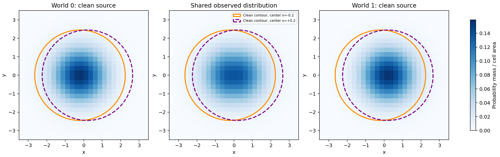
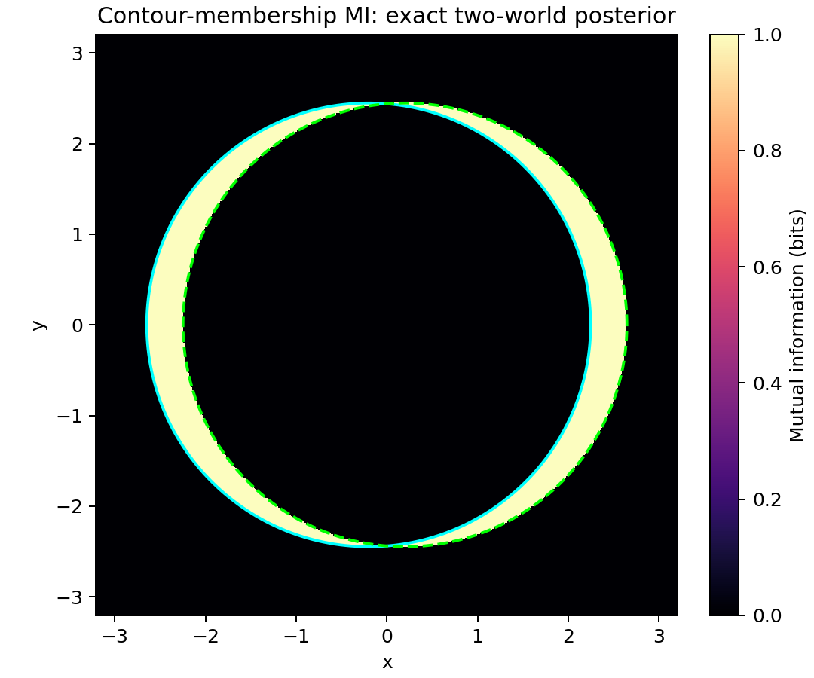
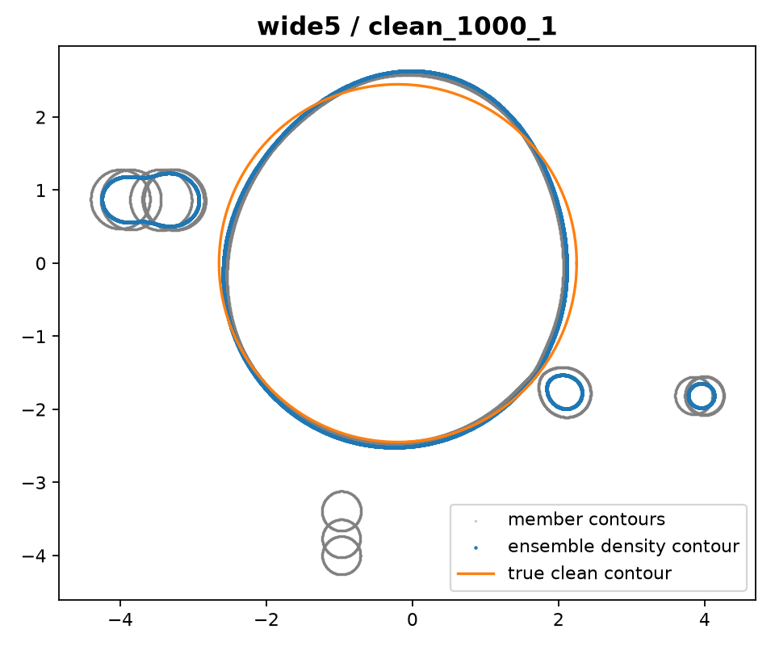

# When shrinking uncertainty leaves the clean contour unresolved

**Research report · 24 October 2026 · Experiments 01–10**

## 1. Main statement, hypothesis, and objective

### Main statement

> This study investigates when selected epistemic uncertainty measures fail to reflect uncertainty about a clean distribution’s density contour. Through a controlled finite-cell source-mixture model, we examine how predictive disagreement and estimated sampling variability behave as the amount of contaminated data increases. The central finding is that reported uncertainty can decrease while distinct clean contours remain compatible with the observations and clean-contour estimation error persists.

The research began with a geometric intuition: a spherical Gaussian has perfectly circular density contours, while a contour inferred from a finite sample has an uncertain location. Contamination introduces an additional difficulty. Even a precisely learned observed distribution can admit several possible clean sources. The study makes this distinction measurable by controlling the clean distribution, contamination, observation resolution, and information available to each method.

### Working hypothesis

**Selected uncertainty measures can contract around an estimate of the observed distribution while uncertainty about the underlying clean contour remains unresolved.** The discrepancy should be visible through persistent contour error, loss of clean-contour coverage for specified confidence procedures, or small predictive disagreement in the presence of distinct compatible clean contours.

The hypothesis has three operational parts:

| Hypothesis | Evaluation criterion | Evidence so far |
| --- | --- | --- |
| H1: clean-contour ambiguity can persist with arbitrarily many observations | Construct distinct clean contours with exactly the same observed law | Analytic construction and width requirement, experiments 01 and 05 |
| H2: reported uncertainty can shrink around a biased contour estimate | Compare contour error, uncertainty width, and repeated-sample coverage as n grows | Exact frequentist counterexample and full-cell evaluation, experiments 05–06 |
| H3: predictive disagreement can become small while clean-contour error persists | Evaluate explicit MI scores alongside contour geometry and model sensitivity | Exact target diagnostic and probly experiments, 02 and 08–10 |

### Objective

The objective of this first paper is to establish an evaluation framework that connects an uncertainty quantity to a clearly specified clean-contour target. The framework should identify the information that remains unresolved, measure the behavior of selected procedures, and distinguish the effects of sampling, source assumptions, observation resolution, and model flexibility.

The main evaluation is frequentist: the clean source and contamination law are fixed, and performance is assessed across repeated datasets. The primary quantities are Hausdorff contour error, whole-contour confidence-set coverage where a confidence procedure is defined, set width, and explicitly identified predictive uncertainty scores.

## 2. The controlled setting

The clean distribution is a spherical Gaussian in two dimensions:

\[
P_\theta=\mathcal N(\mu,\sigma^2I_2),\qquad
\theta=(\mu_x,\mu_y,\sigma).
\]

Observations come from the mixture

\[
M=(1-\varepsilon)P_\theta+\varepsilon Q,
\]

where \(Q\) is a contamination distribution. A fixed partition covers the observation space, including unbounded tail cells. For cells \(C_1,\ldots,C_K\), the learner observes counts

\[
N\sim\operatorname{Multinomial}(n,m),\qquad
m_j=(1-\varepsilon)P_\theta(C_j)+\varepsilon Q(C_j).
\]

Most later experiments use 36 rectangular cells. The evaluator knows the generating clean contour and contamination; learner inputs and source assumptions are specified separately for each procedure.

The target is the boundary of the clean region containing probability \(\alpha=0.95\):

\[
\Gamma_{.95}(\theta)
=\left\{x:\|x-\mu\|=\sigma\sqrt{-2\log(0.05)}\right\}.
\]

For unit scale, its radius is approximately 2.44775. Its location depends on the center and its size depends on the scale. The two uses of 95% have separate meanings: \(\alpha\) defines the probability mass inside the contour; a confidence level \(1-\beta=0.95\) specifies repeated-sample inclusion of the entire true contour.

For two circular contours, the Hausdorff distance has a simple form:

\[
d_H(\Gamma(\mu,\sigma),\Gamma(\mu',\sigma'))
=\|\mu-\mu'\|+\sqrt{-2\log(0.05)}\,|\sigma-\sigma'|.
\]

This gives the early experiments an exact geometric error measure. Flexible density models later produce general contours, whose distances are computed numerically.

## 3. Establishing what the observations can identify

### Two clean contours behind one observed distribution

[Experiment 01](experiments/01_indistinguishable_worlds/RESULTS.md) creates two unit-scale Gaussian sources centered at \((-0.2,0)\) and \((0.2,0)\). With contamination fraction 0.20, suitable contamination laws make their observed mixtures exactly equal. The clean contours are separated by Hausdorff distance 0.4.

*Figure 1. The two possible clean sources have different contour locations. Both generate the same middle-panel distribution after contamination. The equality holds at the continuous-distribution level and is preserved by the validated partitions.*

The construction is possible whenever the two clean laws satisfy

\[
\operatorname{TV}(P_0,P_1)\leq\frac{\varepsilon}{1-\varepsilon}.
\]

In the selected pair, total variation is approximately 0.15852. The common observation law makes the two clean explanations equally compatible at every sample size. Consequently, every contour estimator has expected error at least 0.2 in at least one of the two worlds. A confidence set with at least 95% coverage in each world must have diameter at least 0.4 with probability at least 90% under the shared observed law.

This places the study within established robust-statistical theory. Chen, Gao, and Ren use the same total-variation threshold in their contamination modulus; their discussion states, “Theorem 3.2 provides a lower bound”. Our contour construction specializes that information obstruction to a geometric target. [Chen, Gao, and Ren, §3](https://arxiv.org/pdf/1511.04144).

### Extending the compatible clean-source family

[Experiment 04](experiments/04_general_contamination_model/RESULTS.md) expands the parameter space to unknown horizontal center, vertical center, and scale. For an exact observed cell law \(m\), compatibility is determined by

\[
(1-\varepsilon)p_j(\theta)\leq m_j\quad\text{for every cell }j.
\]

At epsilon 0.20, the refined parameter grid contains 82 compatible candidates, with contour-set diameter approximately 0.52239. Increasing contamination to 0.30 produces a refined-grid diameter approximately 0.80597. The study therefore moves from a pair of examples to a family of compatible clean explanations.

Two controls clarify the source of that ambiguity. Supplying the true contamination cell law identifies the generating Gaussian on the tested grids. Increasing observation resolution from 36 to 324 cells reduces the main-grid compatible count from 13 to 6 and its diameter from 0.52239 to 0.4. Source information and observation resolution each change what can be learned; the original indistinguishable pair persists.

## 4. Asking what an uncertainty score measures

Once ambiguity is established, the next question is how an uncertainty quantity responds to it. [Experiment 02](experiments/02_mutual_information_target_check/RESULTS.md) supplies the two complete candidate worlds with equal weights and evaluates mutual information for different target variables.

| Quantity in the same two-world diagnostic | Value |
| --- | ---: |
| Entropy of the unresolved world identity | 1 bit |
| MI between the next contaminated cell and world identity | 0 bits |
| MI between the next clean-source cell and world identity | 0.02815 bits |
| MI for clean-region membership in the disagreement region | 1 bit |

The zero observation MI has a precise meaning: another draw from the shared mixture conveys zero information about which clean world generated it. The contour-membership quantity preserves the ambiguity exactly where the two clean regions disagree.

*Figure 2. Bright crescents mark locations whose clean-region membership differs between the two worlds. Under equal weights, membership uncertainty is one bit throughout those regions.*

Houlsby and colleagues frame information gain through an observation that “maximises the decrease in expected posterior entropy”. That interpretation motivates explicitly naming the observation channel in this diagnostic. [Houlsby et al., §2](https://mlg.eng.cam.ac.uk/pub/pdf/HouHusGha11a.pdf). Wimmer and colleagues provide the broader motivation for examining entropy-based epistemic measures, reporting “various incoherencies that call their appropriateness into question”. [Wimmer et al., abstract](https://arxiv.org/pdf/2209.03302).

The diagnostic establishes a central organizing principle: **the uncertainty target determines the interpretation of the score**. Uncertainty about a future mixture observation, a clean observation, and the clean contour can behave differently under exactly the same evidence.

The posterior investigations in [experiment 03](experiments/03_posterior_contour_comparison/RESULTS.md) and experiment 04 add a complementary lesson about assumptions. A contamination-ignoring Gaussian posterior contracts around the central fitted contour, with zero observed coverage of either clean truth in 400 trials at each n ≥ 1,000. A supplied two-world control retains both contours. The broader compatibility study shows how source restrictions and prior weights affect the remaining explanations. These results motivated the explicit treatment of assumptions in the frequentist evaluations that followed.

## 5. Turning the question into a frequentist test

### A coverage requirement and an exact counterexample

[Experiment 05](experiments/05_frequentist_theory/RESULTS.md) establishes the main theoretical evaluation criteria. A reported set of contours \(\mathcal G_n\) is assessed through

\[
\Pr_{\theta,Q}\{\Gamma_{.95}(\theta)\in\mathcal G_n\}\geq 1-\beta,
\]

with the truth fixed and probability taken over repeated data. The derivation also gives a direct failure criterion: if an estimated contour converges to a contour at positive distance from the truth, while its reported containing radius converges to zero, true-contour coverage converges to zero.

An exact counterexample uses the count of observations with positive horizontal coordinate. Under a clean unit-scale Gaussian, its success probability is \(\Phi(\mu_x)\). Under the symmetric contaminated mixture, it is 1/2. A clean-model confidence interval therefore contracts toward center zero, while the two possible clean centers remain at ±0.2. A contamination-aware inversion retains an interval whose limiting contour-set diameter is approximately 0.63728.

| n | Clean-model coverage on clean data | Clean-model coverage on contaminated data | Contamination-aware coverage on contaminated data |
| ---: | ---: | ---: | ---: |
| 100 | 0.967073 | 0.691259 | 0.996681 |
| 1,000 | 0.952961 | 0.00107185 | 0.999990 |
| 10,000 | 0.950573 | 2.011 × 10⁻⁴⁴ | Approximately 1 |

*Table 1. Coverage is calculated by summing binomial probabilities over every possible count. The two contaminated worlds have equal coverage by symmetry.*

For the full cell model, experiment 05 constructs simultaneous Clopper–Pearson intervals for cell probabilities and projects them through the contamination compatibility constraints. The true contour is included whenever the observed law falls inside that simultaneous cell region. This supplies a finite-sample-valid reference under the declared contamination budget and parameter domain. Clopper and Pearson’s discussion of “the proportion of times that this prediction is correct” gives the repeated-sample interpretation underlying the binomial ingredient. [Clopper and Pearson, pp. 404–407](https://www.barestatistics.nl/uploads/1/1/7/9/11797954/clopper__pearson_1934.pdf).

### The full-cell comparison

[Experiment 06](experiments/06_full_cell_frequentist/RESULTS.md) evaluates the three-parameter problem using 1,200 datasets and 478,800 bootstrap refits. All methods receive the same 36-cell observations. The methods are a Gaussian Wald confidence set, a bootstrap Hausdorff ball, and the contamination-aware reference implemented with continuous parameter boxes.

The bootstrap resamples empirical cell counts to characterize variation of the fitted estimator. Efron describes the bootstrap’s aim as estimating “the sampling distribution of some prespecified random variable”; this motivation and quotation were consulted and recorded in experiment 06. [Efron, original paper](https://blogs.helsinki.fi/bk-club/files/2012/05/Efron_Bootstrap_AS1979.pdf).

| Scenario | Wald inclusion | Bootstrap inclusion | Reference inclusion |
| --- | ---: | ---: | ---: |
| Clean controls, across tested sample sizes | 90–96/100 | 92–96/100 | 99–100/100 |
| Shared contaminated mixture, each truth and sample size | 0/100 | 0/100 | 100/100 |
| Shifted Gaussian contamination, each sample size | 0/100 | 0/100 | 100/100 |

*Table 2. Observed whole-contour inclusion frequencies. Each setting uses 100 independent datasets; the two shared-mixture truths are evaluated on paired observations.*

On the shared mixture, mean fitted contour error stays near 0.30. As n increases from 1,000 to 100,000, the bootstrap diameter upper bound decreases from 0.28489 to 0.02841. The Wald diameter upper bound decreases from 0.44724 to 0.04416. The reference retains the range of compatible clean contours.

*Figure 3. Shared-mixture comparison: conventional sets contract around the fitted contour while the contamination-aware outer set retains coverage. The width panel reports diameter upper bounds.*

Together, the exact counterexample and the full-cell experiment establish a coherent mechanism: increasing data stabilizes an observed-law fit, while source ambiguity and clean-target bias remain relevant to contour recovery.

## 6. Connecting the evaluation to implemented epistemic scores

### From method selection to a validated probly adapter

[Experiment 07](experiments/07_probly_method_selection/RESULTS.md) selects probly as the UQ implementation layer and specifies the connection between predictive scores and contour geometry. [Experiment 08](experiments/08_probly_adapter/RESULTS.md) pins probly 0.9.1 and validates its entropy decomposition against direct calculations. For member cell laws \(p_b\), the evaluated epistemic score is

\[
\operatorname{MI}=H\!\left(\frac1B\sum_b p_b\right)-\frac1B\sum_b H(p_b).
\]

The experiment applies this score to Gaussian bootstrap members across 180 datasets. As sample size increases, predictive MI falls similarly on clean and contaminated data, while the clean-contour errors follow different paths.

| Data | n | Mean MI, nats | Mean clean-contour error | Mean bootstrap radius |
| --- | ---: | ---: | ---: | ---: |
| Clean | 1,000 | 0.001483 | 0.07382 | 0.13568 |
| Clean | 100,000 | 0.00001490 | 0.00775 | 0.01355 |
| Shared mixture | 1,000 | 0.001462 | 0.28389–0.31598 | 0.13833 |
| Shared mixture | 100,000 | 0.00001479 | 0.29958–0.30018 | 0.01398 |

*Table 3. Means over 30 datasets per setting. Contaminated error ranges span the two fixed clean truths.*

This provides an implemented example of the target distinction introduced in experiment 02. Predictive agreement grows while the contaminated clean-contour error remains near 0.30.

### Neural density ensembles and sensitivity

[Experiment 09](experiments/09_neural_density_ensemble/RESULTS.md) then exercises probly’s PyTorch ensemble factory. Five independently initialized networks each parameterize a normalized three-component Gaussian mixture and train on the same grouped observations. The ensemble density and individual member densities yield 95%-mass contours.

The common-data initialization design draws on Lakshminarayanan, Pritzel, and Blundell, who state, “We used the entire training dataset to train each network”. Our implementation adapts this idea to unconditional grouped-density estimation. [Lakshminarayanan et al., §2.4](https://arxiv.org/pdf/1612.01474).

Across 20 datasets and 100 trained members, mean contaminated contour error at n=100,000 is approximately 0.373, with mean member radius approximately 0.0248. Further optimization changes the ensemble contours by at most approximately 0.003 in the recorded diagnostic. Matched Gaussian bootstrap and contamination-aware controls provide a common-data comparison.

[Experiment 10](experiments/10_bounds_components_sensitivity/RESULTS.md) tests the dependence on density-model choices. It retains the same 20 datasets and compares three versus five components under the original and expanded parameter bounds, producing 400 retained member fits.

| Configuration | Mean contaminated contour error at n=100,000 | Mean cell MI, nats | Mean member radius |
| --- | ---: | ---: | ---: |
| Three components, original bounds | 0.37384–0.37567 | 2.23 × 10⁻⁵ | 0.02512 |
| Three components, expanded bounds | 0.36288–0.36344 | 3.90 × 10⁻⁵ | 0.03128 |
| Five components, original bounds | 0.34810–0.35434 | 2.37 × 10⁻⁶ | 0.01602 |
| Five components, expanded bounds | 0.34811–0.35470 | 5.01 × 10⁻⁶ | 0.03000 |

*Table 4. Means over five matched datasets; error ranges span the two fixed truths. Member radius is the maximum member-contour distance from the ensemble contour.*

Persistent large-sample clean-contour error survives all four configurations. Small-sample behavior reveals another important effect: flexible models can introduce disconnected tail regions even on clean data. The largest clean-contour error is 2.2602, with predictive MI approximately 0.0002542 nats.

*Figure 4. A clean n=1,000 dataset fitted by the expanded five-component model. The central boundary is close to the true circle, while additional tail islands contribute strongly to Hausdorff error. A finer grid changes this estimated contour by approximately 0.00338.*

These observations introduce a second geometric issue alongside source ambiguity: a continuous density model assigns within-cell structure to observations available only as counts. Tail cells and flexible mixture components make that choice visible in the extracted contours.

## 7. What the combined evidence establishes

The experiments connect three levels of the research question. At the information level, distinct clean contours can produce exactly the same observed distribution. At the uncertainty-target level, the same evidence yields different uncertainty values for mixture predictions and clean-region membership. At the procedure level, the tested confidence constructions and predictive scores can become increasingly concentrated around a fitted distribution while clean-contour error persists.

Successful controls are part of that account. The target-aligned membership calculation retains the ambiguous regions, and the contamination-aware frequentist construction provides a valid reference under explicit assumptions. The sensitivity experiments also reveal settings with large member spread. Together, these findings make the research question operational: **how well does a reported uncertainty quantity represent what remains unresolved about the specified clean contour, under the information supplied to the learner?**

The proposed evaluation contribution is a controlled sequence that combines known ambiguity, target-specific diagnostics, repeated-sample contour evaluation, and model-sensitivity checks. Its practical value is the ability to trace a reported uncertainty value back to the prediction task, source assumptions, and geometric object it describes.

## 8. Limitations and unresolved questions

### Scope of the failure claim and prior work

The present evidence concerns the selected measures, model classes, and contamination settings. A universal failure of epistemic uncertainty definitions has not been established. Target-aligned MI succeeds in the exact two-world example. The contamination threshold, partial-identification obstruction, and misspecification mechanisms have established statistical precedents. A comprehensive novelty assessment remains necessary.

The study evaluates contaminated observations used for inference. It has not yet evaluated a standard clean-training/OOD-test benchmark or a broad collection of modern UQ algorithms. REACH and the replacement uncertainty definition belong to the separate follow-up project.

### Information regimes and confidence claims

The contamination-aware reference receives a correct contamination budget and permits unrestricted contamination. Clean-model procedures use different structural assumptions. The comparisons expose the effects of those assumptions; they are not an equal-assumption ranking of algorithms.

Predictive MI and maximum-member contour radius have no automatic frequentist confidence level. Experiment 09’s descriptive radius misses the truth even in its clean controls. Experiment 10 also records substantial small-sample inclusion when member radii become large. These facts rule out interpreting the neural results as a demonstrated loss of an already established 95% coverage guarantee.

### Sample sizes, dependence, and calibration

The principal full-cell comparison uses 100 repetitions per setting; the probly bootstrap pilot uses 30, and neural settings use five. The two possible clean truths share observations, and experiment 10 reuses experiment 09’s datasets. Observed zero coverage is not proof of a zero population probability: for example, the Wilson interval for 0/100 is approximately [0,0.037]. Clean Wald and bootstrap results also require a more precise calibration study.

### Geometry, discretization, and reference width

Most later experiments use a fixed 36-cell partition. A systematic matched-raw-data resolution study remains open. The reference’s reported diameters are conservative upper bounds, and box refinement materially changes them. Their numerical sizes should not be equated with the exact irreducible uncertainty floor.

Neural contour extraction has observed refinement discrepancies around 0.0025–0.0034. These checks are not certified uniform error bounds. Hausdorff distance is sensitive to disconnected islands; companion spatial or topology-sensitive metrics would help characterize their practical importance.

### Model and optimization sensitivity

The neural model is an overparameterized finite Gaussian mixture evaluated at a constant input. It does not represent the full range of deep-ensemble architectures. Parameter bounds remain active after expansion, and gradient tolerances are not achieved uniformly. Component-count, initialization, optimization, and bound effects remain intertwined in the reported disagreement.

### Computational obstacles already encountered

Earlier posterior sampling had low-acceptance settings that were recorded as unavailable. Parameter-grid and scale-bound checks required revisions during the exploratory studies. The neural backend’s bundled dependency was verified after an unsuccessful separate installation attempt. Experiment 10 encountered tail-cell underflow in a strict positivity check; the correction retained nonnegativity and normalization checks and was followed by independent validation of all 400 saved fits. These events and their resolutions are documented in the experiment reports.

## 9. Priorities for the next study

The next investigation should use matched raw observations to vary cell resolution while preserving the continuous shared-mixture construction. This will help separate clean-source ambiguity from additional geometric choices introduced by grouping.

A second priority is a predeclared clean-data calibration procedure for any neural-derived contour confidence set. Larger repeated-sample evaluations, member-count sensitivity, and stronger optimization checks can then assess its performance under contamination.

The spatial evaluation should retain full-contour Hausdorff error and add interpretable boundary-location summaries. Regularity restrictions or treatments of disconnected regions should be specified before inspecting the true contour. Broader contamination families and information controls can then test the conditions under which the observed mechanisms persist.

## References and evidence trail

This report synthesizes existing results. The proofs, code, diagnostics, and full numerical outputs remain in the linked experiment folders. The quotations below are used at their relevant points in the narrative; source-access scope is recorded here.

| Reference | Role and consulted material |
| --- | --- |
| Mengjie Chen, Chao Gao, Zhao Ren (2016; arXiv v2 2017), *A General Decision Theory for Huber’s ε-Contamination Model*. [Paper](https://arxiv.org/pdf/1511.04144) | Introduction and §3, especially Theorem 3.2; robust-statistical context for the shared-law construction. Rechecked for this report. |
| Neil Houlsby, Ferenc Huszár, Zoubin Ghahramani, Máté Lengyel (2011), *Bayesian Active Learning for Classification and Preference Learning*. [Paper](https://mlg.eng.cam.ac.uk/pub/pdf/HouHusGha11a.pdf) | §2; information-gain interpretation used in experiment 02. Rechecked for this report. |
| Lisa Wimmer, Yusuf Sale, Paul Hofman, Bernd Bischl, Eyke Hüllermeier (2023), *Quantifying Aleatoric and Epistemic Uncertainty in Machine Learning: Are Conditional Entropy and Mutual Information Appropriate Measures?* [Paper](https://arxiv.org/pdf/2209.03302) | Abstract and introductory motivation; prior scrutiny of entropy-based measures. Rechecked for this report. |
| C. J. Clopper, E. S. Pearson (1934), *The Use of Confidence or Fiducial Limits Illustrated in the Case of the Binomial*. [Paper](https://www.barestatistics.nl/uploads/1/1/7/9/11797954/clopper__pearson_1934.pdf) | Binomial confidence construction, pp. 404–407; reference ingredient in experiments 05–06. Scan reopened for this report; quotation carried from experiment 05. |
| Bradley Efron (1979), *Bootstrap Methods: Another Look at the Jackknife*. [Paper](https://blogs.helsinki.fi/bk-club/files/2012/05/Efron_Bootstrap_AS1979.pdf) | Resampling motivation. Abstract/introductory material and quotation carried from experiment 06; the report-time fetch timed out. |
| Balaji Lakshminarayanan, Alexander Pritzel, Charles Blundell (2017), *Simple and Scalable Predictive Uncertainty Estimation using Deep Ensembles*. [Paper](https://arxiv.org/pdf/1612.01474) | §§2.1–2.4 and Algorithm 1; motivation for independently initialized common-data ensembles. Relevant passage rechecked for this report. |

Additional sources consulted during the historical posterior investigations—including Kleijn and van der Vaart, Gustafson, and Lee and Gustafson—and the partial-identification confidence reference of Imbens and Manski are documented with their specific uses in experiments 03–05. The software audit and pinned probly implementation details are documented in experiments 07–10.
