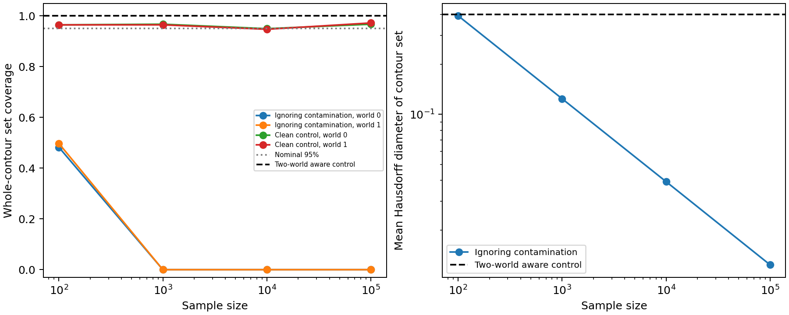

# Posterior contour uncertainty with and without contamination

Date: 2026-10-23. Status: executed, 400 replicates per setting and sample size.

## Main result and what we learned

A Gaussian observation model that ignores contamination produces increasingly narrow posterior contour sets centered on the wrong clean contour. Its observed coverage falls to zero in both possible worlds at n >= 1000. A correctly specified two-world control retains both contours. This is evidence of clean-target overconfidence under model misspecification, not a universal failure of Bayesian uncertainty or of target-aligned mutual information.



## Theoretical decisions and their consequences

1. **Restrict the unknown parameter to horizontal center mu.** Supply sigma = 1 and vertical center = 0 to both models. The clean 95%-mass contour consequently has known radius 2.44774683. This isolates location uncertainty; unknown scale and arbitrary center remain untested. This is a deliberate special case of the proposal, not the full model.
2. **Use the original finite-cell evidence.** Use exact Gaussian bin probabilities, not cell midpoints or reconstructed raw coordinates. The mixture density factors into a common vertical normal density and a horizontal mixture density. Vertical cell counts therefore provide no information about mu in these models; horizontal marginal counts suffice. This factorization is specific to our construction.
3. **Declare a finite prior explicitly.** The contamination-ignoring model has a uniform prior on mu in [-2,2] at spacing 0.001. Its likelihood is the multinomial likelihood of Gaussian horizontal bin probabilities. Posterior computation is exact for this finite hypothesis space up to floating-point arithmetic, not MCMC or a claimed continuous-posterior computation. Both true means and zero belong to the grid.
4. **Define a whole-contour credible set.** Take inclusive 2.5% and 97.5% posterior center quantiles and all grid-supported contours between them. Because radius is fixed, whole-contour set coverage equals inclusion of the true center; the set's Hausdorff diameter equals the difference between its endpoint centers. This is a set of possible contours, not a claim about arbitrary pointwise bands. The contour at the posterior mean is the point estimate, and its Hausdorff error is absolute center error. Nominal 95% posterior credibility is distinct from the 95% probability mass defining the contour.
5. **Use the exact two-world posterior as a positive control.** The aware model is supplied the two complete candidate worlds, with equal prior weights. Identical mixture likelihoods leave the weights at (0.5,0.5). Any credible set with posterior mass at least 95% must include both contours; it has diameter 0.4 and coverage 100% in either world. This is a privileged restricted-model control, not a generally applicable estimator for unknown Q or a fair algorithm leaderboard.
6. **Pair the two contaminated-world evaluations.** A shared dataset is evaluated against both truths. The two coverage estimates are dependent, not 800 independent trials. Clean controls use independent datasets from each clean source. There are 400 trials per setting and n, with a fixed random seed.
7. **Classify the mechanism as misspecification.** The no-contamination likelihood does not contain the observed mixture law, even though it includes each clean source separately. Thus posterior confidence is conditional on an incorrect observation model. This interpretation is motivated by Kleijn and van der Vaart [1], whose abstract states: “Bayesian credible sets are not valid confidence sets if the model is misspecified.” Their theorem has regularity assumptions; we do not invoke its continuous-parameter normal-limit theorem for this finite prior. Our finite-grid calculation and empirical coverage stand separately.

## Numerical results

All widths below are mean Hausdorff diameters of contour sets; errors are mean Hausdorff errors of the posterior-mean contour. Both contaminated worlds use the same fitted posterior.

| n | Ignoring-contamination width | Coverage, world 0 | Coverage, world 1 | Error, world 0 | Error, world 1 |
| ---: | ---: | ---: | ---: | ---: | ---: |
| 100 | 0.393518 | 48.25% | 49.75% | 0.20129 | 0.20310 |
| 1000 | 0.124285 | 0/400 | 0/400 | 0.19829 | 0.20171 |
| 10000 | 0.039290 | 0/400 | 0/400 | 0.19985 | 0.20015 |
| 100000 | 0.012378 | 0/400 | 0/400 | 0.20025 | 0.19975 |

Zero observed coverage is not proof of zero finite-sample coverage probability: the 95% Wilson interval for 0/400 is approximately [0, 0.00951]. All per-setting coverage intervals are saved in `summary.json`.

| n | Clean world 0 coverage | Clean world 1 coverage |
| ---: | ---: | ---: |
| 100 | 96.50% | 96.50% |
| 1000 | 96.75% | 96.50% |
| 10000 | 95.00% | 94.75% |
| 100000 | 96.75% | 97.25% |

Clean controls show broadly nominal behavior, not a proof of exact calibration. Discrete inclusive credible intervals can be conservative, particularly at larger n. The aware-control coverage and width are analytic constants, not fitted empirical performance.

## Limiting interpretation

On the declared grid, the population expected log likelihood is maximized at mu = 0, rather than either clean mean +/-0.2. This maximizer was checked numerically. For a finite parameter set with a unique expected-log-likelihood maximizer and positive prior mass, the law of large numbers makes posterior odds of every inferior hypothesis tend to zero. Therefore, conditional on uniqueness, the finite-grid posterior contracts to that maximizer. This elementary argument is our derivation; numerical verification of the maximizer is not a general continuous-model proof.

The data are informative about the observed distribution yet insufficient to choose between the clean contours. The aware posterior preserves that distinction; the restricted observation model removes it by assumption. Combined with experiment 02, the evidence now separates two mechanisms: using an uncertainty score for a different target, and conditioning contour uncertainty on a wrong source model.

## Implementation checks and decisions during execution

- An initial prior grid [-1,1] failed a strict boundary-mass check in the first run. Expanded to [-2,2] before producing final results; all reported runs use the expanded grid. Final endpoint posterior mass was below 1e-8 in every checked fit.
- Gaussian bin probabilities use survival-function differences in positive tails to avoid cancellation; checked positivity and normalization.
- Refined the grid from 0.001 to 0.0005 for the first 20 replicates of every setting and n. The maximum credible endpoint change was 0.0005. This checks numerical sensitivity, not equivalence of finite and continuous priors.
- Saved every replicate's lower endpoint, upper endpoint, and posterior mean in `replicates.npz`.
- Fixed seed: 20261024 (an arbitrary identifier, not an execution date). Sample sizes: 100, 1000, 10000, 100000. No adaptive trial selection.

## Papers consulted and where used

[1] B. J. K. Kleijn and A. W. van der Vaart (2012), *The Bernstein–Von-Mises theorem under misspecification*, Electronic Journal of Statistics 6, 354–381. [Publisher DOI](https://doi.org/10.1214/12-EJS675), [author-institution PDF](https://pure.uva.nl/ws/files/1850322/114737_376240.pdf). Consulted abstract and institutional record. Used in decision 7 to distinguish posterior credibility under a misspecified model from frequentist coverage; exact supporting quotation appears there. No theorem is applied without checking assumptions, and this experiment does not establish novelty over that literature.

The mixture construction, contour geometry, finite-prior posterior calculations, and finite-hypothesis limiting argument are local derivations based on experiments 01–02. No external source is claimed for those derivations. Prior MI sources are documented with their usage and quotations in experiment 02's RESULTS.md.

## Next questions

Follow-up completed: [experiment 04](../04_general_contamination_model/RESULTS.md) addresses each question and records remaining limits.

- Expand the contamination-aware control beyond two supplied worlds, with explicit assumptions on Q; measure how conclusions depend on prior and source-model specification.
- Allow unknown scale and vertical center, and vary contamination strength instead of treating this single setting as general evidence.
- Compare against robust estimation and existing misspecification results before claiming novelty.
- A target-aligned failure of epistemic uncertainty under correct modeling remains unestablished; the present positive control is evidence against such a blanket claim.

## Reproduce

After experiment 01, from the repository root:

```bash
OPENBLAS_NUM_THREADS=1 python Uncertainty_Modeling/EU_AU_Disentanglement/Epistemic_Contour_Failure/experiments/03_posterior_contour_comparison/run.py
```

Dependencies: numpy, scipy, matplotlib. Outputs: `summary.json`, `replicates.npz`, `coverage_and_width.png`.
