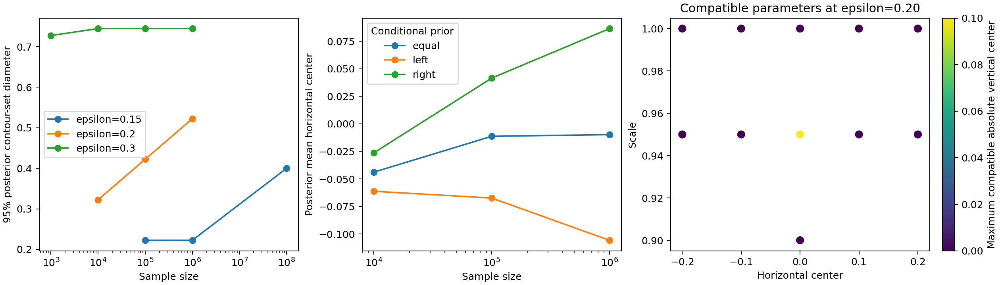

# Beyond two worlds: unknown center, scale, and contamination sensitivity

Date: 2026-10-23. Status: executed population analysis, posterior sensitivity study, numerical checks, and focused literature review; low-sample sampling limits documented below.

## Theoretical decisions before execution

1. Replace the two-world hypothesis space with a fixed grid of spherical Gaussian parameters (mu_x, mu_y, sigma). Both center coordinates and scale are unknown. Q remains unrestricted at the cell-law level. The finite grid is an explicit restriction, not an exhaustive continuous identified set.
2. Use a 6 by 6 partition of the whole plane, including unbounded tail cells, with coordinate edges [-infinity,-2,-1,0,1,2,infinity]. This coarser partition permits transparent posterior computation without numerical underflow in essentially empty tail cells. It changes the information resolution relative to experiment 03; results must not be compared as identical-information performance.
3. For exact observed cell law m and known epsilon, a candidate is compatible precisely when (1-epsilon)p_theta <= m componentwise. Then q = [m-(1-epsilon)p_theta]/epsilon is a probability vector. This is a local algebraic derivation. Compute this set for all candidate parameters rather than supplying only two worlds.
4. Use a transparent Bayesian parameterization (m,theta), with a Dirichlet base prior on m restricted to the event A that some grid candidate is compatible. Given m, assign theta conditional probabilities proportional to specified positive weights over its compatible candidates. This defines a proper joint prior independent of observed counts. The nuisance Q is induced by the mixture equation. It is not equivalent to independent priors on Gaussian parameters and Q.
5. Under multinomial counts N, the marginal posterior of m is Dirichlet(N+alpha) restricted to A. Rejection sampling is exact for this declared prior; conditional probabilities over theta can then be averaged without sampling theta itself. Report acceptance, sample size, and Monte Carlo sensitivity rather than treating posterior computation as exact arithmetic.
6. Compare positive conditional weights favoring left versus right locations and equal weights. Keep the same marginal prior on m, so only beliefs within compatible sets change. This tests prior sensitivity, not posterior robustness to every possible nuisance prior. Finite-sample frequentist coverage is not established by a single posterior run.
7. Add a minimum-total-variation point estimate on the same candidate grid and a no-contamination maximum-likelihood point estimate. A robust point estimator alone does not supply a calibrated contour uncertainty set. The minimum-TV comparison is a simple local implementation, not a reproduction of the full robust estimator in Chen, Gao, and Ren.
8. Keep true centers (+/-0.2,0) and sigma=1 fixed while varying epsilon over 0.15, 0.20, 0.30. These values satisfy the shared-continuous-mixture construction's feasibility threshold; Q must change with epsilon to preserve the pair construction. This is a controlled worst-case family, not a fixed-Q dose-response experiment.

## Sources consulted and usage at design time

- Chen, Gao, and Ren, *A General Decision Theory for Huber's epsilon-Contamination Model* (EJS 2016; arXiv v2 2017), introduction: “the objective is to estimate θ robust to the contamination from Q.” [Paper](https://arxiv.org/pdf/1511.04144). Used in decisions 1 and 7 to position unrestricted contamination and robust estimation as existing statistical settings. Its TV-modulus analysis will inform the novelty assessment; no novel contamination lower bound is claimed.
- Lee and Gustafson, *Issues of parameterization and computation for posterior inference in partially identified models* (2024), abstract: “the computational performance can be poor.” [Paper](https://arxiv.org/pdf/2408.10416). This describes off-the-shelf MCMC in partially identified models and motivates the transparent parameterization in decisions 4–5. The rejection sampler here is our derivation, not their implemented algorithm.
- Gustafson, *Bayesian Inference for Partially Identified Models* (2010), abstract: “This limiting distribution will have the identification region as its support.” [Author's abstract in PubMed](https://pubmed.ncbi.nlm.nih.gov/21972432/), [DOI](https://doi.org/10.2202/1557-4679.1206). Used to motivate separating identification from posterior weights in decisions 3–6. Only the abstract was available; the publisher PDF request failed. We do not apply its theorem without checking assumptions.

These quotations support the specific motivations above. The compatibility criterion and posterior sampling formula are local derivations; their details are given below after verification.

## Executed model and posterior derivation

Final main grid: mu_x and mu_y in [-0.5,0.5] at spacing 0.1, sigma in [0.65,1.35] at spacing 0.05: 1,815 candidates. The refined grid halves each spacing: 12,789 candidates. Both grids contain the two generating parameters exactly. Identified candidates were interior to the final parameter bounds.

Let F(m) be the compatible grid candidates and A = {m: F(m) is nonempty}. With a Dirichlet(1,...,1) density b(m) on the 36 cells, define

    pi(m) = b(m) 1_A(m) / Z,
    pi(theta | m) = w(theta) 1{theta in F(m)} / sum_{v in F(m)} w(v).

Here Z is a finite positive normalizer, independent of the observations. The unknown clean law enters only through compatibility; q is then determined by (m,theta). Every compatible q is permitted for the grid family. Integrating pi(theta|m) gives one, so the marginal prior on m is exactly the stated truncated Dirichlet, not multiplied by the number of compatible candidates. This normalization is essential to the sampling formula.

For observed counts N, multiply by the multinomial likelihood to obtain

    pi(m | N) proportional to Dirichlet(m; N+1) 1_A(m).
    pi(theta | N) = E_{m | N}[pi(theta | m)].

We use independent rejection draws for m and average the entire conditional distribution over theta. This is a Monte Carlo calculation of a valid posterior for this declared prior. It is not a posterior under independent priors on theta and Q, and it is not a fitted method from the cited papers. Neither the exact generating m nor the true q enters this learner's prior or sampling algorithm. Those quantities are used only in simulation and population diagnostics.

Conditional weights are w=1, exp(-8 mu_x), and exp(+8 mu_x), labeled equal, left, and right. All are strictly positive; they do not rule out either truth. The marginal prior on m is held fixed across these choices on the same parameter grid. Refining the parameter grid changes the prior as well as resolution, so that check is not merely an arithmetic-error test.

A reported 95% posterior set contains candidates in decreasing posterior-probability order until mass reaches at least 0.95. Stable index order resolves ties. This is a discrete highest-probability set, with Monte Carlo uncertainty near the cutoff. For two circular contours,

    d_H(Gamma(mu,sigma), Gamma(mu',sigma'))
      = ||mu-mu'|| + sqrt(-2 log(0.05)) |sigma-sigma'|.

The set diameter is the maximum of this expression over included pairs. This local geometry calculation allows both location and radius uncertainty. A posterior set is not automatically a uniformly valid frequentist confidence set.

## 1. Ambiguity survives beyond two supplied worlds

These are compatibility sets at exact m, without a prior. Parameter-grid counts and diameters are not exhaustive continuous-parameter quantities.

| Actual epsilon | Main-grid candidates | Refined candidates | Main diameter | Refined diameter |
| ---: | ---: | ---: | ---: | ---: |
| 0.15 | 6 | 21 | 0.40000 | 0.40000 |
| 0.20 | 13 | 82 | 0.52239 | 0.52239 |
| 0.30 | 60 | 447 | 0.74477 | 0.80597 |

At epsilon=0.20, the refined set includes horizontal centers from -0.25 to 0.25, vertical centers from -0.10 to 0.10, and scales from 0.90 to 1.025. These are coordinate ranges, not a Cartesian product of independently feasible values. At epsilon=0.30, refinement changes the diameter by about 0.0612; we have not established continuous-grid convergence.

Supplying the true contamination cell law q_0 reduces the exact compatibility set to the world-0 Gaussian on each grid. Thus the ambiguity responds to added source information, not just sample size.

An additional nested observation-partition check at epsilon=0.20 increases resolution from 36 to 324 cells. On the same main parameter grid, compatible candidates drop from 13 to 6 and the diameter drops from 0.52239 to 0.4. The original pair survives; some additional ambiguity was due to coarse observation cells. This does not certify continuous-density compatibility for every retained candidate.

## 2. Prior influence persists with large samples

One independently generated dataset is used per epsilon and n; priors share that dataset and the accepted m draws. These are posterior sensitivity experiments, not 400-replicate coverage experiments like experiment 03. The different sample sizes are not nested acquisition histories.

At n=1,000,000:

| Epsilon | Conditional prior | Mean horizontal center | 95% set diameter | Includes world 0 / world 1 contours |
| ---: | --- | ---: | ---: | --- |
| 0.15 | equal | -0.00049 | 0.22239 | no / no |
| 0.15 | left | -0.04202 | 0.22239 | no / no |
| 0.15 | right | 0.04087 | 0.22239 | no / no |
| 0.20 | equal | -0.00977 | 0.52239 | yes / yes |
| 0.20 | left | -0.10570 | 0.44477 | yes / no |
| 0.20 | right | 0.08647 | 0.44477 | no / yes |
| 0.30 | equal | 0.00523 | 0.74477 | yes / yes |
| 0.30 | left | -0.15914 | 0.68955 | yes / no |
| 0.30 | right | 0.17340 | 0.68955 | no / yes |

The left/right differences greatly exceed Monte Carlo errors recorded in `summary.json`. They reflect different priors conditional on essentially the same observed law. At exact m for epsilon=0.20, conditional mean horizontal centers are 0, -0.10918, and +0.10918 respectively. This population calculation demonstrates that the prior effect is not just finite-sample noise.

**Unexpected finding and follow-up:** at epsilon=0.15, even one million observations did not put either truth in the equal-weight 95% posterior set for this dataset. A targeted run at n=100,000,000 restored both truths to that set and its diameter to 0.4, close to the exact-m conditional calculation. Both true-candidate posterior probabilities were approximately 1/6. Thus the earlier exclusion is not evidence of permanent posterior elimination under equal weights. Tiny compatibility margins in individual cells can demand substantially more evidence than the phrase “large dataset” suggests. This is an interpretation supported by the larger-sample check, not a general rate theorem.

At that larger sample, left/right priors still excluded the opposite contour from their 95% sets, with diameter 0.32239. The excluded contour retained about 2.05% posterior probability. Exclusion from a 95% set is not the same as zero probability or a mathematical contradiction: posterior credibility conditions on prior information and does not promise uniform coverage of every compatible truth.



The plotted 95% set diameters need not decrease with n; sample sizes use independent datasets and reveal compatible alternatives at different rates. Missing low-n points indicate inadequate sampler acceptance, not zero uncertainty. The right panel projects compatible parameters onto (mu_x,sigma); color gives the largest compatible absolute mu_y for that pair.

## 3. Source assumptions can create apparent certainty

Hold the observed law from actual epsilon=0.20 fixed and vary the declared contamination budget:

| Declared epsilon | Main compatible count | Refined compatible count | Main / refined diameter |
| ---: | ---: | ---: | --- |
| 0.05 | 0 | 0 | empty / empty |
| 0.10 | 1 | 4 | 0 / 0.11119 |
| 0.15 | 6 | 21 | 0.40000 / 0.40000 |
| 0.20 | 13 | 82 | 0.52239 / 0.52239 |
| 0.30 | 59 | 433 | 0.74477 / 0.79704 |

The sets are nested as declared epsilon increases. An empty finite grid is rejection of that grid model, not proof that the continuous Gaussian family is incompatible. The singleton at declared epsilon=0.10 becomes four candidates after refinement: **do not claim exact point identification from the coarse-grid singleton.** Both original true contours are excluded at that declared budget. This is a narrow-but-wrong source-model restriction, not evidence that accounting for contamination automatically guarantees validity.

The actual-epsilon sweep and declared-epsilon sweep are different experiments: the former changes the generating mixture as well as Q, while the latter holds m fixed.

## 4. Robust estimation comparison and novelty assessment

For each exact observed law, the main-grid minimum-TV point estimate and the contamination-ignoring population maximum-likelihood estimate both select (mu_x,mu_y,sigma)=(0,0,1.05). Their contour error relative to either generating truth is 0.32239. These are population point estimates; we did not evaluate bootstrap bands or repeated-sample coverage for the robust estimate.

There is no paradox in a robust point estimate having nonzero error. A local bound for the minimum-TV estimator, when the true clean parameter is in the grid, is

    TV(p_hat, p_true) <= 2 TV(m_hat,m) + 2 epsilon.

It follows from minimum-distance optimality, the triangle inequality, and TV(m,p_true)<=epsilon. This elementary bound does not assert exact recovery or a calibrated contour band; converting TV error to contour error requires additional analysis. We did not implement the Scheffe tournament estimator of Chen et al.

**Literature finding:** Chen, Gao, and Ren, Theorem 3.2, define the contamination modulus using the same condition TV(P_theta1,P_theta2)<=epsilon/(1-epsilon) as our first construction. Their accompanying text says, “Theorem 3.2 provides a lower bound”. [Paper, Section 3](https://arxiv.org/pdf/1511.04144). Our ambiguity threshold and the existence of a contamination floor are established robust-statistics phenomena. Applying their general-loss viewpoint to contour geometry may organize the analysis, but this alone is not a novel theorem.

Misspecification-induced narrow credible sets are also existing theory; experiment 03 cites Kleijn and van der Vaart (2012) at the point of use. Here we inherit that comparison rather than newly applying their theorem. Prior-dependent partial-identification posteriors are likewise existing work, as motivated by the Gustafson and Lee–Gustafson sources above. This study therefore needs a sharper evaluation contribution than “contamination prevents certainty.”

## Computation, failed checks, and sensitivity

- **Initial rejection failure:** the first version requested 2,048 accepted draws and obtained zero out of 131,072 proposals at epsilon=0.15, n=1000. We did not treat failure to sample as posterior certainty.
- **Final stopping rule:** 2,048 independent accepted draws, with a cap of 32,768 proposals per setting. No posterior is reported if this target is unmet. Final excluded settings: (0.15,1000): 0 accepted; (0.15,10000): 747 accepted; (0.20,1000): 8 accepted. Their diagnostics are saved; none is silently plotted as a result.
- The remaining settings achieved 2,048 accepted draws. At high n acceptance approached one. The computational limit motivates a future constrained sampler if low-n posteriors become necessary.
- **Scale-bound check:** the initial sigma range [0.8,1.2] had compatible candidates at its lower endpoint. Expanded to [0.65,1.35] and reran the full study. The final exact-m compatible sets do not touch parameter boundaries. This bounds check does not replace a continuous optimization proof.
- Gaussian probabilities use exact CDF differences with stable tail calculations; every candidate law is positive and normalized. Compatibility uses multiplicative tolerance 1e-12, not a fixed absolute allowance that could dominate rare cell masses.
- Verified the two generating worlds remain compatible, known-q control uniqueness on the grid, and nesting of compatibility sets under increased epsilon and reduced observation resolution.
- An independent 2,048-draw rerun of the epsilon=0.20, n=100000 equal-weight posterior changed the mean coordinates by (0.000385,0.000343,0.000200), within six combined Monte Carlo standard errors in all coordinates. Detailed standard errors are saved.
- Refined the parameter grid for the epsilon=0.20, n=1000000 equal-weight posterior. Mean changed from (-0.00977,-0.000008,0.96636) to (-0.00366,-0.00155,0.97073); diameter remained 0.52239 and both truths remained in the 95% set. Changes exceed Monte Carlo noise: quantitative prior/grid sensitivity remains real, so no continuum-posterior accuracy is claimed.
- Seeds: 20261025 for the sweep, plus 1 for the independent Monte Carlo check, plus 2 for the refined posterior, plus 3 for the targeted 100-million-observation follow-up. Seeds are identifiers, not execution dates.

## Answers to experiment 03's next questions

1. **Beyond two worlds and prior/source sensitivity:** completed on a 1,815-candidate family with unrestricted cell contamination, an explicit joint prior, three conditional priors, known-Q and declared-epsilon controls. General independent theta/Q priors and continuous parameter inference remain open.
2. **Unknown scale and vertical center; contamination sweep:** completed for three contamination levels with both coordinates and scale unknown to the learner, with parameter and observation resolution checks.
3. **Robust estimation and prior work:** population minimum-TV comparison and focused literature check completed. The existing ambiguity and misspecification mechanisms are not new contributions by themselves. A comprehensive novelty review and robust uncertainty-band comparisons remain open.
4. **Target-aligned failure under correct modeling:** no universal failure established. The broader posterior retains uncertainty and responds to assumptions. A 95% posterior set can omit a compatible truth because of prior weighting or finite evidence; that requires explicit calibration criteria before calling it a failure. The original aim must be scoped to a measure, target, assumptions, and operational guarantee.

## Next discriminating study

Framework correction after user clarification: the main line is frequentist, not Bayesian. [Experiment 05](../05_frequentist_theory/RESULTS.md) ingests these findings and supplies the missing frequentist theory. The earlier proposal below is retained as history, not the active method-selection instruction.

Use repeated datasets to compare whole-contour coverage under a prior-free contamination-aware confidence construction, the present posterior, and the misspecified posterior at a common observation resolution. Include several fixed truths and nuisance laws, not only the symmetric pair. This would distinguish a failure to meet a declared coverage requirement from prior-sensitive but internally coherent Bayesian inference. The present single-dataset prior sweep does not establish that coverage result.

## Reproduce and artifacts

From the repository root:

```bash
OPENBLAS_NUM_THREADS=1 python Uncertainty_Modeling/EU_AU_Disentanglement/Epistemic_Contour_Failure/experiments/04_general_contamination_model/run.py
```

Dependencies: numpy, scipy, matplotlib. The script is self-contained and regenerates the mixture rather than reading earlier experiment outputs. Artifacts: `summary.json` (all results and diagnostics), `arrays.npz` (parameter grid, exact laws, counts, posterior probability vectors), and `general_model.png`. The figures and tables are controlled simulations, not real-data evaluation.
