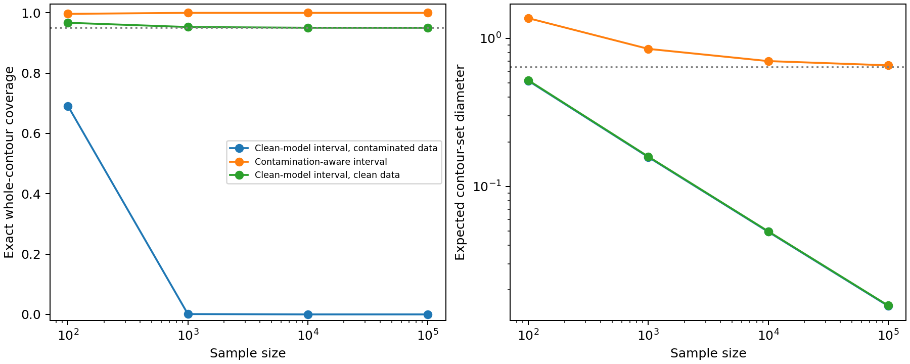

# Frequentist theory: contour coverage, contamination, and numerical certification

Date: 2026-10-23. Status: theoretical derivations completed and implementation checks executed. This is the main frequentist line; no posterior is used in this experiment.

## Decisions and ingestion of earlier evidence

The user clarified that the evaluation framework is frequentist; a Bayesian direction was never agreed. We therefore retain experiments 03–04 as historical baseline/sensitivity work, not as the main theory or an argument for a replacement definition. This correction is methodological, not a reversal of their numerical findings.

| Earlier result | What carries forward | What it does not establish |
| --- | --- | --- |
| 01: identical mixtures, different contours | An estimator-independent identification obstruction and confidence-set width constraint | A new contamination lower bound or failure of all epistemic measures |
| 02: observation MI versus membership MI | The target must be specified before judging a score | Failure of target-aligned MI |
| 03: narrow wrong posterior contour sets | Misspecification can coexist with small reported uncertainty; repeated-sample coverage is measurable | A general theorem about frequentist or Bayesian uncertainty |
| 04: expanded parameter/source model | Unknown center/scale, nuisance assumptions, and grids materially affect conclusions | Continuous-model certification or frequentist coverage from a single posterior run |

Decisions for this step:

1. Treat theta and Q as fixed unknown quantities. Randomness comes from repeated independent datasets and any declared algorithmic randomness, not a distribution over truths.
2. Fix the confidence target at whole-clean-contour inclusion, at nominal level 1-beta. Keep alpha (the probability mass defining a contour) separate from beta (the coverage error budget).
3. Derive a conservative reference confidence set with a provable contamination-aware guarantee. It is an evaluation control built from standard ingredients, not the second paper's new epistemic definition and not REACH.
4. Separate coverage of one fixed true contour from simultaneous coverage of every compatible contour. Our reference obtains the stronger property; evaluated methods need not promise it.
5. Use a known-radius location submodel for an exact counterexample, and derive the reference construction for unknown two-dimensional center and scale. Do not silently transfer submodel numerical results to the full problem.
6. Address off-grid truths analytically; a set of isolated grid points cannot literally cover a continuous off-grid contour.
7. Treat clean-model coverage collapse as failure under contamination outside the clean model's assumptions. A clean-data guarantee is not claimed to have been violated on its own terms.

## Papers consulted, with use at the point of argument

**[CP]** C. J. Clopper and E. S. Pearson (1934), *The Use of Confidence or Fiducial Limits Illustrated in the Case of the Binomial*, Biometrika 26(4), 404–413. [Original paper scan](https://www.barestatistics.nl/uploads/1/1/7/9/11797954/clopper__pearson_1934.pdf), [publisher DOI](https://doi.org/10.1093/biomet/26.4.404). Consulted the general discussion and binomial confidence-belt construction, pp. 404–407. Their coverage interpretation refers to “the proportion of times that this prediction is correct”. This motivates decision 1 and supplies the binomial inversion ingredient in Propositions 1 and 4. The union bound and contamination projection below are local derivations, not attributed to this paper.

**[IM]** G. W. Imbens and C. F. Manski (2004), *Confidence Intervals for Partially Identified Parameters*, Econometrica 72(6), 1845–1857. [Publisher abstract](https://doi.org/10.1111/j.1468-0262.2004.00555.x). Consulted the abstract and indexed first-page excerpt; direct author-PDF access timed out. The abstract distinguishes intervals that “cover the entire identification region” from those that “cover the true value of the parameter”. Used in decision 4 and the interpretation of Proposition 1. We do not import their asymptotic scalar-interval construction into our contour problem.

**[CGR, carried forward]** M. Chen, C. Gao, and Z. Ren (2016; arXiv v2 2017), *A General Decision Theory for Huber's epsilon-Contamination Model*. [Theorem 3.2](https://arxiv.org/pdf/1511.04144). Reviewed in experiment 04; its cited passage, “Theorem 3.2 provides a lower bound”, and its TV threshold identify the established robust-statistics context for Proposition 3. The lower-bound mechanism is not claimed as novel.

Implementation reference: [SciPy's exact binomial interval documentation](https://docs.scipy.org/doc/scipy-1.16.1/reference/generated/scipy.stats._result_classes.BinomTestResult.proportion_ci.html) identifies the exact method as Clopper–Pearson. Our implementation uses beta quantiles directly; no asymptotic normal approximation is substituted.

## Model and operational guarantee

Fix a finite partition of the whole plane before observing the evaluation data. The cells include tails. Let K be the number of cells and

    N ~ Multinomial(n,m),
    m = (1-epsilon) p(theta) + epsilon q,
    theta = (mu_x,mu_y,sigma), sigma > 0, q in the K-simplex.

The target Gamma_alpha(theta) is the circular boundary with radius c_alpha sigma, where c_alpha=sqrt(-2 log(1-alpha)). The reference is required to satisfy

    inf_{theta in Theta, q in simplex}
        P_{theta,q}{Gamma_alpha(theta) belongs to G_n(N)} >= 1-beta.

Theta and epsilon, or a justified upper bound on epsilon, must be declared. The probability is over repeated datasets with each truth held fixed. This is whole-contour set coverage, not average pointwise coverage or OOD detection accuracy.

## Proposition 1: a finite-sample contamination-aware confidence set

For each cell j, N_j marginally has Binomial(n,m_j) distribution. Construct a two-sided Clopper–Pearson interval [L_j,U_j] with error beta/K. In beta-quantile notation, with t=beta/(2K),

    L_j = 0 if N_j=0, otherwise BetaQuantile(t; N_j,n-N_j+1),
    U_j = 1 if N_j=n, otherwise BetaQuantile(1-t; N_j+1,n-N_j).

Let R_n be the intersection of these coordinate intervals with the probability simplex. By [CP] and the union bound,

    P_m{m in R_n} >= 1-beta.

The cell counts need not be independent for this union bound. Now define

    C_n = {theta in Theta: there exists v in R_n
                            with v >= (1-epsilon)p(theta)},
    G_n = {Gamma_alpha(theta): theta in C_n}.

**Proof of coverage.** On m in R_n, every theta compatible with the exact m has the witness v=m. In particular, the true theta belongs to C_n. Thus the target contour belongs to G_n with probability at least 1-beta, uniformly over theta and q. In fact the entire population identified contour set is included on that same event. This stronger guarantee explains possible conservatism; it must not be mistaken for a requirement every valid method must satisfy. This is precisely the distinction motivating [IM].

These intervals are finite-sample valid, not necessarily exact-equality 95% coverage. The construction remains valid at epsilon=0, where the simplex constraint forces v=p(theta).

## Proposition 2: exact feasibility without nuisance optimization

For a proposed theta, let

    a_j(theta) = max(L_j,(1-epsilon)p_j(theta)).

Then theta belongs to C_n if and only if

    a_j(theta) <= U_j for every j,
    sum_j a_j(theta) <= 1 <= sum_j U_j.

**Proof.** Necessity follows from a <= v <= U and sum v=1. For sufficiency start at a and distribute the remaining mass 1-sum a among the coordinate capacities U-a. Their total capacity is sum U-sum a, at least the mass required. The resulting v lies in R_n and dominates the clean subprobability vector. For epsilon>0, q=(v-(1-epsilon)p)/epsilon is nonnegative and sums to one. This gives a direct vectorized reference procedure; no prior and no Monte Carlo nuisance integration are required.

**Unknown contamination bound.** If only epsilon <= e_max is known, use e_max. Any smaller-contamination mixture can be written with e_max by absorbing part of the clean law into the contamination component. Hence the same coverage proof applies. Understating the bound invalidates this argument. A data-estimated bound requires its own valid uncertainty control; it cannot be plugged in as known.

## Proposition 3: a necessary width condition and a general failure criterion

Suppose two admissible worlds have identical observed law and target-contour separation d>0. Write E_i for the event that a reported contour set contains Gamma_i. For any set S_n,

    1_{E_0}+1_{E_1} <= 1 + 1{diam_H(S_n) >= d}.

Taking expectations under the common observation law gives

    coverage_0 + coverage_1 <= 1 + P{diam_H(S_n) >= d}.

Consequently, coverage at least 1-beta in both worlds requires

    P{diam_H(S_n) >= d} >= 1-2 beta.

If the diameter contracts to zero in probability, the smaller of the two coverages is at most 1/2+o(1). This is a per-n worst-case statement; without further convergence assumptions it need not identify a single fixed world having limiting coverage at most 1/2. It formalizes a failure test for any proposed contour uncertainty procedure, independently of its Bayesian/frequentist origin. It specializes the established contamination obstruction recorded in [CGR].

**Biased-center variant.** If a point contour estimator converges in Hausdorff distance to Gamma_star with d_H(Gamma_star,Gamma_true)>0, and a reported set is contained in a Hausdorff ball of radius R_n -> 0 around that estimator, then its true-contour coverage tends to zero. Proof: the triangle inequality makes inclusion impossible whenever estimator error exceeds R_n. This applies to shrinking standard-error or bootstrap sets only after their centering and shrinking-radius assumptions have actually been established; it is not a blanket assertion about every bootstrap method.

## Proposition 4: an exact frequentist counterexample and matched valid control

Consider the submodel mu=(mu_x,0), sigma=1, mu_x in [-1,1]. Aggregate the same cell counts into S=#{X_1>0}. This is a declared coarsening of the observed partition, shared by both procedures.

Under the clean Gaussian, r=P(X_1>0)=Phi(mu_x). Let [L,U] be a level 1-beta Clopper–Pearson interval for r. The clean-model interval for mu_x is

    I_clean = [Phi^{-1}(L), Phi^{-1}(U)] intersect [-1,1].

It has at least nominal frequentist coverage under the clean submodel, and maps directly to a confidence set of circular contours. Under contamination,

    r = (1-epsilon)Phi(mu_x) + epsilon t,  0 <= t <= 1.

Therefore a valid contamination-aware interval from exactly the same statistic is

    I_robust = [Phi^{-1}(max(0,(L-epsilon)/(1-epsilon))),
                Phi^{-1}(min(1,U/(1-epsilon)))] intersect [-1,1].

**Proof.** On r in [L,U], the true Phi(mu_x) lies between the adjusted endpoints, for every t. Monotonicity of Phi yields inclusion. Both procedures are prior-free transformations of the same binomial confidence interval. Clipping represents an intersection with the declared parameter domain; an empty intersection is reported as empty, not forced to an endpoint.

For our shared symmetric mixture, r=1/2 while either mu_x=-0.2 or +0.2 may be the clean truth. As n increases, I_clean contracts to {0}; its true-contour coverage tends to zero in both worlds. I_robust converges to [-a,a],

    a = Phi^{-1}(1/[2(1-epsilon)]).

At epsilon=0.20 its limiting contour-set diameter is 2a=0.637278728. This is the identification interval for the sign statistic, not the identification set using all 36 cells. Discarding information can enlarge the uncertainty floor.

The bounded center domain prevents rare extreme counts from giving infinite expected widths. It is declared for both methods and contains both truths. This counterexample proves a failure of the clean-model procedure when used to assess clean contours under contamination. It neither violates its clean-model guarantee nor proves that standard confidence intervals are intrinsically defective.

## Proposition 5: protecting continuous off-grid truths

Experiments 03–04 used finite parameter grids. Covering a nearby grid point is not literal coverage of an off-grid true contour. A continuous reference must either optimize over continuous parameters or use certified parameter boxes.

For a box centered at theta_g, let ||mu-mu_g||<=h_mu, |sigma-sigma_g|<=h_sigma, and sigma>=s_min>0 throughout the box. In dimension two,

    TV(P_theta,P_theta_g)
      <= min(1, h_mu/(s_min sqrt(2 pi)) + h_sigma/s_min) = eta_g.

**Local derivation.** Along a Gaussian parameter path, half the L1 norm of a mean-direction density derivative is ||dmu||/(sigma sqrt(2 pi)). For scale, it is E|chi_squared_2-2| |dsigma|/(2 sigma), bounded by |dsigma|/sigma through Cauchy–Schwarz and Var(chi_squared_2)=4. Integrating along the segment proves the bound. A cell probability changes by at most TV, hence

    p_j(theta) >= max(0,p_j(theta_g)-eta_g) = ell_gj.

Retain a parameter box if the feasibility inequalities of Proposition 2 hold with ell_g in place of p(theta). This is a necessary, possibly loose condition for the box to contain a feasible theta. In particular it cannot discard the true box on the cell-confidence event. The vector ell_g need not sum to one; it is only a lower bound used for an outer relaxation, not a clean probability law.

Contour geometry gives

    d_H(Gamma(theta),Gamma(theta_g)) <= h_mu + c_alpha h_sigma = rho_g.

The union of Hausdorff balls of radius rho_g around retained grid-center contours therefore covers the continuous true contour with probability at least 1-beta, provided the declared parameter domain is covered by the boxes. The resulting set may include noncircular contours; alternatively retain only circular contours satisfying the box bounds. Each is a valid outer representation.

For the main grid of experiment 04, h_mu=sqrt(2)*0.05 and h_sigma=0.025 give rho=0.131904349. This nonnegligible inflation is why bare-grid diameters cannot be sold as certified continuous uncertainty. Fixed boxes leave a numerical resolution floor; adaptive refinement is needed for tight results. Sampling uncertainty, source ambiguity, and this computational enlargement are distinct.

## Spatial boundary evaluation

For each candidate parameter define signed distance

    s_theta(x) = ||x-mu|| - c_alpha sigma.

On the confidence event, inf_{theta in C_n}s_theta(x) <= s_true(x) <= sup_{theta in C_n}s_theta(x), simultaneously for every x. Thus {x: inf s <= 0 <= sup s} contains the entire true boundary. A strictly negative supremum certifies that a point is inside every candidate region; a strictly positive infimum certifies that it is outside every candidate region. A wide ambiguity region alone is not miscalibration. Certified outer parameter boxes can supply conservative versions of these envelopes. No new spatial simulation is claimed here.

## Executed exact results

For each n, sum the binomial probability over every possible S. There is no simulation error in these coverage calculations, although floating-point arithmetic remains. The two contaminated worlds have the same coverage by symmetry.

| n | Clean-model coverage on clean data | Clean-model coverage on mixture | Contamination-aware coverage on mixture | Expected clean-model / aware diameter on mixture |
| ---: | ---: | ---: | ---: | --- |
| 100 | 0.967073 | 0.691259 | 0.996681 | 0.51702 / 1.36951 |
| 1000 | 0.952961 | 0.00107185 | 0.999990 | 0.15788 / 0.84967 |
| 10000 | 0.950573 | 2.011e-44 | approximately 1 | 0.04938 / 0.70265 |
| 100000 | 0.950389 | 10^(-508.32715) | approximately 1 | 0.01556 / 0.65779 |

“Approximately 1” reflects numerical precision, not a proof of exact finite-n coverage one. The smallest clean-model coverage underflows in ordinary floating-point probability arithmetic, so `summary.json` also stores stable log10 coverage. No zero probability is inferred from underflow.



The conservative reference's excess width is not evidence of superiority in every application; the theorem is a coverage guarantee, not efficiency optimality. Both methods use the same sign statistic, not the richer full-cell reference of Proposition 1.

## Independent implementation checks

- Compared the explicit feasibility condition with generic linear programming on 300 random examples, including deliberately invalid boxes; all agreed.
- Checked the Gaussian cell-probability bound at 500 random points inside parameter boxes; all respected the bound. The proof, not these sampled checks, establishes uniform validity.
- Used an off-grid truth (0.173,-0.137,0.973) with 20% Gaussian contamination centered at (2,-1), scale 1.2; 36 cells and 200 independent datasets at each n. Evaluated the true continuous parameter directly and retained its enclosing box through the certified relaxation.
- At n=1000,10000,100000, observed cell-region coverage was 1.00,0.96,0.925 respectively; true-parameter inclusion and true-box retention were 1.00 in all three runs. The cell-region result 0.925 is an observed fraction in 200 trials, not evidence that the exact 0.95 lower-bound theorem fails. These small checks are not a general calibration study. Every time the true cell law was in its region, both parameter and box inclusion held as proved.
- No Bayesian sampler or prior entered any calculation. The code imports only deterministic Gaussian probability utilities from experiment 04.

## What is now established, and what remains

Established here: an explicit frequentist evaluation target; a finite-sample-valid reference construction; a closed-form feasibility test; a necessary contour-width condition; a shrinking-around-bias failure criterion; a fully frequentist exact counterexample; and an off-grid coverage safeguard. These are local derivations from standard ingredients, not claims of novelty.

Still missing for a full paper: select and justify the modern epistemic estimators whose outputs actually concern this contour target; implement the full-cell reference with efficient certified refinement; compare methods at a common resolution and information regime; evaluate spatial envelopes; and establish a contribution beyond established contamination/misspecification theory. Fixed-level confidence regions here do not provide optional-stopping or simultaneous-across-n guarantees. Data-dependent partition selection requires independent fitting data or an additional validity argument.

The next implementation should compare a clean-model frequentist contour confidence procedure, a resampling uncertainty procedure with an explicit target, and the full-cell contamination-aware reference. Bayesian baselines are optional historical comparisons, not the organizing framework.

## Reproduce

```bash
OPENBLAS_NUM_THREADS=1 python Uncertainty_Modeling/EU_AU_Disentanglement/Epistemic_Contour_Failure/experiments/05_frequentist_theory/run.py
```

Outputs: `summary.json`, `binomial_intervals.npz`, `exact_frequentist_comparison.png`. Dependencies: numpy, scipy, matplotlib. Seed 20261026 is an arbitrary reproducibility identifier for randomized checks; exact binomial coverage does not use random numbers.

## Follow-up

[Experiment 06](../06_full_cell_frequentist/RESULTS.md) executes the full-cell frequentist comparison and records its coverage findings, numerical limits, and method-selection questions.
