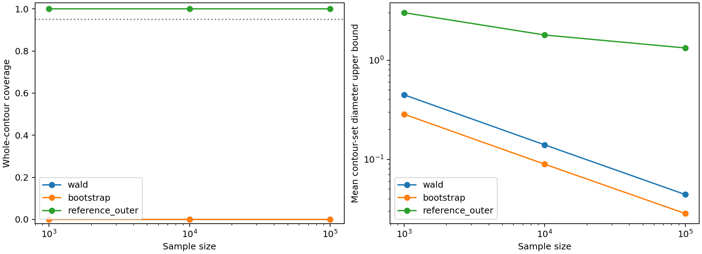

# Full-cell frequentist comparison

Date: 2026-10-23. Status: executed matched frequentist comparison, 1,200 datasets and 478,800 bootstrap refits, with independent numerical and sensitivity checks.

## Decisions before execution

- Use the same fixed 36-cell partition for every method. Both Gaussian center coordinates and scale are estimated; fit grouped Gaussian probabilities, never cell midpoints.
- Compare a clean-Gaussian Wald ellipsoid, a nonparametric bootstrap Hausdorff ball around the grouped Gaussian estimator, and the contamination-aware confidence projection from experiment 05. The first is asymptotically justified under its clean model; the bootstrap targets sampling variability of the fitted functional of the observed cell distribution. Neither is presumed valid for a latent clean contour under contamination.
- Use true clean contours as fixed evaluation targets. Include clean data, the indistinguishable-world mixture, and a shifted Gaussian contamination with an off-grid clean truth. Paired worlds use the same observations and are not independent trials.
- Use multinomial resampling from empirical cell frequencies for the bootstrap. Bradley Efron (1979), *Bootstrap Methods: Another Look at the Jackknife*, abstract, describes the aim to “estimate the sampling distribution of some prespecified random variable”. [Original paper](https://blogs.helsinki.fi/bk-club/files/2012/05/Efron_Bootstrap_AS1979.pdf). This motivates resampling variability, not a guarantee of recovery of a latent clean source. Our Hausdorff-ball construction is a local choice, not claimed to reproduce a confidence method from that paper.
- Implement the reference with retained parameter boxes, not isolated grid points. Conservative lower bounds on Gaussian cell probabilities allow safe pruning. Limit refinement for runtime; record the resulting geometric resolution. Widths are reported as certified geometric upper bounds where exact diameters are not computed.
- Compare coverage with Monte Carlo intervals and report clean controls. Empty reference sets and numerical fitting failures must be counted and disclosed, not silently removed.

## Implemented procedures and theoretical meaning

All observations are counts in rectangles with coordinate edges [-infinity,-2,-1,0,1,2,infinity]. The Gaussian family is spherical, with unknown mu_x, mu_y, and sigma. For evaluating continuous confidence sets, the declared parameter domain is [-0.5,0.5]^2 times [0.65,1.35]. The two conventional sets may also be intersected with this domain without changing inclusion of any tested truth or invalidating their reported diameter upper bounds.

**Grouped Gaussian fitting.** Fit t=(mu_x,mu_y,log sigma) by maximizing the multinomial grouped-Gaussian likelihood. The Gaussian cell law factors into x and y bin probabilities, so the full likelihood depends on the two marginal count vectors. This is an exact likelihood reduction for the declared Gaussian model, not midpoint reconstruction. Under contamination, the resulting estimate is a fitted functional of the observed distribution and need not recover the clean component. Bootstrap draws resample the joint cell counts, retaining empirical cross-coordinate dependence.

**Wald confidence set.** Use expected Fisher information of the grouped Gaussian model at the estimate, divided by n, to obtain covariance V. Include contours whose parameters satisfy (t-t_hat)' V^{-1}(t-t_hat) <= chi2_3(0.95). Under a regular, correctly specified identifiable Gaussian model, asymptotic normality motivates this ellipsoid. We do not assert a finite-sample 95% guarantee or a misspecification-robust guarantee. This is model-based Fisher covariance, not a sandwich covariance.

**Bootstrap confidence set.** For each dataset draw 399 independent multinomial bootstrap count vectors from its empirical cell law and refit. Let R be the empirical 95th percentile, using the higher order-statistic convention, of the Hausdorff distances from bootstrap contours to the original fitted contour. Report the Hausdorff ball of radius R around that contour. It targets variability around the observed-law fit. The Efron citation above motivates empirical-distribution resampling; validity for this nonsmooth distance quantile and latent clean target is not imported from that paper. Clean controls are essential. No Bayesian prior, posterior, or source-identity labels are used.

**Contamination-aware reference.** Use the Bonferroni-adjusted Clopper–Pearson cell region and projection of experiment 05, with known epsilon (0 for clean controls; 0.20 for contaminated scenarios). Compute an outer set of continuous parameter boxes. Its finite-sample coverage follows from the proof in experiment 05 when the truth lies in the declared parameter domain. This method has extra correct structural knowledge—epsilon and permission for unrestricted Q—that the clean-model methods ignore by design. This is an assumption-stress evaluation, not a claim of equal modeling assumptions or universal algorithm superiority.

Carried-forward source at this point: Clopper and Pearson (1934), *The Use of Confidence or Fiducial Limits Illustrated in the Case of the Binomial*, pp. 404–407, describe “the proportion of times that this prediction is correct”. [Original paper](https://www.barestatistics.nl/uploads/1/1/7/9/11797954/clopper__pearson_1934.pdf). Experiment 05 consulted and documented this source; the present study reuses that confidence construction. The projection and box implementation are local derivations. No new novelty claim is made for these standard ingredients.

## New numerical decision: interval bounds rather than bare grids

For a parameter box, bound each standardized bin endpoint (edge-mu)/sigma by its minimum and maximum over the four mean/scale corners. Positivity of sigma ensures these bounds are valid. If a and b are the lower and upper bin edges, then

    P(a < X <= b) >= max(0, Phi(z_b,min) - Phi(z_a,max)).

Multiply the nonnegative marginal lower bounds to bound each spherical-Gaussian rectangular cell probability. Use these lower bounds in experiment 05's feasibility inequalities. If a box fails the relaxed test, no parameter inside it can be feasible. Retaining all other boxes gives an outer confidence set. This improves computational tractability without assuming that any isolated grid point is the true parameter.

Starting from the full parameter domain, split surviving boxes in all three dimensions for six levels. The largest final box contour radius is 0.024434659. The stopping rule limits computational resolution; it is not a criterion for statistical certainty. All pruning bounds are analytic; floating-point evaluations and the 1e-14 feasibility tolerance are not formal interval-arithmetic certification.

For reporting widths, we use **upper bounds** rather than claim exact set diameters:

- Bootstrap: 2R by the triangle inequality.
- Wald: twice a containing-ball radius. If k=chi2_3(0.95), this radius is sqrt(k lambda_max(V_mu)) + c_alpha sigma_hat [exp(sqrt(k V_logsigma))-1].
- Reference: take the coordinate hull of all retained parameter boxes. If its coordinate spans are d_x,d_y,d_sigma, report sqrt(d_x^2+d_y^2)+c_alpha d_sigma.

These upper bounds have different looseness. Their ratio is not a reliable efficiency ranking. Reference contour coverage is determined by whether the continuous true parameter is in any retained box, not by proximity to a grid center. The exact unrelaxed projection is also evaluated directly at each known truth for a separate check.

## Experimental design

100 independent datasets per scenario and n, with n=1000,10000,100000. Every method sees the same dataset. Bootstrap seed and resampling draws are recorded through the reproducible script. The scenarios are:

1. Clean Gaussian: center (-0.2,0), sigma=1.
2. Clean off-grid Gaussian: center (0.173,-0.137), sigma=0.973.
3. Shared mixture from experiment 01, epsilon=0.20: evaluated against both clean contours centered at (-0.2,0) and (0.2,0), sigma=1. This is one dataset per trial with two truths, not two independent trials.
4. Geometric contamination: 80% of the off-grid clean Gaussian and 20% Gaussian Q with center (1,-0.7), sigma=1.05. Q is fixed across sample sizes and is not supplied to the reference; only epsilon is supplied.

No trials were discarded. There were no empty reference outer sets and no fitting failures. There are 1,200 independent observed datasets and 478,800 bootstrap refits. Coverage summaries across the two indistinguishable worlds are dependent.

## Main findings

At every tested n in both contaminated scenarios, Wald and bootstrap sets included the clean contour in 0/100 trials. The reference included it in 100/100 trials. These observed fractions are not population probabilities: Wilson 95% intervals are approximately [0,0.0370] for 0/100 and [0.9630,1] for 100/100. All per-setting intervals are saved in `summary.json`.

Clean controls gave Wald coverage between 90% and 96%, and bootstrap coverage between 92% and 96%. In particular, the 90/100 Wald result has a Wilson interval below 95% at its upper endpoint; we do not dismiss it as established nominal calibration. Larger repeated-sample calibration studies and multiplicity-aware interpretation are required before claiming precise clean-data coverage. The reference outer set covered 99–100% of clean trials, consistent with its conservatism.

The common fitted contour error shrank on clean data but remained near 0.30–0.33 under contamination, while the conventional confidence sets contracted. That is the shrinking-around-a-biased-target mechanism of experiment 05. This empirical result does not prove a defect in all bootstrap methods or all epistemic uncertainty measures.

## Coverage table

| Scenario / truth | n | Wald | Bootstrap | Reference outer |
| --- | ---: | ---: | ---: | ---: |
| clean_left / -0.200 | 1000 | 96% | 96% | 99% |
| clean_left / -0.200 | 10000 | 90% | 94% | 100% |
| clean_left / -0.200 | 100000 | 93% | 92% | 100% |
| clean_offgrid / +0.173 | 1000 | 94% | 93% | 100% |
| clean_offgrid / +0.173 | 10000 | 95% | 94% | 100% |
| clean_offgrid / +0.173 | 100000 | 94% | 94% | 100% |
| shared_mixture / -0.200 | 1000 | 0% | 0% | 100% |
| shared_mixture / -0.200 | 10000 | 0% | 0% | 100% |
| shared_mixture / -0.200 | 100000 | 0% | 0% | 100% |
| shared_mixture / +0.200 | 1000 | 0% | 0% | 100% |
| shared_mixture / +0.200 | 10000 | 0% | 0% | 100% |
| shared_mixture / +0.200 | 100000 | 0% | 0% | 100% |
| shifted_contamination / +0.173 | 1000 | 0% | 0% | 100% |
| shifted_contamination / +0.173 | 10000 | 0% | 0% | 100% |
| shifted_contamination / +0.173 | 100000 | 0% | 0% | 100% |

## Width and error on the shared mixture

| n | Wald diameter upper | Bootstrap diameter upper | Reference diameter upper | Mean fitted contour error, world 0 |
| ---: | ---: | ---: | ---: | ---: |
| 1000 | 0.44724 | 0.28489 | 3.01191 | 0.30801 |
| 10000 | 0.13995 | 0.08931 | 1.79382 | 0.29685 |
| 100000 | 0.04416 | 0.02841 | 1.32813 | 0.30034 |

The fitted error is the error of the common grouped Gaussian point estimator. The reference is a set-valued procedure and is not assigned that point estimate; the duplicated `mean_fit_error` metadata in its summary rows is contextual only.




## Numerical verification and new understanding

- Checked the batched Fisher-scoring fit against independent BFGS optimization on 12 clean grouped datasets. Maximum mean negative-log-likelihood difference: 8.88e-16. All experiment fits had per-observation score residual below 3.23e-8. These checks support numerical convergence; they do not prove global uniqueness for every possible dataset.
- Checked 300 randomly selected parameter boxes and interior points against the analytic cell lower bounds; all passed. The analytic argument supplies uniform box validity, rather than sampled checks alone.
- For every trial, whenever the true observed cell law was in the simultaneous cell region, the true parameter passed exact projection and its containing box was retained. Whenever the true parameter passed exact projection, it was included in the outer set.
- Exact-projection clean coverage ranged from 93% to 98%, while outer-set coverage was 99–100%. This demonstrates that finite box relaxation increases conservatism. Cell-confidence-region coverage itself fluctuated across the 100-trial runs; no theorem of equality to 95% is asserted.
- On an independent clean anchor at n=100000, refining from five to six to seven levels reduced the diameter upper bound from 0.52354 to 0.33741 to 0.26644. On a shared-mixture anchor the corresponding bounds were 1.50063, 1.28577, and 1.19880. **The current reference width is not a tight estimate of irreducible ambiguity.** Numerical refinement and the coordinate-hull bound both matter.
- On those same anchors, increasing bootstrap draws from 399 to 1999 changed the 95% radius from 0.013990 to 0.013609 (clean) and from 0.013780 to 0.014365 (mixture). This is a limited numerical sensitivity check, not proof of exact bootstrap coverage or stability on every trial.
- With center and scale both free, the contaminated point estimate's contour error is larger than the known-radius center error of experiment 05. Sample-size growth does not remove this observed bias. We should not compare numerical widths across those different parameter models as if they were the same task.

## Scope of the conclusion and next decisions

This study confirms a frequentist clean-contour coverage failure for the tested clean-model Wald and bootstrap procedures under the specified contamination settings. The contamination-aware reference retains coverage but is deliberately conservative. The result concerns the interpretation of shrinking sampling variability as knowledge of a latent clean contour; it does not refute the clean-data guarantees or prove a universal epistemic failure.

No posterior or prior is needed for the observed failure. The original ambiguity mechanism and the biased-center interpretation are established robust-statistical phenomena, not a novelty claim.

The next useful decisions are:

1. Determine which modern epistemic score or estimator genuinely claims uncertainty about this clean-contour task. A comparison of only classical confidence procedures is not yet a paper about current epistemic formulations.
2. Tighten the reference through additional box refinement and a less loose diameter calculation if efficiency comparisons are needed. Keep the current coverage-valid reference as a control.
3. Extend coverage calibration and contamination sweeps before generalizing beyond the tested truths and Q laws; 100 trials resolves the large failure here but not small deviations from nominal 95% coverage.
4. Add spatial boundary-envelope evaluation once the reported uncertainty objects and their guarantees are fixed. Current results assess whole-contour sets.

These are future steps, not experiments claimed to have been executed here.

## Reproduce and sources

```bash
OPENBLAS_NUM_THREADS=1 python Uncertainty_Modeling/EU_AU_Disentanglement/Epistemic_Contour_Failure/experiments/06_full_cell_frequentist/run.py
OPENBLAS_NUM_THREADS=1 python Uncertainty_Modeling/EU_AU_Disentanglement/Epistemic_Contour_Failure/experiments/06_full_cell_frequentist/check_sensitivity.py
```

Seeds: 20261027 for the main comparison; 20261028 for independent optimizer/bound checks; 20261029 for sensitivity anchors. These are reproducibility identifiers. Dependencies: numpy, scipy, matplotlib. Main outputs: `summary.json`, `replicates.npz`, `comparison.png`. Additional verification: `verification.txt` and `sensitivity.json`.

Papers used: Efron (1979), original abstract and introductory excerpt, for empirical-distribution bootstrap motivation; Clopper and Pearson (1934), carried forward from experiment 05, for binomial confidence inversion. Links and short supporting quotations are placed at their respective uses above. The Wald construction, grouped likelihood reduction, Hausdorff-ball choice, interval box bounds, and width bounds are locally specified/derived; no external paper is falsely credited with their exact implementation. Earlier source-model and partial-identification literature remains documented in experiments 04–05.
