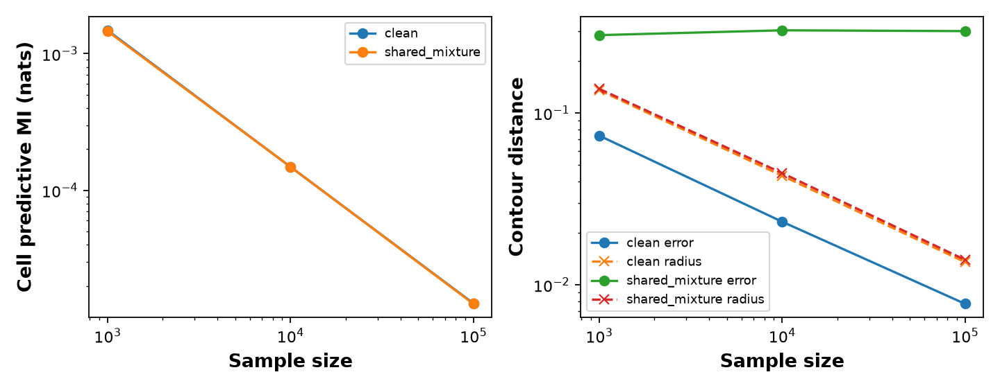

# Experiment 08 — pinned probly quantification adapter

Date: 2026-10-23. Status: executed adapter validation and a small frequentist pilot. This integrates probly's quantification layer with our existing Gaussian bootstrap estimator. It is **not a replication of neural deep ensembles or MC dropout**, and does not yet evaluate probly's ensemble model factory.

## Decisions and new understanding

1. **Software decision:** pin `probly==0.9.1`, installed in `/tmp/contour-probly-0.9.1` with Python 3.13.5. The shared environment was not modified. Full resolved dependencies are in [requirements.lock.txt](requirements.lock.txt); hashes of the inspected library files are in [validation.json](validation.json). The temporary environment may disappear; use the reproduction instructions below.
2. **Method decision:** use the existing grouped Gaussian maximum-likelihood fit, with nonparametric bootstrap multinomial counts, to validate the adapter before introducing a neural model. Training sees counts and cell edges, assumes a spherical Gaussian, and receives neither source labels nor clean-contour labels nor the true contamination law. Epsilon and the two clean truths belong to the evaluator. This is our custom unsupervised adapter.
3. **Why distinguish bootstrap and initialization:** Lakshminarayanan, Pritzel and Blundell (2017), §2.4, state “We used the entire training dataset to train each network”. Their random initialization/data-order recipe differs from our bootstrap fits. Sections 2.1–2.4 concern conditional supervised prediction; our unconditional grouped-density task is an adaptation, with no invented target labels. [Paper](https://arxiv.org/pdf/1612.01474). This motivates checking same-data random starts separately and prevents calling a parametric Gaussian experiment a deep-ensemble replication.
4. **Library boundary:** the installed `probly.method.ensemble` reexports `probly.transformation.ensemble`. Its common implementation dispatches `ensemble_generator` by predictor type; it is not a generic density-training routine. We inspected that contract but did not register a custom Gaussian generator or exercise an optional neural backend. Here, our code generates members and probly represents and quantifies their distributions. This is narrower than the eventual method benchmark in experiment 07.
5. **Explicit target:** each member gives 36 normalized cell probabilities. `ArraySample(create_categorical_distribution(p), sample_axis=0)` supplies the ensemble axis explicitly. `SecondOrderEntropyDecomposition` returns total entropy, average member entropy, and epistemic MI. These concern a future observation's **cell**, not clean-contour location. No posterior interpretation is required: the member distribution here is an empirical bootstrap distribution. This target interpretation is our local application of the inspected implementation, not a claim attributed to the ensemble paper.
6. **Contour quantity:** separately extract each member's circle, with radius `sqrt(-2 log .05) * sigma`. For circles, the exact Hausdorff distance is the center distance plus the absolute radius difference. We evaluate a bootstrap ball about the original fitted circle with radius equal to the empirical 95th percentile of bootstrap distances. This is an approximate bootstrap construction, not a conversion of MI into confidence. Its validity under contamination is not assumed.
7. **Spatial variance:** apply probly `sample_variance` to the rightward support coordinate `mu_x + sqrt(-2 log .05)*sigma`. This is variance of a geometric boundary location, using divisor B (library default), not a spatial map or simultaneous confidence band. Its units differ from MI.

The pinned software sources supporting decisions 4–7 are listed below; these are implementation facts, not additional theoretical guarantees.

## Formula and a conditional theoretical observation

For B equally weighted members with cell laws p_b, the evaluated quantity is

`MI = H(mean_b p_b) - mean_b H(p_b)` (natural logarithms; nats).

**Local derivation:** on a fixed finite cell alphabet, entropy is uniformly continuous. If every member law approaches a common law in L1 distance (maximum over members tends to zero), their mean does too, and the displayed entropy difference tends to zero. No positive-probability lower bound is needed for this continuity argument. Likewise, if every Gaussian member approaches the same finite `(mu_x, mu_y, sigma)` with positive sigma, continuity of the circle map makes member contour spread vanish. These are conditional implications; this pilot does not prove bootstrap consistency or a rate for arbitrary models.

Combined with the indistinguishable-world result from experiments 01/05, such contraction cannot represent all unresolved clean-source contour ambiguity: the two clean contours remain separated by 0.4 under the same observation law. **The MI calculation itself may still be correct for its specified predictive/member target.** The failure claim concerns interpreting its contraction as resolution of the clean-contour uncertainty. This is not evidence that every epistemic formulation is mathematically wrong.

## Executed protocol

- Same 36 cells and mixture helper as experiment 06; clean truth `(-0.2,0,1)`, and shared mixture at epsilon 0.2 compatible with both `(-0.2,0,1)` and `(0.2,0,1)`.
- Sample sizes 1,000, 10,000, 100,000; 30 independent datasets per scenario/size, seed 20261028. Both contaminated truths are evaluated on exactly the same observations and fitted members.
- 199 bootstrap refits per dataset: 180 datasets and 35,820 bootstrap refits. Five additional same-data random-start fits per dataset assess optimization variability. Finite-member sensitivity uses the first 5, 20, and 50 of the same 199 bootstrap members.
- No new contamination-aware reference runs: experiment 06 remains the reference comparison. No new contamination sweep, OOD benchmark, or neural training is claimed.

## Observations

Means over 30 datasets; contaminated error ranges below span the two fixed clean truths. Full values and MI Monte Carlo standard errors are in [summary.csv](summary.csv).

| Data | n | Cell MI (nats) | Clean-contour error | Bootstrap radius | Whole-contour ball coverage |
| --- | ---: | ---: | ---: | ---: | ---: |
| Clean | 1,000 | 0.001483 | 0.07382 | 0.13568 | 28/30 |
| Clean | 10,000 | 0.0001486 | 0.02329 | 0.04312 | 28/30 |
| Clean | 100,000 | 0.00001490 | 0.00775 | 0.01355 | 28/30 |
| Shared mixture | 1,000 | 0.001462 | 0.28389–0.31598 | 0.13833 | 0/30 in each world |
| Shared mixture | 10,000 | 0.0001487 | 0.30213–0.30283 | 0.04467 | 0/30 in each world |
| Shared mixture | 100,000 | 0.00001479 | 0.29958–0.30018 | 0.01398 | 0/30 in each world |

The observed MI decreases about 100-fold over a 100-fold increase in n in both scenarios. This is numerical behavior, not a proved rate. Contaminated contour error persists while the bootstrap radius decreases. Rightward support variance also decreases, from 0.003059 to 0.00003155 under contamination. Thus changing from predictive MI to this bootstrap-derived geometric variance alone does not preserve source ambiguity.

The clean result is encouraging but imprecise: 28/30 has an approximate 95% Wilson interval [0.787, 0.982]; 0/30 has [0, 0.114]. The contaminated worlds share datasets, so they are not 60 independent repetitions. This pilot does not establish precise 95% calibration or population zero coverage.

Five same-data random starts agree within 9.63e-9 in `(mu_x,mu_y,log sigma)`. Their MI is at floating-point zero (occasionally tiny negative values around 1e-17, retained rather than interpreted as negative uncertainty). **New understanding:** initialization spread for this converged parametric model is essentially absent even on clean finite samples. It is unsuitable as a stand-in for a neural ensemble's sampling uncertainty. This does not refute neural deep ensembles.

Finite-member results also matter: on clean n=1,000 data, mean MI is 0.001052 with five members and 0.001483 with 199. Member count is not an innocuous setting. Nested subsets are a sensitivity check, not independent estimates of Monte Carlo bias or a convergence proof.



## Validation and limitations

Passed: hand-computed binary MI (0.3680642071684971 nats); identical-member zero; category/member permutation invariance; additive entropy decomposition; known sample variance; normalization of every member; every pilot MI compared with an independent entropy formula; existing fit-gradient assertions; random-start agreement. See [validation.json](validation.json). Installation/import and experiment execution succeeded. Plotting emitted font-weight substitution warnings; no estimator check failed.

Raw per-dataset values are in [raw.npz](raw.npz), with column layout in the validation file. This stores diagnostics, not fitted members/counts; the deterministic script regenerates those. The figure's contaminated line uses the left truth; the table and CSV include both.

No broad failure of modern UQ methods, neural method performance, new calibrated uncertainty definition, or universal contour-confidence interpretation is established. The substantive progress is a tested, pinned quantification adapter and a demonstration of its target/misspecification limitation in a controlled bootstrap setting.

## Sources actually consulted

- **Balaji Lakshminarayanan, Alexander Pritzel, Charles Blundell (2017). _Simple and Scalable Predictive Uncertainty Estimation using Deep Ensembles_.** [Full paper](https://arxiv.org/pdf/1612.01474), §§2.1–2.4 and Algorithm 1. Used and quoted at decision 3 to separate supervised neural ensembles from our grouped-density bootstrap. No clean-contour confidence guarantee is attributed to this paper. No additional research papers were newly consulted for this pilot.
- **probly contributors, probly 0.9.1.** [Repository](https://github.com/pwhofman/probly), [release package](https://pypi.org/project/probly/0.9.1/). Inspected installed wheel files: `method/ensemble.py`, `transformation/ensemble/_common.py`, `representation/distribution/array_categorical.py`, `representation/sample/array.py`, `quantification/decomposition/entropy/_common.py`, and `quantification/measure/sample/_common.py`. The last describes `sample_variance` as “Measure uncertainty for samples via their sample variance.” The entropy class's `_epistemic` calls `mutual_information`. Used for decisions 4–7 and validated numerically. Hashes identify the inspected core files; moving main-branch pages are not the version authority.
- **Local prior work:** experiments [01](../01_indistinguishable_worlds/RESULTS.md), [05](../05_frequentist_theory/RESULTS.md), and [06](../06_full_cell_frequentist/RESULTS.md) supply the source-ambiguity argument, frequentist interpretation, and estimator. This is reuse of our existing derivations, not newly consulted external literature.

## Reproduction and next questions

From this experiment directory, with Python 3.13:

```bash
python3.13 -m venv /tmp/contour-probly-reproduce
/tmp/contour-probly-reproduce/bin/python -m pip install -r requirements.lock.txt
/tmp/contour-probly-reproduce/bin/python run.py
```

Keep sibling experiments 04–06 available: the script imports their helpers. No optional neural backend is required for this adapter pilot.

Next: specify and validate a normalized neural density model trained only on permitted cell counts, then exercise probly's actual ensemble transformation with independently initialized members. Compare its predictive MI and extracted contour variability with these bootstrap controls on matched datasets. Architecture, optimization convergence, member count, and contour extraction error must be documented before interpreting a failure. MC dropout remains optional. Broader contamination/spatial sweeps and precise clean calibration remain open.

## Follow-up

[Experiment 09](../09_neural_density_ensemble/RESULTS.md) executed the actual probly PyTorch ensemble transformation with a normalized neural mixture-density adapter, matched controls, and optimization sensitivity. Active component bounds and lack of clean calibration limit interpretation; these findings take priority over scaling up the pilot unchanged.
