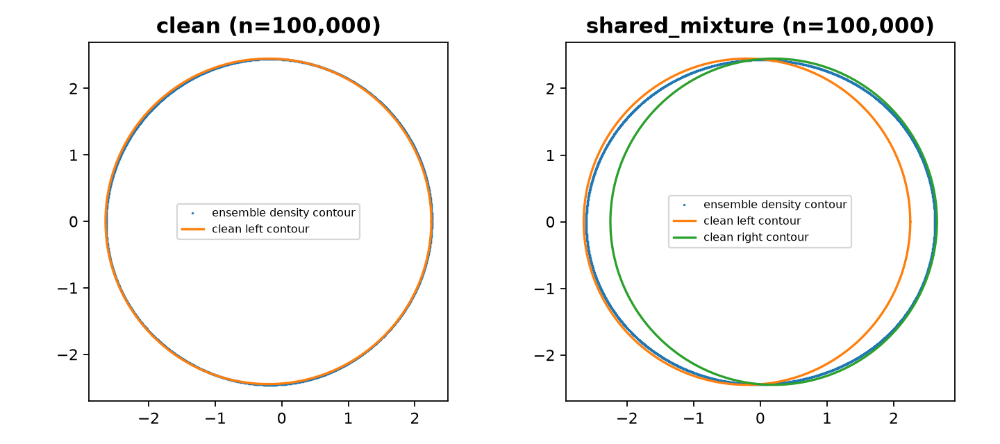

# Experiment 09 — neural mixture-density ensemble through probly

Date: 2026-10-23. Status: executed a small neural adapter pilot, optimization sensitivity, contour checks, and matched frequentist controls. This advances beyond experiment 08 by using **probly's actual PyTorch ensemble transformation**. It is an adapted unconditional density experiment, not a reproduction of the original supervised deep-ensemble benchmarks.

## Decisions, assumptions, and source usage

### Model and information available to the learner

Each member is a `Linear(1,16) → Tanh → Linear(16,12)` network evaluated at a constant input of one. Its 12 outputs parameterize three isotropic bivariate Gaussian components: softmax weights, component means `2*tanh(z)` in each coordinate, and standard deviations `0.35 + 1.65*sigmoid(z)`. Their mixture is a normalized continuous density. Exact Gaussian CDF differences give its 36 cell probabilities, including unbounded tail cells.

**Local design decision:** the mixture permits departures from a single spherical Gaussian while preserving analytic normalization and exact grouped likelihood. Because there are no covariates in this experiment, a constant input is appropriate; the network is an overparameterization of a finite Gaussian mixture, not a learned spatial feature map. Merely using a neural network here does not establish representativeness of large neural UQ systems. The three-component architecture and bounds are modeling choices, not requirements from probly or facts about the data. Sensitivity to them is still needed.

Members observe only the same 36 counts and cell edges, and minimize `-sum_j (N_j/n) log p_j`. They do not see source labels, clean contours, the clean parameter, or the contamination law. They fit an observed density; there is no identified clean-source component. The two possible clean truths are used only for evaluation. The contamination-aware reference additionally knows epsilon, explicitly distinguishing its information regime.

### Member generation and training

We call `probly.method.ensemble(base, num_members=5, reset_params=True)` using probly 0.9.1 and PyTorch 2.14.1+cpu. Runtime checks confirm different initial parameters and independent parameter storage for all five members. The inspected backend clones/resets modules and returns a `ModuleList`; our code supplies the density decoder and training objective. We do not claim probly trains this task automatically.

**Source-backed motivation:** Lakshminarayanan, Pritzel and Blundell (2017), §2.4, write “We used the entire training dataset to train each network”. We follow independent initialization and common training data, rather than the bootstrap member-generation mechanism of experiment 08. [Original paper, §§2.1–2.4 and Algorithm 1](https://arxiv.org/pdf/1612.01474). Their setup is supervised conditional prediction; this unconditional grouped-density adapter is our extension. We use deterministic full-batch L-BFGS instead of their stochastic training recipe. Adversarial training is omitted. Five members match their suggested starting size, but are not sufficient to establish member-count stability.

Each member receives two L-BFGS stages of at most 300 iterations, with strong-Wolfe line search, gradient tolerance 1e-9 and loss-change tolerance 1e-12, in float64 on one CPU thread. Reaching a stopping criterion does not certify a global optimum. Subsequent direct-mixture optimization diagnoses sensitivity to the neural parameterization.

### Quantities evaluated

- **Predictive epistemic score:** probly `SecondOrderEntropyDecomposition` applied to the sample of member cell laws. Its MI is `H(mean p_b) - mean H(p_b)`, in nats. This targets the cell of a future observed sample. There is no Bayesian posterior in this construction.
- **Estimated contour:** the boundary of a highest-density region containing 95% of the **ensemble mean density**. The mean is a 15-component Gaussian mixture with each member's component weights divided by five. Extract each member's own 95%-mass contour separately.
- **Member spread:** maximum Hausdorff distance of a member contour from the ensemble mean-density contour. This is a descriptive radius. It has **no nominal confidence level**. The CSV field `inside_member_radius` records whether the true contour lies within that radius; it must not be called 95% coverage.
- **Clean-contour error:** Hausdorff distance between the ensemble contour and each fixed true clean circle. Both contaminated truths are evaluated on the same counts and fits.

**New understanding/local implication:** neural member disagreement and repeated-sample uncertainty remain different objects. Near agreement after fitting one dataset does not quantify how the fitted contour would change across new datasets. Moreover, a contour of the observed mixture is not generally a clean-source contour. A failure of that interpretation is not a violation of a promised clean-source guarantee by the ensemble paper.

## Executed protocol and artifacts

Two scenarios: the clean Gaussian `(-0.2,0,1)` and the existing epsilon=0.2 shared-mixture construction, compatible with clean centers `(-0.2,0)` and `(0.2,0)` at sigma=1. Sample sizes 1,000 and 100,000; five independent datasets per scenario/size; seed 20261029. Total: 20 datasets, 100 independently initialized neural members.

[run.py](run.py) produces [rows.csv](rows.csv), [training.csv](training.csv), [validation.json](validation.json), [fits.npz](fits.npz), and the figure below. Saved fits include counts, decoded member mixture parameters, and extracted ensemble contour vertices, sufficient to reconstruct densities and scores. Network weights are regenerated by the seeded script, not stored in the NPZ.

[check_optimization.py](check_optimization.py) continues each fitted mixture directly in its 12 output coordinates for up to 1,000 L-BFGS iterations. This is an **optimization diagnostic**, not additional ensemble members or new datasets. It saves [optimization_sensitivity.csv](optimization_sensitivity.csv), [polished_fits.npz](polished_fits.npz), and [sensitivity_validation.json](sensitivity_validation.json).

[check_matched_controls.py](check_matched_controls.py) fits the experiment 06 Gaussian bootstrap (199 refits per dataset) to exactly the same counts and checks true-parameter membership in the simultaneous Clopper–Pearson projection. It saves [matched_controls.csv](matched_controls.csv). Reference membership uses the exact feasibility test from experiment 05, not a new approximation to the confidence region's width.

## Observed results

Means over only five datasets per row. Contaminated error ranges span the two fixed truths; they are not confidence intervals.

| Data | n | Cell MI, nats | Clean-contour error | Maximum member distance |
| --- | ---: | ---: | ---: | ---: |
| Clean | 1,000 | 0.0005083 | 0.2303 | 0.05765 |
| Clean | 100,000 | 0.000001795 | 0.02359 | 0.00710 |
| Shared mixture | 1,000 | 0.0006523 | 0.4092–0.5248 | 0.16051 |
| Shared mixture | 100,000 | 0.00002126 | 0.3727–0.3737 | 0.02482 |

The means suggest lower predictive disagreement at larger n while contaminated clean-contour error persists. Individual datasets vary substantially: for shared-mixture n=1,000, one dataset yields MI about 1.74e-13, whereas another yields about 8.74e-4. Two sample sizes and five repetitions cannot establish a contraction law. The first-two-member scores are also recorded; these nested subsets do not establish convergence in member count.

**Evidence qualifying the failure narrative:** the descriptive member radius misses the true clean contour for every clean dataset as well as every contaminated truth evaluation. Thus this radius is already unsuitable as a frequentist confidence procedure in the clean control. We cannot interpret its contaminated misses as a demonstrated loss of previously established 95% calibration.

On matched counts, the ordinary Gaussian bootstrap contains the clean truth in 4/5 datasets at n=1,000 and 5/5 at n=100,000; it misses both contaminated truths in every dataset. The contamination-aware CP projection contains the tested true parameter in all 30 truth evaluations across 20 datasets. The two contaminated truths do not constitute independent repetitions. These counts are descriptive pilot results; the reference's guarantee comes from experiment 05's derivation, not these small empirical frequencies.

The matched Gaussian estimator has smaller mean clean error (0.1072 and 0.00881) than the neural mixture (0.2303 and 0.02359). Increased flexibility is not automatically helpful when the clean Gaussian family is correct. Do not present the neural adapter as an improved contour estimator.



## Numerical checks, failed assumptions, and limitations

### Contour extraction

Use a grid on `[-12,12]^2` at spacing 0.04. Sort density values and integrate grid weights to locate the 0.95 mass threshold; do not renormalize the truncated density. Gaussian CDF calculations check enclosed mass above `1 - 2e-6`. Marching contours must close within the domain. Subdivide extracted segments to spacing at most 0.005; compare these finite point sets with a 12,000-point clean circle using nearest-neighbor Hausdorff distance.

For a known Gaussian, contour discrepancy is 0.002449. Halving grid spacing to 0.02 for the first dataset in each scenario/size changes extracted ensemble contours by 0.00248–0.00253. These are numerical checks on selected cases, not certified uniform error bounds. Distances around a few thousandths, including very small member spreads, are near the numerical resolution. The large contaminated errors are well above these observed discrepancies. Finer grids and certified geometry remain necessary for precise width claims.

### Optimization and parameter bounds

The second neural optimization stage changes member cell laws by up to 0.002016 in L1 and improves average NLL by up to 5.69e-6. Final maximum neural gradient is 5.06e-6; nine of 100 members exceed 1e-6. The requested 1e-9 gradient tolerance was therefore **not achieved uniformly**; loss-change stopping and parameterization effects matter.

Direct-output continuation changes cell laws by up to 0.003663 in L1 and improves average NLL by up to 2.29e-5. The largest ensemble-contour change is 0.002970 and the largest MI change is 3.05e-6 nats. These checks support stability of the large contour-error finding, but not every tiny MI value. The maximum remaining direct-coordinate gradient is 2.09e-6, and different local optima remain possible. No global-optimality claim is made.

**Important boundary finding:** across fitted components, mean coordinates reach -2 and +2 numerically, scales reach the lower bound 0.35 and approach the upper bound 2, and weights range from about 0.000668 to 0.9964. Bounds therefore affect some fits; they cannot be described as inactive safeguards. Bound expansion, component-count sensitivity, and stronger optimization checks are required before a broad neural-method conclusion. This is a restriction of the current adapter, not a source-ambiguity theorem.

Independent SciPy CDF calculations agree with the PyTorch probabilities within 1.20e-15. Probability normalization, clone independence, and contour closure checks passed. The source-ambiguity argument is inherited from the previous experiments; this pilot establishes no new impossibility theorem.

### Software diagnosis

An initial attempt to install `pytraverse` separately failed because no matching distribution was found. Inspection showed that probly bundles it; the actual ensemble smoke test succeeded without a separate install. This was a dependency-assumption error, not a probly runtime failure. PyTorch's CPU wheel was installed into the existing isolated environment. Plotting emitted font-weight substitution warnings only.

## Sources actually consulted

1. **Balaji Lakshminarayanan, Alexander Pritzel, Charles Blundell (2017), _Simple and Scalable Predictive Uncertainty Estimation using Deep Ensembles_.** [Paper](https://arxiv.org/pdf/1612.01474), §§2.1–2.4 and Algorithm 1. Used and quoted at the training decision above. Its prediction tasks and recipe motivate the ensemble adaptation; it supplies no clean-contour confidence guarantee. No other research papers were newly consulted in this experiment.
2. **probly contributors, probly 0.9.1.** [Repository](https://github.com/pwhofman/probly), [release](https://pypi.org/project/probly/0.9.1/). Inspected installed `method/ensemble.py`, `transformation/ensemble/{__init__,_common,torch}.py`, and traversal/reset code. The PyTorch factory's docstring says “Build a torch ensemble”; the runtime checks verify its cloning/reset behavior. The backend source hash is recorded in validation.json. [Main-branch pyproject.toml](https://github.com/pwhofman/probly/blob/main/pyproject.toml) was consulted only to diagnose bundled pytraverse; the installed pinned package is the execution authority.
3. **Local prior results:** [05](../05_frequentist_theory/RESULTS.md) supplies the CP projection and ambiguity arguments; [06](../06_full_cell_frequentist/RESULTS.md) supplies Gaussian fits and matched controls; [08](../08_probly_adapter/RESULTS.md) supplies the validated MI representation and the target distinction. These are reused local derivations/implementations, not newly consulted external papers.

## Reproduction

Python 3.13; full versions in [requirements.lock.txt](requirements.lock.txt). From this experiment folder:

```bash
python3.13 -m venv /tmp/contour-neural-reproduce
/tmp/contour-neural-reproduce/bin/python -m pip install 'torch==2.14.1+cpu' --index-url https://download.pytorch.org/whl/cpu
/tmp/contour-neural-reproduce/bin/python -m pip install -r requirements.lock.txt
/tmp/contour-neural-reproduce/bin/python run.py
/tmp/contour-neural-reproduce/bin/python check_optimization.py
/tmp/contour-neural-reproduce/bin/python check_matched_controls.py
```

Keep sibling experiments 04–06 available for imports. `fits.npz` preserves the exact counts for matched evaluations. The CPU backend and one-thread float64 setup are specified; deterministic seeds do not imply bitwise equality across all platforms.

## Next questions

1. Expand mixture parameter bounds and vary component count; determine whether uncertainty behavior is stable or driven by the adapter restrictions. Improve convergence checks before increasing repetition counts.
2. Establish a clean-data calibration strategy if a neural-derived confidence set is desired. MI and a maximum-member radius alone do not define a calibrated procedure. Keep this separate from the second paper's new uncertainty definition.
3. Evaluate more independent datasets and member counts, then spatial disagreement and contamination sweeps. Separate fitting the observed mixture from making an unjustified clean-source interpretation.

The current result is an implemented and checked neural ensemble adapter with a persistent target-mismatch signal and explicit confounds. It does not establish that all contemporary epistemic definitions fail, or that this small mixture network represents all deep ensembles.

## Follow-up sensitivity test

[Experiment 10](../10_bounds_components_sensitivity/RESULTS.md) tests expanded bounds and three versus five components on all 20 matched datasets. High-sample contaminated error persists, but low-sample behavior and disagreement are sensitive, including disconnected tail contours on clean data. Bounds and convergence remain material qualifications.
