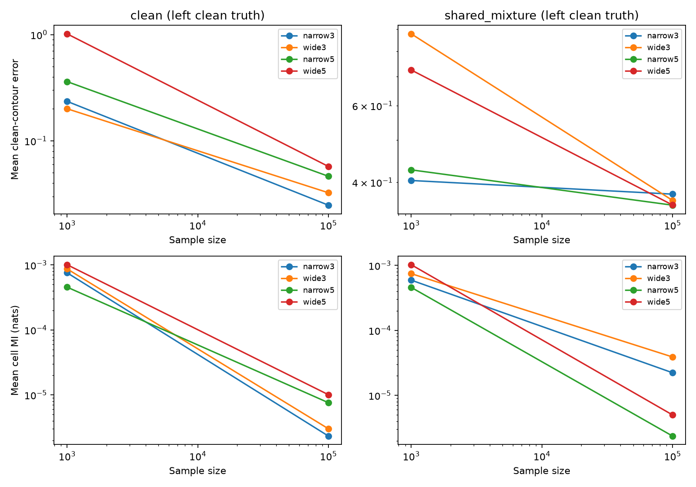

# Experiment 10 — bounds and component-count sensitivity

Date: 2026-10-23. Status: completed matched 2×2 factorial test on all 20 saved datasets from experiment 09: 80 ensemble fits and 400 retained member fits, plus numerical validation. An interrupted partial configuration was rerun; retained results do not double-count that attempt.

## Decisions made before inspecting results

- Keep the frequentist fixed-truth data model, observed counts, cell edges, five members, and predictive MI target unchanged. Test three versus five mixture components and original versus expanded parameter bounds. Use the actual probly ensemble factory.
- Original bounds: component mean coordinates in (-2,2), scale in (0.35,2). Expanded: mean coordinates in (-4,4), scale in (0.2,3). These are numerical/model-class sensitivity choices, not theoretically preferred bounds. Expansion does not guarantee that bounds become inactive.
- Train each member with two stages of up to 400 L-BFGS iterations. Refit the original configuration under this protocol, rather than comparing a new training budget against old fitted members. Preserve continuation changes and final gradients; do not discard poorly converged or inconvenient fits.
- Seed each dataset independently and reuse the same raw network initialization across bounds at fixed component count. Physical initial mixture parameters differ because the decoding bounds change. Across component counts, identical seeds do not create identical initial predictions. Thus this is a matched-data implementation comparison, not a proof that optimization effects have been eliminated.
- Expand the integration domain using the fitted component means and seven component standard deviations, with a minimum of [-12,12]^2. This prevents expanded scales from silently losing tail mass. Check exact Gaussian enclosed mass, quadrature mass, contour closure, and grid refinement. Keep contour distance discretization visible.
- Evaluate the same highest-density 95%-mass contour of the fitted ensemble density. It is a mixture-density contour; it is not automatically the clean contour. Member radius remains descriptive, with no nominal confidence level.
- Record near-bound components using absolute mean coordinates above 99% of their bound or scales within 1% of either end of the allowed scale range, separately including only component weights at least 0.01. Small-weight components may affect optimization and density shape, but should not be confused with substantial bound-constrained mass.

These decisions are local experimental design choices extending experiment 09. No new research papers were consulted to choose these sensitivity settings. The earlier ensemble-paper motivation remains documented and quoted in experiment 09; it does not prescribe the architecture or bounds tested here.

## Results: what survived, and what did not

At n=100,000, persistent contaminated clean-contour error survives all four configurations: mean error across the two possible clean truths ranges from **0.348 to 0.376**. The descriptive member radius misses both true contours in every contaminated dataset at this sample size. This supports the limited observation that more flexible fitted mixture models do not automatically resolve clean-source ambiguity.

However, the numerical size of MI and member spread is **not architecture-independent**. At n=1,000, expanded models can produce much larger member spreads and large contour errors even on clean data. Thus the experiment does not justify treating all small or large ensemble disagreement as a calibrated measure of clean-contour uncertainty.

The table gives means over five matched datasets, using the left clean truth. The right contaminated truth is also recorded in [summary.csv](summary.csv). Each dataset contributes once to each configuration; these are not 80 independent datasets.

| Configuration | Data | n | Contour error | Cell MI, nats | Member radius |
| --- | --- | ---: | ---: | ---: | ---: |
| narrow3 | clean | 1,000 | 0.2354 | 7.58e-4 | 0.0760 |
| wide3 | clean | 1,000 | 0.2005 | 8.70e-4 | 0.8882 |
| narrow5 | clean | 1,000 | 0.3612 | 4.56e-4 | 0.1469 |
| wide5 | clean | 1,000 | 1.0170 | 1.01e-3 | 1.1929 |
| narrow3 | clean | 100,000 | 0.0248 | 2.33e-6 | 0.0136 |
| wide3 | clean | 100,000 | 0.0325 | 3.01e-6 | 0.0254 |
| narrow5 | clean | 100,000 | 0.0464 | 7.59e-6 | 0.0317 |
| wide5 | clean | 100,000 | 0.0574 | 1.01e-5 | 0.3257 |
| narrow3 | contaminated | 1,000 | 0.4038 | 5.92e-4 | 0.1153 |
| wide3 | contaminated | 1,000 | 0.8775 | 7.45e-4 | 0.6808 |
| narrow5 | contaminated | 1,000 | 0.4272 | 4.58e-4 | 0.1796 |
| wide5 | contaminated | 1,000 | 0.7248 | 1.02e-3 | 1.8883 |
| narrow3 | contaminated | 100,000 | 0.3757 | 2.23e-5 | 0.0251 |
| wide3 | contaminated | 100,000 | 0.3634 | 3.90e-5 | 0.0313 |
| narrow5 | contaminated | 100,000 | 0.3543 | 2.37e-6 | 0.0160 |
| wide5 | contaminated | 100,000 | 0.3547 | 5.01e-6 | 0.0300 |



All configurations have lower mean MI at the larger n, but only two sample sizes and five datasets per condition were evaluated. This is not a proved contraction rate or a broad architecture study. The hidden-layer width remains 16; this tests density component count and parameter bounds, not network depth or feature architectures.

**Contrary evidence retained:** wide5's large descriptive radius contains the contaminated left contour in 4/5 small-sample datasets and the right contour in 3/5, whereas the other configurations miss them throughout. These are inclusion frequencies for an uncalibrated radius, not confidence coverage. A claim that ensemble spread always collapses or always misses would contradict these results.

[paired_differences.csv](paired_differences.csv) preserves each matched bounds/component-count difference, rather than treating configuration averages as independent samples. No significance test or confidence interval is warranted by this pilot alone without a specified sampling/initialization analysis.

## New understanding from the extreme clean case

The largest clean-contour error is **2.2602**, in wide5 on `clean_1000_1`; MI is only 0.0002542 nats. The fitted 95%-mass region has disconnected islands in the tails, whereas the true clean contour is circular. The main central boundary is relatively close to the true circle, but Hausdorff distance is sensitive to the extra islands. Removing those islands after inspecting truth would change the estimator and bias the evaluation; they are retained.


Halving the contour grid spacing changes this example's estimated contour by only 0.00338, so the observed discrepancy is not explained by the tested grid resolution. See [extreme_case.json](extreme_case.json).

**Local interpretation, not a theorem:** with finite cells, a flexible continuous model chooses within-cell geometry that the observed counts do not directly reveal. In particular, our unbounded outer cells contain limited spatial information. Tail islands and large member spreads are consistent with sensitivity to that interpolation and fitting choice. This experiment does not isolate their cause from local optimization or establish a new identifiability result for arbitrary Gaussian mixtures. It motivates separating cell-prediction disagreement, continuous-contour geometry, and clean-source ambiguity in subsequent evaluation.

## Bounds and optimization checks

Each configuration has 100 retained members. A near-bound component uses the criterion stated in the protocol; `weight ≥ 0.01` refers to its mass within that member.

| Configuration | Members with any near-bound component | With near-bound component of weight ≥ 0.01 | Final gradient > 1e-6 | Largest continuation L1 change |
| --- | ---: | ---: | ---: | ---: |
| narrow3 | 62 | 35 | 5 | 0.0000180 |
| wide3 | 42 | 23 | 16 | 0.0001171 |
| narrow5 | 79 | 48 | 10 | 0.0042255 |
| wide5 | 69 | 40 | 32 | 0.0030149 |

Expanded bounds reduce some boundary proximity, but do not make the bounds inactive. The desired gradient tolerance of 1e-9 is not attained uniformly; loss-change stopping still matters. Maximum final gradient is 8.34e-6. Second-stage average-NLL improvements range up to 1.80e-5. These are convergence diagnostics, not proofs of global optimality. In particular, five-component score differences cannot be attributed entirely to statistical uncertainty. See [training.csv](training.csv) and [diagnostic_summary.json](diagnostic_summary.json).

**Decision after testing:** do not describe the neural adapter as fully robust to bounds/architecture or scale it unchanged into a definitive failure benchmark. The high-sample contour-error observation is stable over this tested set, but quantitative disagreement, low-sample behavior, bound activity, and optimization remain material qualifications.

## Numerical failure, correction, and verification

The first wide5 attempt stopped during the independent probability check because experiment 04's helper required strictly positive floating-point component cell probabilities. Three extremely small component-cell masses underflow to zero across the retained fits. This does not imply mathematically zero Gaussian mass. The failed attempt is preserved in [initial_failure.log](initial_failure.log).

The independent check now uses stable Gaussian CDF differences, permits representational zeros, and still requires nonnegative probabilities and unit sums. The training objective, datasets, bounds, seeds, and already-completed configurations were not changed by this correction. Completed configurations were reused; the unfinished wide5 configuration was rerun from its deterministic seeds.

All 400 saved member laws were then checked independently: maximum PyTorch/SciPy mixture-cell discrepancy **8.33e-17**. The smallest fitted probability in any cell with a positive observed count is **0.0001444**, far above the objective's 1e-100 numerical log floor. Thus the underflow does not activate that floor on observed cells in these retained fits. See [probability_validation.json](probability_validation.json).

Analytic Gaussian contour recovery passes the 0.01 check. Sixteen first-dataset contour refinements (four configurations × two scenarios × two sample sizes) have maximum change **0.002685**. The additional extreme clean-case refinement is 0.003375. Exact Gaussian enclosed mass exceeds 1−1e-9; quadrature mass differs from it by less than 1e-7; all extracted contours close within the integration domain. These are observed numerical checks, not uniform certified Hausdorff error bounds. Distances around a few thousandths remain near numerical resolution.

## Sources and claim attribution

- **Newly consulted sources:** local [experiment 09 code](../09_neural_density_ensemble/run.py), [its RESULTS.md](../09_neural_density_ensemble/RESULTS.md), and the project research requirements. The source code describes itself as a “Small independently initialized neural mixture-density ensemble pilot.” We reuse that adapter, its pinned probly interface, and the existing fixed-truth datasets. The present bounds, component counts, numerical corrections, and interpretations are our own experimental decisions.
- **Research-paper background carried forward, not newly reviewed this step:** Balaji Lakshminarayanan, Alexander Pritzel, Charles Blundell (2017), *Simple and Scalable Predictive Uncertainty Estimation using Deep Ensembles*, [paper](https://arxiv.org/pdf/1612.01474), §§2.1–2.4 and Algorithm 1. Experiment 09 records its exact supporting quotation and the departures from its supervised training recipe. It does not prescribe these mixture bounds or guarantee clean-contour coverage. No additional papers were consulted for this sensitivity test; no new theorem is attributed to an external source.
- **Software used:** probly 0.9.1 and PyTorch 2.14.1+cpu, as pinned in [requirements.lock.txt](requirements.lock.txt). The ensemble backend was inspected and hashed in experiment 09. Cell MI uses the representation/formula validated in experiments 08–09. Software output is numerical evidence, not a theoretical guarantee.

The matched bootstrap and CP-reference observations from experiment 09 remain available on these same counts; they were not rerun here. The new comparison changes only the neural density adapter and its fitting protocol.

## Reproduction and artifacts

With the isolated environment from experiment 09, run from this directory:

```bash
/tmp/contour-probly-0.9.1/bin/python run.py
/tmp/contour-probly-0.9.1/bin/python summarize.py
/tmp/contour-probly-0.9.1/bin/python check_saved_probabilities.py
/tmp/contour-probly-0.9.1/bin/python plot_extreme.py
```

For a fresh environment, use experiment 09's CPU-PyTorch installation procedure and this folder's lockfile. Preserve sibling experiments for imports and `09_neural_density_ensemble/fits.npz` for the matched counts. Its SHA256 is recorded in [validation.json](validation.json).

`run.py` resumes complete configurations when their `*_fits.npz` files and CSV records are present. For a full fresh run, copy the scripts into a clean experiment directory at the same sibling level; retain the source experiment folders. Do not mix stale completed files with changed settings. Saved parameters and contours are in `narrow3_fits.npz`, `wide3_fits.npz`, `narrow5_fits.npz`, and `wide5_fits.npz`; [rows.csv](rows.csv) retains per-dataset scores and errors. The probability-validation file covers all configurations, including resumed ones; the inline probability maximum in validation.json only covers fits executed during that invocation.

## Next theoretical and experimental questions

1. Quantify how much contour variability is due to finite-cell geometry versus clean-source ambiguity: vary partition resolution on matched raw observations, retaining the exact shared-mixture construction and fixed clean contours. Counts alone cannot be retrospectively refined without generating new information.
2. Diagnose tail islands using predeclared alternatives (e.g. a regularity restriction or a topology-sensitive companion metric), with clean-data controls. Do not replace full-contour Hausdorff error simply because it exposes unwanted islands.
3. Establish a clean-data calibration procedure if confidence claims are desired, and improve optimization/member-count sensitivity before interpreting neural disagreement quantitatively. This remains an evaluation study, not the new uncertainty definition reserved for the second paper.
