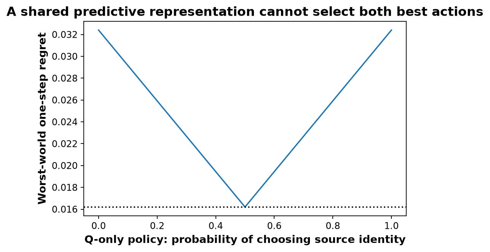
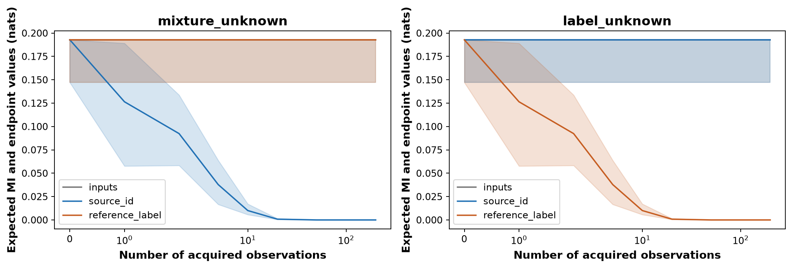
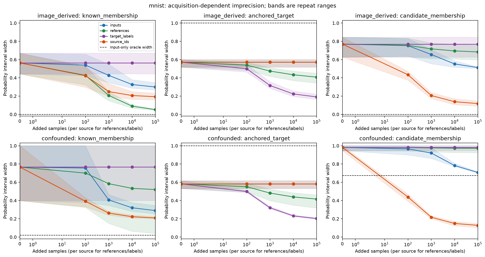
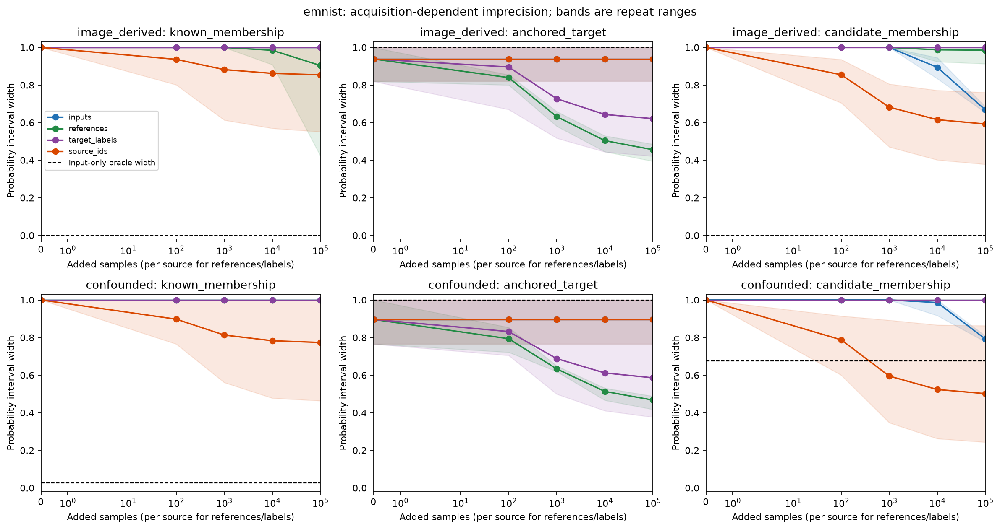
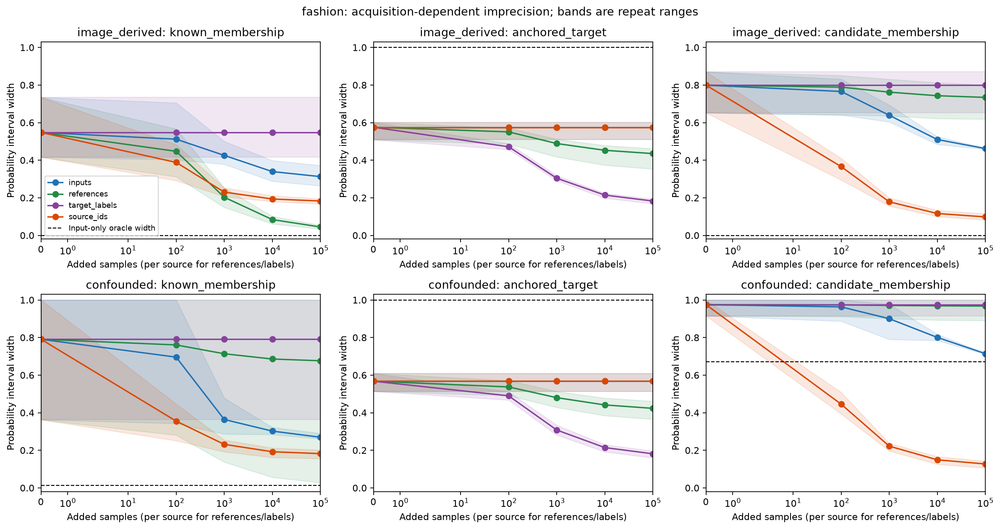
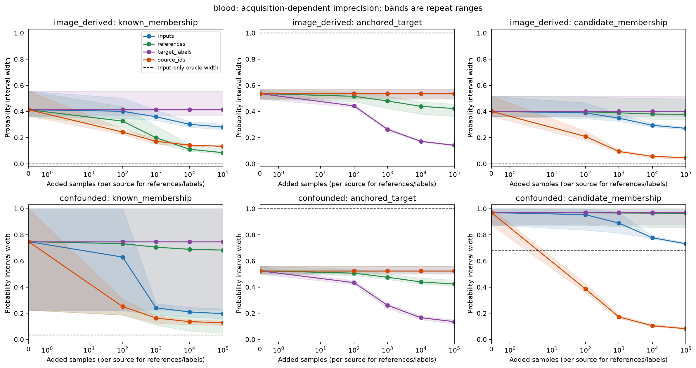
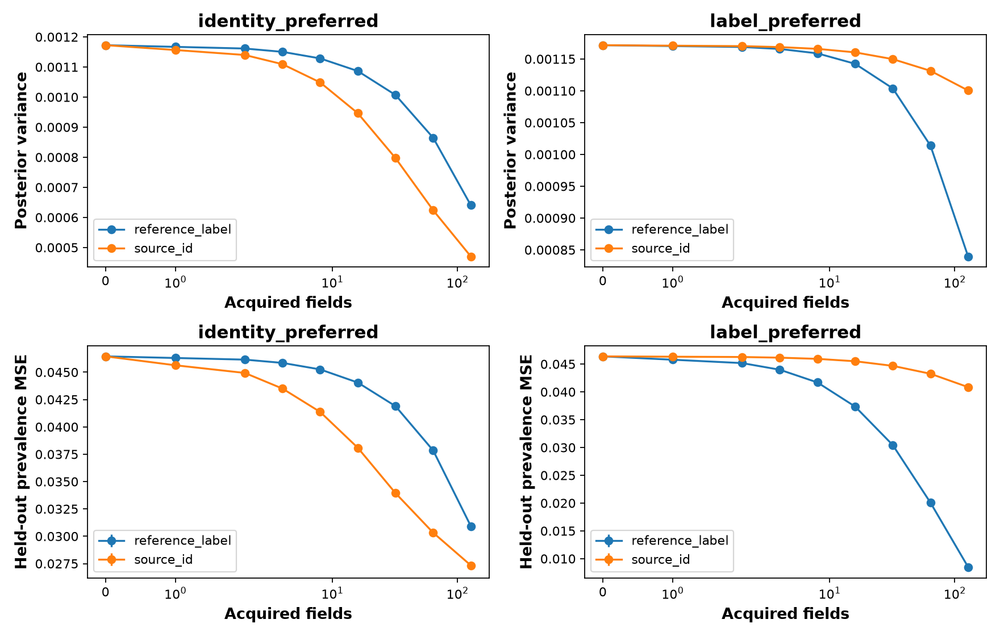
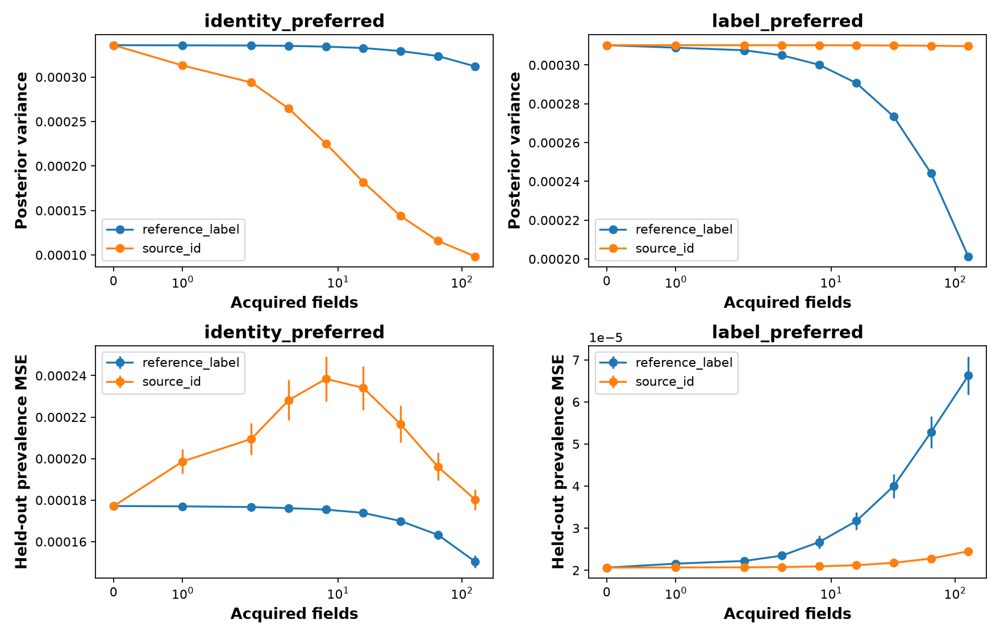

# Which Data Reduce Which Uncertainty?
## Acquisition-Specific Identification for Source-Shifted Predictions

**Working first draft.** This manuscript synthesizes six exploratory studies archived with the project. It is not a submission-ready paper: literature review, dataset citations, independent reruns, and the final experimental protocol still need author review. Reported values below are from the named timestamped runs, not later reruns unless stated.

## Abstract

Predictive uncertainty summarizes uncertainty about a model's predictions, but it does not by itself specify which additional observation would reduce uncertainty about a chosen population quantity. We study this distinction for source-shifted classification, where unlabeled inputs, source identities, reference examples, and target labels reveal different parts of a finite-source model. Our central result is an exact two-world counterexample: two models induce the same distribution over a binary target probability and the same predictive mutual information, yet source identities are optimal in one world and source-stratified labels in the other. The difference is not a failure of Bayesian updating; it is information discarded when the parameter model is projected to predictions without retaining acquisition-channel likelihoods. We then construct compatible-set intervals for three distinct targets—known-source membership, candidate-source membership, and a reference-anchored label probability—and examine simulated acquisitions on image-derived cell laws from MNIST, EMNIST Letters, Fashion-MNIST, and BloodMNIST. The controlled experiments show that source identities can resolve mixture ambiguity that large unlabeled-input samples cannot resolve under exact source confounding. Two image-based pilots on CAMELYON17 and FMoW display target-specific changes in interval width, but remain limited by custom splits, broad residual intervals, and source-law assumptions. Finally, a prespecified real-record counterexample passes its held-out directional endpoint on CAMELYON17 and fails on FMoW. The evidence supports a conditional methodological conclusion: acquisition value depends on the target, model, and observation channel jointly. It does not show that predictive mutual information is incorrect, that the proposed intervals are calibrated for new populations, or that the effects generalize broadly across visual domains.

## 1. Introduction

Uncertainty estimates are often used to decide what to inspect next. A classifier may report predictive entropy, mutual information (MI) over an ensemble, or a range of plausible probabilities. These summaries address different questions, and none automatically answers the operational one: **which observation should be acquired to improve knowledge of this particular target?**

The answer depends on what is unknown and what a proposed acquisition reveals. If deployment data are a mixture of known sources and a candidate source, unlabeled inputs can reveal the mixture's input marginal. Source identities can reveal mixture proportions directly. Reference inputs can refine source-conditional input laws. Target labels can refine source-conditional label rates. Those channels need not be interchangeable, even when they concern the same deployment population.

This paper examines the relation between a predictive representation and acquisition-specific uncertainty in finite-source models. We distinguish three probability targets that are sometimes conflated: membership in one known source conditional on being in the known-source set; membership in a specified candidate source; and a reference-anchored target-label probability. We construct intervals by optimizing each target over a set of source models compatible with observations and explicit finite-sample constraints. These intervals are target-specific identification summaries, not a decomposition of uncertainty into additive components.

Our main logical result is deliberately small. Two worlds can induce exactly the same predictive distribution over a common target, and therefore the same predictive MI, while different observation channels have different expected value in the two worlds. The result isolates a limitation of policies restricted to a predictive representation. An acquisition-aware Bayesian procedure with the correct channel likelihood can distinguish the worlds and update correctly.

We complement the exact result with four groups of experiments. First, an image-derived finite-cell study simulates acquisition over four datasets and includes a constructed source-confounding condition. Second, real-record counterexample searches on CAMELYON17 and FMoW compare model-selected acquisition preferences with exact held-out expected squared error. Third, image-based CAMELYON17 and FMoW pilots compare source-compatible probability widths with neural uncertainty scores. These latter studies are exploratory: they use custom group-disjoint splits and do not establish benchmark-level performance or broad generalization.

Our contributions are:

1. An exact two-world construction showing that an identical predictive law and MI can correspond to opposite best acquisitions for the same target.
2. A target-explicit compatible-set framework distinguishing source membership, candidate membership, and a fixed-reference label probability.
3. Controlled simulations demonstrating that different acquisition channels contract different target intervals, including a confounded regime where unlabeled inputs do not identify candidate membership.
4. An auditable empirical record of two image pilots and two prespecified held-out counterexample tests, including the negative FMoW result.

We do not claim that MI is an incorrect measure of predictive disagreement, that scalarization is always inadequate, or that interval width measures epistemic uncertainty in a universal sense. The claims are conditional on the target definitions, source model, sampling channels, and finite-cell representations specified below.

## 2. Problem Setup

### 2.1 Sources, cells, and targets

Let $S\in\{0,1,\ldots,K\}$ index sources, with $0,\ldots,K-1$ designated known and $K$ a specified candidate source. Let $C\in\{1,\ldots,J\}$ be a finite cell induced by a fixed representation of the input. Source $s$ has cell probabilities $a_{sc}=P(C=c\mid S=s)$ and deployment mixture weight $w_s=P(S=s)$. The deployment cell marginal is

$$
b_c=P(C=c)=\sum_{s=0}^{K}w_sa_{sc}.
$$

For binary labels, write $\theta_{sc}=P(Y=1\mid S=s,C=c)$. A target is a functional of the source laws and weights. For example, at a cell $c$, candidate membership is

$$
n_c=P(S=K\mid C=c)=\frac{w_Ka_{Kc}}{\sum_{s=0}^{K}w_sa_{sc}},
$$

and known-source membership conditional on membership in the known set is

$$
k_c=P(S=0\mid C=c,S<K)=\frac{w_0a_{0c}}{\sum_{s=0}^{K-1}w_sa_{sc}}.
$$

The third target is a reference-anchored label probability. Its exact source weights and conditioning are part of the estimand; for the image-derived study, it is the binary target probability under fixed, equally weighted known sources, computed from the corresponding source-and-cell-conditional rates. It is not generally the deployment label probability. For CAMELYON17, the analogous target is the tumor probability under fixed equal known-hospital weights. Results for one target do not automatically imply results for another.

### 2.2 Compatible sets and interval endpoints

Given observations $D$ from selected channels, let $\mathcal{F}(D)$ be the set of source weights and source-conditional laws compatible with the specified constraints. A target $t(\eta)$, with $\eta$ denoting the model parameters, is summarized by

$$
I_t(D)=\left[\inf_{\eta\in\mathcal{F}(D)}t(\eta),\;\sup_{\eta\in\mathcal{F}(D)}t(\eta)\right].
$$

The endpoints are support extrema over the declared compatible set. They are not posterior credible intervals, and the interval hull need not contain every feasible target value when the parameter set is disconnected. In the finite-cell experiments, ratios are optimized using linear-fractional programming. When the denominator may be zero, the implementation returns $[0,1]$ as an explicit conservative undefined-denominator policy. This convention can produce full-width intervals even when other parts of the model are constrained.

The observation channels have distinct likelihoods: unlabeled deployment inputs inform $b$; source identities inform $w$; reference inputs inform $a_s$; labels from known source-cell strata inform $\theta_{sc}$. Consequently, a target can be narrowed by one channel and unchanged by another. Widths across targets are not additive and should not be read as components of a single uncertainty score.

### 2.3 Static predictive summaries versus acquisition response

Let $R(\eta)$ denote a predictive representation and $A_j(\eta)$ the response of the target under acquisition channel $j$. For any fixed shared auxiliary assumptions, $A$ is determined by $R$ only if it is constant on every fiber of $R$: whenever $R(\eta)=R(\eta')$, we must have $A(\eta)=A(\eta')$. This is an elementary factorization criterion. It does not say that all predictive summaries fail, nor does it rule out representations that explicitly include channel likelihoods and target structure.

The distinction is between a static representation and its response to a specified observation. A predictive law can be informative about its own aligned target while omitting which latent mechanism generated that law. In that case the likelihood of an identity, reference label, or other acquired field can differ across models that look identical after projection to predictions.

## 3. Exact Acquisition Counterexample

### 3.1 Two mechanisms, one predictive law

Consider two sources and the common deployment target $T=P(Y=1)$. A latent hypothesis selects $p\in\{0.2,0.8\}$ with prior probability $1/2$ each. In **World M**, the source-1 proportion is $p$, source 0 has known label rate 0, and source 1 has known label rate 1. In **World L**, the source proportions are known to be equal and both sources have unknown label rate $p$. In both worlds the deployment target is $T=p$.

Thus the two worlds induce the same predictive distribution over Bernoulli target probabilities,

$$
Q=\tfrac12\delta_{\operatorname{Bern}(0.2)}+\tfrac12\delta_{\operatorname{Bern}(0.8)}.
$$

At the initial state, both have predictive MI $0.192744757$ nats and target posterior variance $0.09$. The archived sensitivity family over mixture weights $q\in[0.25,0.75]$ also gives the same MI interval, $[0.147044215,0.192744757]$ nats. This sensitivity range is not a confidence interval.

The worlds differ in what their candidate acquisitions observe. In World M, a deployment source identity is informative about the unknown mixture weight, while a label from source 0 is always zero. In World L, source identities are independent of $p$, while a source-0 label is Bernoulli($p$). Unlabeled inputs are uninformative in both constructions.

### 3.2 Exact one-step value

For squared-error estimation of $T$, posterior variance is Bayes risk. Initially,

$$
\operatorname{Var}(T)=0.6^2(0.5)(0.5)=0.09.
$$

After one informative observation, the posterior probability of the high-rate hypothesis is either $0.8$ or $0.2$, giving posterior variance $0.6^2(0.8)(0.2)=0.0576$. The expected variance reduction is therefore $0.0324$. An uninformative observation leaves the variance at $0.09$ and has value zero. Hence identities are optimal in World M, whereas source-stratified labels are optimal in World L.

Any rule restricted to the common predictive representation must choose the same action in both worlds. If it chooses identities with probability $r$, its regret is $0.0324(1-r)$ in World M and $0.0324r$ in World L; the minimum worst-world regret is $0.0162$. Bayesian updating with the full channel likelihood does not suffer this limitation. The counterexample concerns predictive-representation-only acquisition rules, not Bayesian design with the correct observation model.

The source notebook additionally compares exact enumeration with 10,000 paired simulated repetitions and presents a separate fixed-sample confidence-set illustration. Posterior support intervals, posterior variance, epistemic-MI intervals, and confidence sets are different objects and are not interchanged in the analysis.

## 4. Experimental Studies

### 4.1 Four image-derived source models

The first study uses cached classifier predictions to map MNIST, EMNIST Letters, Fashion-MNIST, and BloodMNIST into finite cells. Class groups define two known sources and one specified candidate source. Source histograms weight classes equally within each group and include a declared 2% uniform-cell replacement mechanism. These are image-derived source laws, but the subsequent acquisition observations are simulated categorical draws; no new images are collected and no network is retrained.

The baseline contains 500 deployment inputs, 200 reference cells per known source, 100 noisy binary target labels per known source, and no deployment source identities. Each acquisition arm adds only its own channel at budgets 0, 100, 1,000, 10,000, and 100,000, with six paired repeats. Reference and label budgets are per known source, so their total cost is twice the displayed budget. Ten-percent label-flip noise is specified for target labels.

Two regimes are considered. In the image-derived regime the candidate law comes from held-out classes. In the confounded regime its input law is constructed as the average of the two known-source laws. Under this construction, distinct source mixtures can yield the same input marginal. This is a designed non-identification condition, not a claim that the datasets naturally contain an unknown source with this exact law.

### 4.2 Real-record acquisition counterexamples

Two separate studies test whether near-matched predictive MI states can favor opposite observation channels for a fixed prevalence target. Each searches 600 model states under a prespecified selection procedure, freezes the selected pair, and evaluates the prespecified endpoint on held-out records. Neither uses image pixels or neural predictions in the counterexample. These are selected analogues, not exact equality of full predictive laws and not prevalence estimates of how often the effect occurs.

For CAMELYON17, hospitals 0 and 3 are known sources and hospital 2 is the candidate source. The chosen pair has MI relative difference $0.0170009\%$. Exact expected held-out MSE after one identity versus one target label is $0.04568537$ versus $0.04629771$ in the identity-preferred state, and $0.04633004$ versus $0.04577468$ in the label-preferred state. Both directions agree with the prespecified model preferences. The 2,000-repeat curves retain this ordering through budget 128. This is a selected positive held-out result under the declared Beta model, not an exact-equality theorem.

For FMoW, Americas and Europe are the known regions, Asia is the candidate, and class 42 is the prespecified binary event. The selected pair has MI relative difference $0.0643531\%$. The held-out endpoint fails in both states: the model identity-preferred state has MSE $0.00019807175$ after identity versus $0.00017691726$ after label; the model label-preferred state has MSE $0.00002065736$ after identity versus $0.00002140581$ after label. Both empirical directions oppose the model-selected directions. The analysis retains the failure and does not relabel states after inspecting held-out outcomes.

For both studies, model-posterior expected variance reduction and held-out MSE against the empirical population are distinct quantities. Initial bias and model/population mismatch can reverse their ordering. The FMoW result is therefore a substantive negative finding for the prespecified endpoint, not noise to be omitted from an aggregate claim.

### 4.3 Image-based CAMELYON17 and FMoW pilots

The image studies use frozen ImageNet ResNet18 features, matched CE and DAPPr heads, and 30 Monte Carlo dropout passes. Both use custom group-disjoint 60/20/20 splits rather than official WILDS benchmark splits. CAMELYON17 uses hospitals 0 and 3 as known sources and hospital 2 as candidate. FMoW uses Americas and Europe as known sources and Asia as candidate, with pre-2016 observations. The image pilots cap each source and role at 2,000 images; their reported curves concern empirical resampling conditional on the retained records.

The studies report two types of output. OOD AUROC compares predictive scores against a domain label. Acquisition curves report compatible-set interval widths for different probability targets. Neither output is a direct held-out demonstration that an acquisition improves classification risk. The intervals depend on finite-cell models, source-law assumptions, and an explicit $[0,1]$ policy when conditioning mass may be zero.

## 5. Results

### 5.1 Input confounding separates input information from source identity

In the constructed-confounding regime, the exact candidate-membership interval under exact input-only information has positive width in each four-dataset model: 0.6732 (MNIST), 0.6758 (EMNIST), 0.6710 (Fashion-MNIST), and 0.6775 (BloodMNIST). At 100,000 additional unlabeled inputs, mean candidate widths are 0.7071, 0.7925, 0.7145, and 0.7319, respectively. Source identities at the same displayed budget reduce the mean widths to 0.1280, 0.5017, 0.1273, and 0.0820. Thus the fixed model's input marginal leaves ambiguity that source identity can resolve; increasing the input sample does not remove a population non-identification floor.

This pattern is target-specific. For example, in the image-derived regime, target labels reduce the anchored-target width to 0.1911 (MNIST), 0.6212 (EMNIST), 0.1828 (Fashion-MNIST), and 0.1409 (BloodMNIST) at the maximum budget. Source identities instead produce candidate widths of 0.0460 for BloodMNIST, while reference inputs produce known-membership widths of 0.0518 (MNIST), 0.0447 (Fashion-MNIST), and 0.0848 (BloodMNIST). No one arm is uniformly informative for all three targets.

All 2,880 saved intervals include their declared truths, and no compatible set is empty. The intervals share settings and observations, so pooled inclusion is descriptive rather than 2,880 independent coverage trials. There are 348 undefined-denominator cases returned as $[0,1]$. The report's nominal simultaneous inclusion statement is conditional on one fixed setting, the model assumptions, and exact optimization; six repeats do not establish precise calibration. Maximum solver residual is approximately $1.24\times10^{-14}$.

### 5.2 Real-record counterexamples are mixed

The prespecified CAMELYON17 selected-pair endpoint passes in both states, with a relative MI difference of $0.0170009\%$. The FMoW endpoint fails in both states despite a relative MI difference of $0.0643531\%$. Together these studies show that near-matched scalar MI does not guarantee a stable acquisition ranking under the tested model and held-out endpoint. They do not prove that the full predictive distributions are equal or that every low-MI-difference pair has opposing best actions. The selected-pair design also means these results cannot be interpreted as frequencies over all model states or populations.

### 5.3 Image pilots show target-specific width responses, not acquisition benefit

On the requested CAMELYON17 image run, domain OOD AUROC is 0.6897 for MC predictive MI, 0.6853 for MC probability-envelope width, and 0.5973 for DAPPr EU. At added budget 2,048, source identities reduce mean known-membership width from 1.000 to 0.823 and candidate-membership width from 0.986 to 0.721. Target labels reduce the reference-label width from 0.859 to 0.623. Inputs alone leave the reference-label width unchanged. These are different target probabilities, and the changes do not constitute a decomposition or a direct risk-improvement measurement.

On the FMoW image run, OOD AUROC is 0.5737 for MC predictive MI, 0.5458 for MC width, and 0.5605 for DAPPr EU. At budget 2,048, source identities reduce known-membership width from 0.999 to 0.884 and candidate-membership width from 0.987 to 0.860. Target labels reduce reference-target width from 0.778 to 0.324; additional inputs alone have little effect under this configuration.

The CAMELYON17 requested run has only four evaluation patients across the selected sources and candidate, reports source-law total-variation differences of 0.3115, 0.1995, and 0.3625, and uses the $[0,1]$ undefined-denominator policy for 30.5% of its 1,200 intervals. The FMoW run reports source-law differences of 0.0135, 0.0125, and 0.0145; 11.67% of queries use the same policy. Both runs leave broad residual intervals and lack population-level calibration evidence. Equal image counts do not imply equal independent patient or geographic units.

The exact run directories matter. The CAMELYON17 notebook's embedded output points to a later run than the timestamped artifact named for this study. Numbers in this draft refer to the requested `092023...` run and its own README, not to that later artifact. The later run's distinct containment and source-law diagnostics are not pooled here.

## 6. Discussion

The exact counterexample identifies the object missing from a prediction-only acquisition rule: the likelihood linking the unknown mechanism to each candidate observation. A predictive law summarizes what the model expects for the target, but may discard whether uncertainty is due to a source mixture or source-specific label rates. Those mechanisms can agree on predictions and differ on which observations are informative. Including channel likelihoods and the target in the state restores the information needed for Bayesian design.

The finite-cell experiments give a concrete, interpretable instance of this issue. If the candidate input law lies in the span of known-source laws, input marginals alone may not identify source weights. The exact input-only candidate-width floors in the confounded regime expose this ambiguity; source identities provide a different measurement. In the image-derived regime, the cell distributions have varying degrees of affine separation, so input information can help, though finite sampling and model restrictions leave residual widths. Label and reference-input channels act on different parameters, so their effects depend on the target definition.

The image pilots demonstrate implementation feasibility and target-specific response patterns, not a validated acquisition system. Their probability intervals are neither MI intervals nor bounds on classification error. OOD AUROC values compare score rankings on the custom evaluation splits and are not evidence that one score is generally superior. In particular, the DAPPr comparison is a pilot with a frozen encoder and custom heads; it should not be read as a reproduction or empirical failure of the original method.

The real-record counterexamples provide a useful reality check because they compare model-selected actions with exact held-out expected MSE. The CAMELYON17 result supports the proposed endpoint in one selected case; FMoW contradicts it in another. This mixed result underlines why model-based acquisition preference must be tested against the population and endpoint of interest. It also cautions against turning a close MI match into a claim of equal predictive representation: the tests select near matches in a scalar, not exact equality of full predictive laws.

### Limitations

First, the central exact construction and compatible-set framework use declared finite models. They do not characterize all epistemic uncertainty or all possible representations. Second, the four-dataset acquisition experiment simulates categorical samples from image-derived laws; it is not prospective data collection. Third, the visual pilots use custom splits and a small number of independent groups, with notable source-law differences in CAMELYON17 and broad residual intervals in both datasets. Fourth, the undefined-denominator convention can widen intervals to $[0,1]$, and its frequency is non-negligible in both image runs. Fifth, the real-record counterexamples condition on selected near-matched states and small held-out groups; one prespecified test fails. Finally, neither empirical coverage for new populations nor superiority over alternative acquisition policies is established.

Future work should use multiple independent patient/geographic splits, characterize stability to cell definitions and source-law drift, evaluate acquisitions on directly measured held-out decision loss, and compare target-aware policies against baselines with equal information and cost. A stronger theory should state exactly which source and target assumptions make a given representation sufficient for a given channel response.

## 7. Conclusion

Uncertainty about predictions and uncertainty about a declared population target are related but not interchangeable, and neither alone specifies what data should be acquired. In an exact construction, identical predictive distributions and MI coexist with opposite optimal acquisitions because candidate channels observe different unknown parameters. Controlled source-mixture simulations and image pilots illustrate this target dependence, while real-record endpoint tests are mixed. The defensible conclusion is conditional: acquisition decisions require the target, model, and observation channel together. The present experiments do not establish universal failure of predictive uncertainty, broad clinical or geographic generalization, or calibrated population guarantees.

## References

- Charnes, A. and Cooper, W. W. (1962). Programming with linear fractional functionals. *Naval Research Logistics Quarterly*, 9(3–4), 181–186. https://doi.org/10.1002/nav.3800090303
- Hüllermeier, E. and Waegeman, W. (2021). Aleatoric and epistemic uncertainty in machine learning: An introduction to concepts and methods. *Machine Learning*, 110, 457–506. https://doi.org/10.1007/s10994-021-05946-3
- Koh, P. W. et al. (2021). WILDS: A benchmark of in-the-wild distribution shifts. *Proceedings of ICML*, 5637–5664. https://proceedings.mlr.press/v139/koh21a.html
- Ni, S. et al. (2026). DAPPr. arXiv:2605.00600. https://arxiv.org/abs/2605.00600. Cited here only as the neural uncertainty-score comparator used in the pilot; verify final bibliographic metadata before submission.
- Ramaswamy, H. G., Scott, C., and Tewari, A. (2016). Mixture proportion estimation via kernel embedding of distributions. *Proceedings of ICML*.

## Reproducibility Map

The reported studies and archived evidence are available in the repository:

| Study | Notebook | Primary result artifacts |
|---|---|---|
| Four-dataset finite-cell acquisition | [`source_acquisition_four_datasets.ipynb`](../source_acquisition_four_datasets.ipynb) | [`README.md`](../workbook/source_acquisition_20261029T151111775438Z/README.md), [`RESULTS.md`](../workbook/source_acquisition_20261029T151111775438Z/RESULTS.md) |
| Exact two-world counterexample | [`acquisition_counterexample.ipynb`](../acquisition_counterexample.ipynb) | [`RESULTS.md`](../workbook/acquisition_counterexample_20261029T192454214626Z/RESULTS.md), [`PROOF_AND_PROTOCOL.md`](../workbook/acquisition_counterexample_20261029T192454214626Z/PROOF_AND_PROTOCOL.md) |
| CAMELYON17 image pilot | [`camelyon17_acquisition.ipynb`](../camelyon17_acquisition.ipynb) | [`README.md`](../workbook/camelyon17_acquisition_20261030T092023425816Z/README.md) |
| CAMELYON17 real-record counterexample | [`camelyon17_counterexample.ipynb`](../camelyon17_counterexample.ipynb) | [`README.md`](../workbook/camelyon17_counterexample_20261030T092024988890Z/README.md), [`heldout_exact_one_step.csv`](../workbook/camelyon17_counterexample_20261030T092024988890Z/heldout_exact_one_step.csv) |
| FMoW image pilot | [`fmow_acquisition.ipynb`](../fmow_acquisition.ipynb) | [`RESULTS.md`](../workbook/fmow_acquisition_20261030T094932286096Z/RESULTS.md) |
| FMoW real-record counterexample | [`fmow_counterexample.ipynb`](../fmow_counterexample.ipynb) | [`README.md`](../workbook/fmow_counterexample_20261030T094929883846Z/README.md), [`heldout_exact_one_step.csv`](../workbook/fmow_counterexample_20261030T094929883846Z/heldout_exact_one_step.csv) |