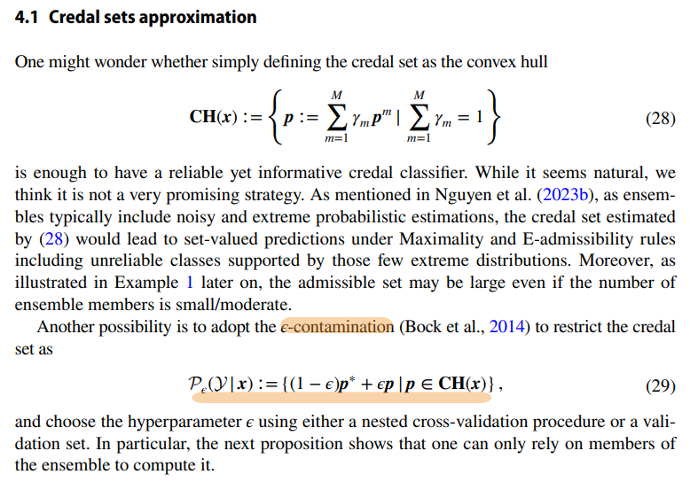

Again, not to diminish my position as 1st year phd, but the results I got with the codex actually look quite promising. It is difficult to discern between creativity and just "sloppy", you know?

But I uploaded the repo. We will use the following materials as reference:

- [Jupyter notebook with the main analisys](Uncertainty_Modeling/EU_AU_Disentanglement/REACH_AISTATS/dappr_epistemic_sets.ipynb)
    Note: The Jupyter notebook save at the end a folder within workbook section with its detail results. But you can use the one I saved already as reference.
- [Saved results with MNIST, EMNIST, MNIST-Fashion, MNIST-Blood](Uncertainty_Modeling/EU_AU_Disentanglement/REACH_AISTATS/workbook/dappr_epistemic_sets_seed0_20261028T102147697274Z)

Now, lets start with the definition of epistemic uncertainty. You can see at the notebook that he use the following formulation.

> For one input, let $p_1,\ldots,p_T$ be the K-class predictions from T dropout passes. With $u_t=1/T$, declare
> $$\mathcal W_\rho=\{w=(1-\rho)u+\rho q:\ q\in\Delta^{T-1}\},\qquad 0\leq\rho\leq1.$$

I think it gets this idea from the paper [Credal ensembling in multi‑class classification](https://doi.org/10.1007/s10994-024-06703-y). It seems to come from robust Bayesian inference (but I am not familiar with those kind of models yet). At the session 4.1 it have the following formulation.

but it seems that on the paper they optimize predictive entropy over the credal set, whereas our set optimizes mutual information over the admissible model weights. 

> Every dropout member retains weight at least $(1-\rho)/T$; the remaining mass can be reassigned. No OOD label chooses these weights or $\rho$.

For each allowed weight vector, compute the Probly entropy-based mutual information

$$\mathrm{EU}(w;x)=H\!\left(\sum_t w_t p_t(x)\right)-\sum_t w_tH(p_t(x)).$$

Our epistemic set is its image:

$$\mathcal E_\rho(x)=\{\mathrm{EU}(w;x):w\in\mathcal W_\rho\}=[L(x),U(x)].$$

Continuity and connectedness make this image an interval. EU is concave in the weights. The minimum is attained at one of T vertices of $\mathcal W_\rho$. The maximum is solved with Frank–Wolfe steps and a concavity-based tangent upper bound. We retain both `upper_attained` (a feasible value) and `upper` (the outer upper endpoint), with `optimization_gap` between them. All values are in **nats**.

- `rho=0`: the interval collapses to ordinary equal-weight dropout EU.
- `rho=1`: all weights are possible and the lower endpoint is zero because a single member may receive all mass.
- Midpoint `(lower+upper)/2` is the chosen scalar score. It is the mean under a uniform distribution on the **EU interval**, not an expected EU over weights and not a Bayesian estimate.

These endpoints bound this declared finite-sample model family. They are **not confidence or credible intervals** for true epistemic uncertainty. Increasing the set cannot discover hypotheses missing from the dropout sample.

Weights are varied **pointwise per input**; these are not joint bounds under one common posterior weight vector for the whole dataset.