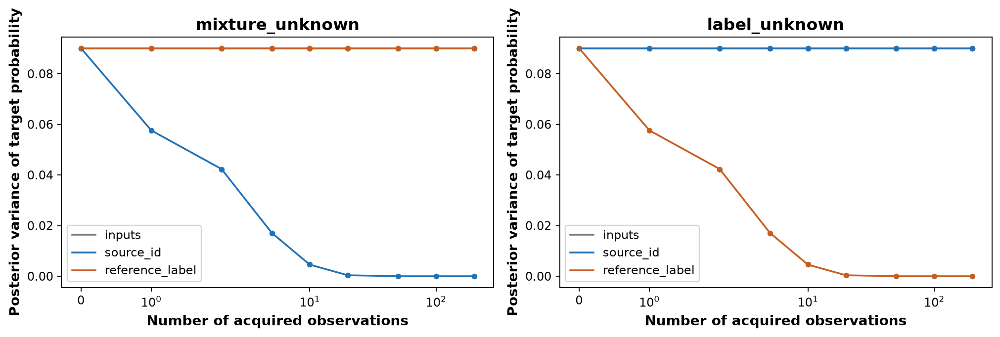
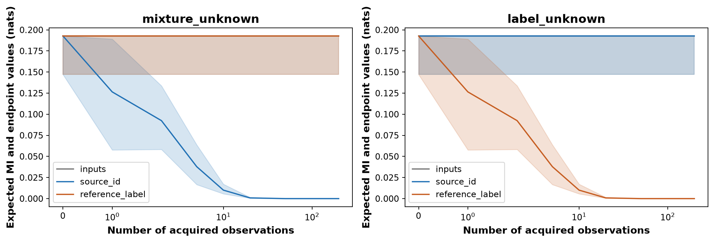
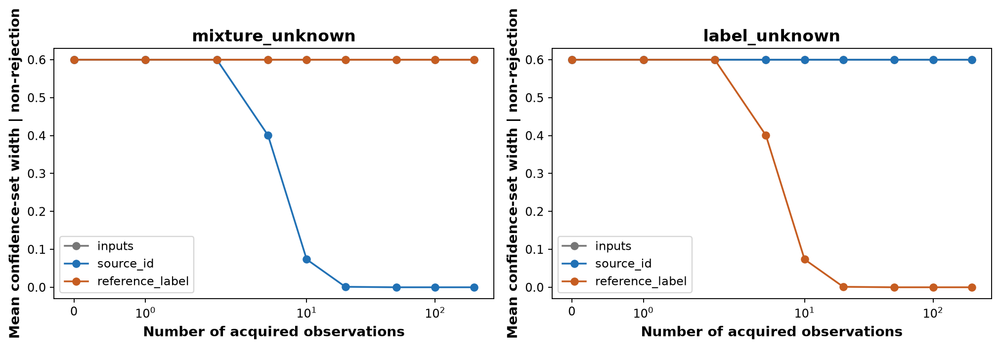
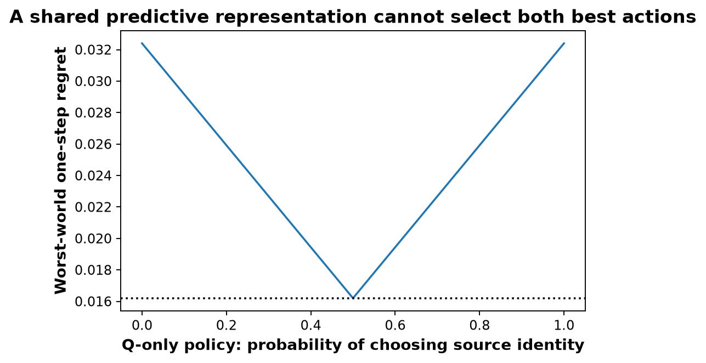

# Same predictive uncertainty, opposite useful acquisitions

This page collects all four saved figures, their interpretation, the exact counterexample, and complementary numerical checks.

**Main result:** two worlds have the same predictive distribution and initial epistemic uncertainty, yet source identities are useful in one and source-stratified labels are useful in the other. Choosing what to acquire requires knowing how each observation channel relates to the unknown parameters.

**Notebook coverage:** [executed.ipynb](executed.ipynb) embeds all four figures in section 6 and displays initial uncertainty, one-observation values, and selected simulation summaries as tables. The [source snapshot](source_notebook.ipynb) has its outputs cleared. All saved figures are embedded below, with the complementary table results summarized here.

For the full derivation, read [PROOF_AND_PROTOCOL.md](PROOF_AND_PROTOCOL.md) or the [editable notebook](../../acquisition_counterexample.ipynb). See also the [generated results](RESULTS.md) and [theoretical sources](SOURCES.md).

## Construction and acquisition channels

Both worlds have two sources, one uninformative input cell `X = 0`, and the same target **T = P(Y = 1)** in deployment. A latent hypothesis selects `p = 0.2` or `p = 0.8`, each with prior probability one half.

| Quantity | World M: `mixture_unknown` | World L: `label_unknown` |
|---|---|---|
| Deployment source proportion P(S = 1) | Unknown p | Known 0.5 |
| Source-0 target rate | Known 0 | Unknown p |
| Source-1 target rate | Known 1 | The same unknown p |
| Deployment target probability T | p | p |
| `inputs`: observe an unlabeled input | Always 0; uninformative | Always 0; uninformative |
| `source_id`: observe a deployment identity | Bernoulli(p); informative | Bernoulli(0.5); uninformative about p |
| `reference_label`: query a target label from source 0 | Always 0; uninformative | Bernoulli(p); informative |

Every acquisition costs one observation. The reference label comes from a known, deliberately selected source 0. An unstratified deployment label would instead be Bernoulli(p) in **both** worlds and help both; it is not the channel tested here.

Both worlds therefore have the same distribution over predictions: an equal-weight mixture of Bernoulli(0.2) and Bernoulli(0.8). Their full structural information differs, even though their predictive representations agree.

## Identical initial uncertainty

[Complete numerical table](identical_initial_uncertainty.csv)

| Quantity | Value in both worlds |
|---|---:|
| Predictive mean | 0.5 |
| Target probability support | {0.2, 0.8} |
| Posterior variance of T | 0.09 |
| Epistemic mutual information (MI) | 0.192744757 nats |
| Lower MI over prior weights q in [0.25, 0.75] | 0.147044215 nats |
| Upper MI over that family | 0.192744757 nats |

With binary entropy h and hypothesis weight q, the MI is `U(q) = h(0.2 + 0.6q) − (1−q)h(0.2) − qh(0.8)`. The notebook independently checks the nominal value using Probly, agreeing within `1e-12`. The lower/upper values use the explicit weighted formula over a declared prior-sensitivity family. They are **not confidence bounds estimated from data**.

## Exact one-observation counterexample

The acquisition value is expected reduction in posterior variance of **the probability T**, which is the Bayes risk for estimating T under squared error. It is not the variance of the binary outcome Y.

An informative observation updates the hypothesis weight from 0.5 to either 0.2 or 0.8, with equal marginal probability. Remaining variance is `0.6² × 0.2 × 0.8 = 0.0576`, so its value is `0.09 − 0.0576 = 0.0324`. An uninformative observation leaves the prior unchanged by Bayes' rule.

| World | Acquisition | Expected remaining variance | Variance reduction | Expected remaining MI (nats) |
|---|---|---:|---:|---:|
| M | Inputs | 0.0900 | 0 | 0.192744757 |
| M | Source identity | 0.0576 | 0.0324 | 0.126467034 |
| M | Source-0 label | 0.0900 | 0 | 0.192744757 |
| L | Inputs | 0.0900 | 0 | 0.192744757 |
| L | Source identity | 0.0900 | 0 | 0.192744757 |
| L | Source-0 label | 0.0576 | 0.0324 | 0.126467034 |

These are exact enumerations, independent of simulation: [one-observation table](one_observation_counterexample.csv), [all-budget expectations](exact_acquisition_values.csv).

## Figures and interpretation

The first three figures show World M on the left and World L on the right. Gray denotes inputs, blue source identities, and orange source-0 labels. Uninformative curves overlap. The horizontal axis uses a symmetric-log scale and budgets 0, 1, 2, 5, 10, 20, 50, 100, and 200 observations.

### Target-probability estimation risk

[Open PNG](risk.png) · [PDF](risk.pdf)

Lines show exact expected posterior variance; points show means over 10,000 repetitions. In World M, identities reduce risk while labels and inputs leave it at 0.09. In World L, labels reduce risk while identities and inputs leave it at 0.09. Initial predictive uncertainty cannot distinguish these opposite useful actions. At 20 informative observations, exact expected variance is approximately 0.000375757, compared with a simulated mean of 0.000380250.

### Updated epistemic MI and prior-sensitive bounds

[Open PNG](epistemic_bounds.png) · [PDF](epistemic_bounds.pdf)

Lines show exact expected MI. Shading spans the expected lower and upper MI endpoints obtained by updating the prior-weight family with the channel likelihood. It is neither a confidence band nor a range across repetitions. Expectations use the nominal q = 0.5 observation law; they are not worst-case expectations over the prior family.

The informative channel reduces expected MI in each world; uninformative channels retain the initial values. After one informative observation, expected MI is 0.126467034 nats and the expected endpoint range is [0.057667705, 0.189066776] nats. The initially identical bounds only develop different responses once the correct acquisition likelihood is supplied. Individual MI realizations need not decrease after every observation.

### Target-probability confidence-set width

[Open PNG](confidence_width.png) · [PDF](confidence_width.pdf)

This is a separate frequentist construction. For an informative channel at fixed sample size n, retain each candidate p in {0.2, 0.8} whose distance from the observed success frequency is at most `sqrt(log(2/0.05)/(2n))`. For uninformative channels, retain both candidates. Width is 0.6 when both remain and zero when only one remains.

Empty sets are recorded as rejections with missing endpoints, not as zero uncertainty. The plotted mean is **conditional on non-rejection**. At 50 informative observations, its value is zero, but rejection is 0.18% and inclusion is 99.82%. Read the width together with the inclusion and rejection table below.

This fixed-n confidence set has at least 95% inclusion under the declared model; it has no simultaneous-over-time guarantee. It differs from Bayesian support: both hypotheses retain positive posterior mass after any finite full-support Bernoulli sample in exact arithmetic, so Bayesian support width remains 0.6 even as posterior variance and MI become small.

### Regret of a policy using only the predictive representation

[Open PNG](policy_regret.png) · [PDF](policy_regret.pdf) · [Numerical curve](score_only_policy_regret.csv)

A policy receiving only the shared predictive representation must use the same action probabilities in both worlds. If it chooses identities with probability r and source-0 labels otherwise, regret is `0.0324(1−r)` in M and `0.0324r` in L. The minimum worst-world regret is **0.0162**, attained at r = 0.5; always selecting either action gives worst-world regret 0.0324. Allocating probability to inputs cannot improve this bound.

This is an exact one-step decision result. A rule given the world-specific channel likelihoods can select the useful action and avoids this restriction.

## Complementary simulation and validation results

The simulation uses seed 20261029 and 10,000 repetitions. Each repetition draws its true hypothesis once, then uses nested observation streams across budgets. The informative channels share paired observations across worlds, making their empirical results identical by design. Across two worlds, three channels, and nine budgets, [replicate_results.csv.gz](replicate_results.csv.gz) contains 540,000 rows.

The following table applies to either informative channel: identities in M or source-0 labels in L. Variances and confidence widths concern target probabilities, not entropy units.

| Observations | Exact expected variance | Simulated mean variance | Mean confidence width, non-rejected | Rejection | Inclusion |
|---:|---:|---:|---:|---:|---:|
| 0 | 0.09 | 0.09 | 0.6 | 0% | 100% |
| 1 | 0.0576 | 0.0576 | 0.6 | 0% | 100% |
| 2 | 0.042352941 | 0.042191782 | 0.6 | 0% | 100% |
| 5 | 0.017129241 | 0.017067115 | 0.4008 | 0% | 99.96% |
| 10 | 0.004553463 | 0.004587240 | 0.07356 | 0% | 99.89% |
| 20 | 0.000375757 | 0.000380250 | 0.00126 | 0% | 99.95% |
| 50 | 3.13209e-7 | 9.15093e-6 | 0 | 0.18% | 99.82% |
| 100 | 3.23842e-12 | 2.04637e-18 | 0 | 0.04% | 99.96% |
| 200 | 4.72545e-22 | 2.64018e-53 | 0 | 0.04% | 99.96% |

Source: [acquisition_summary.csv](acquisition_summary.csv), which also contains exact and simulated MI endpoints, Monte Carlo standard errors, and absolute variance errors. Uninformative channels retain variance 0.09 and confidence width 0.6 at every budget, with no rejection and 100% inclusion.

The largest absolute difference between simulated and exact expected variance is approximately 0.000161159. The executed notebook checks every setting against `6 × Monte Carlo standard error + 1e-10`. This is an absolute-error check: rare ambiguous outcomes can produce large relative discrepancies at tiny risks, as the high-budget rows show. The exact enumeration is the reference for those expectations. Finite simulations do not prove calibration, and repeated budgets/channels are dependent.

## What the result establishes

A predictive distribution over distributions can discard information about which unknown mechanism produced it. Any scalar or interval computed solely from that predictive representation also agrees across these worlds and therefore cannot universally select the best acquisition. The useful complement is the response to each acquisition channel.

This does not establish that MI incorrectly measures predictive disagreement, that prior-sensitive intervals are confidence intervals, or that DAPPr training fails. Correct Bayesian updating with the full likelihood succeeds. An arbitrary scalar could encode structural information; the counterexample concerns summaries restricted to the predictive representation.

The model is deliberately stylized: inputs are uninformative, hypotheses and priors are specified, source-0 labels are available, identities are perfect, and costs are equal. It isolates a logical insufficiency rather than measuring its frequency in natural-image datasets.

## Complete artifact index

| Artifact | Contents |
|---|---|
| [executed.ipynb](executed.ipynb), [source_notebook.ipynb](source_notebook.ipynb) | Executed narrative, code, tables, and figures; clean source snapshot |
| [RESULTS.md](RESULTS.md), [PROOF_AND_PROTOCOL.md](PROOF_AND_PROTOCOL.md) | Generated conclusion and full mathematical narrative/protocol |
| [SOURCES.md](SOURCES.md) | Theoretical dependencies and their roles |
| [identical_initial_uncertainty.csv](identical_initial_uncertainty.csv) | Matched initial predictive and epistemic quantities |
| [one_observation_counterexample.csv](one_observation_counterexample.csv) | Exact one-step action values |
| [exact_acquisition_values.csv](exact_acquisition_values.csv) | Exact expectations for every world, action, and budget |
| [score_only_policy_regret.csv](score_only_policy_regret.csv) | Exact regret curve for randomized predictive-only policies |
| [acquisition_summary.csv](acquisition_summary.csv) | Simulation means, exact comparisons, errors, inclusion, and rejection |
| [replicate_results.csv.gz](replicate_results.csv.gz) | Per-repetition posterior, target, MI, and confidence-set results |
| [acquisition_draws.npz](acquisition_draws.npz) | True targets and informative/uninformative identity draws; constant channels are specified in the protocol |
| [config.json](config.json) | Seed, repeats, budgets, prior family, confidence level, costs, and versions |
| [acquisition_counterexample.py](acquisition_counterexample.py) | Calculation/helper source snapshot |
| [test_acquisition_counterexample.py](test_acquisition_counterexample.py) | Saved test source |
| [build_acquisition_counterexample.py](build_acquisition_counterexample.py) | Notebook-builder source snapshot |
| [artifact_manifest.json](artifact_manifest.json) | Original run inventory and hashes; predates this README expansion |

All four saved PNG figures are embedded above and have linked PDF versions. No other standalone figures are saved in this run folder.
