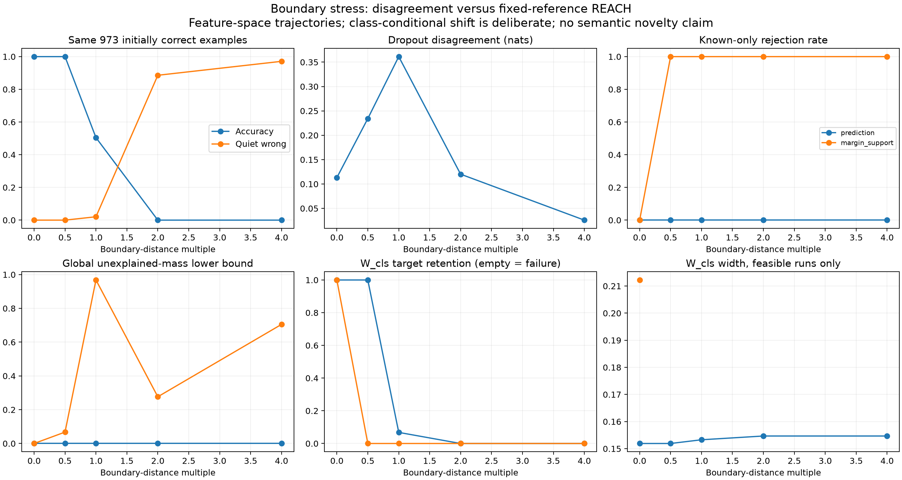

# Boundary trajectories: disagreement and fixed-reference REACH

The same attack trajectories expose two different failures. Dropout disagreement
falls after the decision boundary even though predictions are wrong.
Prediction-only REACH continues returning narrow, incorrect class intervals.
A partition that retains margin and support information instead rejects the
clean source family. This is evidence that the partition matters, not that
REACH automatically avoids the disagreement blind spot.

## Experimental design

This transfers the boundary-path idea from `eu_blindspot.ipynb` to the saved
MNIST experiment; it does not rerun the CLIP/CIFAR notebook. The model is the
original frozen MNIST CNN encoder with its saved 64-feature linear head and
input dropout .2. That head was fitted to 4000 training images for 100 epochs.
Calibration uses 3000 separate development images. It has ten digit outputs,
not the notebook's learned K+1 unknown output.

The saved test population contains 100 examples per digit (1000 total), of
which 973 were initially classified correctly. Each initially correct feature
vector moves toward its nearest linear decision plane by 0, .5, 1, 2 or 4 times
its boundary distance. Initially incorrect rows remain unchanged. At depth 1,
ties make the exact predicted label numerically sensitive; five predictions
differ from the historical run. All predictions at other depths match.
Dropout scores were recomputed on the exact feature arrays used here with 100
passes and fixed MC seed 20261024 at each depth.

The perturbations are in feature space. They need not correspond to realizable,
label-preserving images. Original labels are carried along the trajectories as
the stress-test convention. They are never provided to the interval solver.

Two fixed partitions are compared:

- **prediction:** ten predicted-class cells.
- **margin_support:** predicted class x low-margin indicator x far-from-known
  indicator, giving 40 cells. Thresholds are the saved development-set 10th
  percentile of margin and 95th percentile of minimum LDA distance. They are
  not retuned on attacked examples.

For each of ten acquisition seeds, 1000 clean reference draws per digit and
4000 deployment draws are sampled independently with replacement from the
finite test population. Identical row indices are reused across depths and
partitions. Reference rows always come from clean features; the deployment
rows follow the attack trajectories. Source proportions remain uniform.

Thus the experiment deliberately changes class-conditional cell laws while
holding the reference model fixed. Post-attack retention is a diagnostic under
misspecification, not a promised confidence-coverage property.

## What each reported quantity means

- **Dropout EU:** entropy of the mean prediction minus mean per-pass entropy.
- **Quiet wrong:** wrong prediction with both TU and EU below their fixed
  clean-validation 90th-percentile thresholds.
- **W_cls:** width of the predicted digit's cell posterior under the known-only
  joint-mass region, using clean references. An incompatible region is an
  empty set; its width is NaN, not zero or one.
- **W_label:** reference-anchored binary-target width. Target rates are simulated
  as linspace(.1,.9,10), with 512 target labels per digit and known flip rate .2.
  These source labels and references remain fixed across attack depths.
- **W_residual:** width for membership in an unrestricted extra source under
  a separate augmented region. It is unexplained mass relative to clean rows,
  not semantic novelty and not the probability that a point was attacked.
- **Global residual lower bound:** minimum total mass that cannot be explained
  by the clean known-source mixture within the confidence bounds.

The nominal .05 error allocation is .025 for known references, .0125 for the
deployment log and .0125 for target labels. No candidate reference law is
provided. The extra source is unrestricted. The same joint-mass construction
is used for both partitions.

## Results on the same 973 initially correct examples

| Depth | Accuracy | Mean dropout EU | Quiet wrong | Prediction-only rejection | Margin/support rejection |
|---|---:|---:|---:|---:|---:|
| 0 | 100% | .113 | 0% | 0/10 | 0/10 |
| .5 | 100% | .234 | 0% | 0/10 | 10/10 |
| 1 | 50.5% | .361 | 2.1% | 0/10 | 10/10 |
| 2 | 0% | .120 | 88.6% | 0/10 | 10/10 |
| 4 | 0% | .026 | 97.1% | 0/10 | 10/10 |

EU peaks at the boundary and becomes smaller than its clean value deep on the
wrong side. This is the intended boundary blind-spot contrast.

**Prediction-only REACH also misses the problem.** Its mean W_cls is .152 at
depth 0 and .155 at depths 2 and 4. At those latter depths, mean endpoints are
approximately [.840,.994], yet none of the evaluated cell targets is retained.
The representation allows changed class composition within cells to be explained
as changes in source weights. Compatibility of the predicted-class histogram
does not establish the validity of the clean source laws.

**The margin/support partition warns by rejection.** It rejects the clean
family in all ten draws at every nonzero depth. There are therefore no valid
known-only class interval outputs there after rejection. The zero target
retention shown for those empty sets must not be confused with confidently
incorrect feasible intervals from the prediction-only partition.

Its mean global unexplained-mass lower bounds at depths .5, 1, 2 and 4 are
respectively .067, .968, .277 and .705. The nonmonotonic curve matters: near
the boundary, many observations enter low-margin cells; farther beyond it,
large margins return while distance-based support information becomes useful.
This experiment combines those signals and does not isolate their individual
contributions. Rejection at depth .5, while accuracy remains 100%, is a warning
of distribution change, not a detector calibrated to classification errors.

## Label widths and aggregation

For a fixed cell and acquisition seed, W_label, its endpoints and its clean
reference-anchored target are exactly unchanged across all depths. This was
checked explicitly. It is not designed to estimate attack-induced classifier
error. Its displayed deployment-weighted mean can change because the trajectory
moves observations between cells. For margin/support it changes from .338 to
.674 between depths 0 and 4; this is a composition effect, not new label evidence.

Summaries weight cells by their occupancy among the same 973 initially correct
examples, then average acquisition seeds. The underlying target probabilities
are computed from the whole uniform-class finite population. Per-cell endpoints,
statuses, target values and quiet-wrong counts are saved in `intervals.csv`.
Undefined reference-label targets are excluded from target-retention denominators
and their fractions are recorded in the per-seed summary. Empty known-only sets
count as non-retention and are excluded from mean widths; rejection is separate.

## Checks, limits and next decision

The 7500 interval records and 10000 paired point/partition records passed
independent checks, including five analytic LP cases, endpoint identities,
occupancy weights, quiet-wrong counts, EU bounds and per-cell label invariance.
LP residual checks run during inference. Model and source-input provenance is
recorded in `config.json`; the historical tie audit is saved separately.

These are ten paired acquisition draws around one trained head, one calibration
set and one fixed finite population. There is no claim of general OOD detection,
new-image coverage or equivalence between unexplained mass and semantic novelty.
We compare dropout disagreement here, not bootstrap-ensemble disagreement.
Run `run.py` then `validate.py` in the reach-aistats environment to reproduce.

The next decisive controls are: margin-only versus support-only partitions;
matched random feature displacements; and source-weight shifts that preserve
clean class-conditionals. They would separate a useful shift warning from a
generic response to perturbation or an error detector. Image-space changes and
additional training seeds should follow before generalizing to real OOD inputs.
