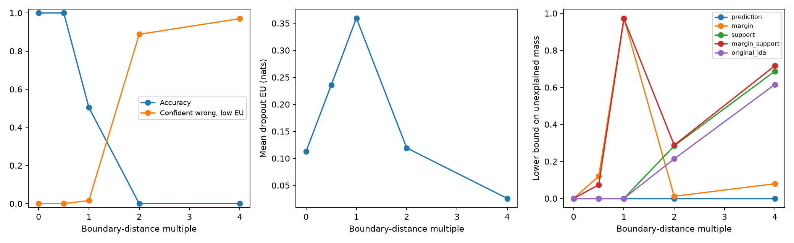

# Boundary information in REACH — 2026-10-20

## Outcome

The boundary effect reproduces on our frozen MNIST representation. Dropout
disagreement peaks near a classifier boundary and becomes small again for many
confidently wrong predictions. A REACH region built only from predicted labels
misses these shifts. Adding margin and support-distance bins exposes different
parts of the path. This is evidence for enriching the partition, not treating
dropout EU as a universal novelty detector.

## Controlled setup

The saved DigitNet encoder is frozen. A new 10-class linear head with input
dropout 0.2 is trained for 100 epochs on 4,000 images from the original CNN
training split. This head starts from seed 20261020; no pretrained weights are
downloaded. Calibration uses 3,000 disjoint images from the original development
split. The test population contains the first 100 images of each digit class in
MNIST test (1,000 total). These are separate from both training and calibration.

The new head correctly classifies 973 test images initially. Each initially
correct feature is moved toward its nearest linear decision plane. Its first
crossing distance is computed exactly as the minimum positive logit gap divided
by the corresponding weight-difference norm. We evaluate multiples 0, 0.5, 1, 2
and 4 of that distance. Initially incorrect features remain unchanged. All
boundary-score summaries below use the same 973 initially correct examples.

These are feature-space perturbations. They need not be realizable digit images,
and their original labels do not turn into semantic unknown classes. At exactly
one boundary distance, classification depends on numerical tie-breaking; the
roughly 50% accuracy there is not a robustness estimate.

Dropout scores use 100 stochastic passes. Both TU and EU warning thresholds are
fixed at their calibration-set 90th percentiles. "Quiet wrong" means a wrong
prediction with both TU and EU at or below their respective thresholds.

## The uncertainty blind spot reproduces

| Boundary multiple | Accuracy | Mean dropout EU | EU AUROC, attacked vs clean | Quiet wrong fraction |
| ---: | ---: | ---: | ---: | ---: |
| 0 | 1.000 | 0.113 | 0.500 | 0.000 |
| 0.5 | 1.000 | 0.236 | 0.818 | 0.000 |
| 1 | 0.504 | 0.360 | 0.938 | 0.016 |
| 2 | 0.000 | 0.119 | 0.528 | 0.888 |
| 4 | 0.000 | 0.026 | 0.121 | 0.970 |

High EU detects the boundary regime well. Deeper into the wrong side, the model
becomes confident and its dropout predictions agree again. Low EU therefore does
not certify correctness or familiarity, even on this fixed representation.

## Applying the insight to REACH

We compare five fixed partitions, calibrated before test perturbations:

* **prediction:** the new head's predicted class (10 cells).
* **margin:** predicted class × low/high top-two logit margin (20 cells); low means
  below the calibration margin's 10th percentile.
* **support:** predicted class × near/far minimum Mahalanobis distance (20 cells);
  far means above the calibration distance's 95th percentile, using the saved LDA.
* **margin_support:** the two binary indicators together (40 cells).
* **original_lda:** the original frozen 11-cell MNIST partition.

For inference, independent reference and deployment draws are simulated from the
finite test population. Clean references draw m examples per class; deployment
draws n rows from the balanced population at the selected perturbation depth.
Identical row draws are shared across partitions and depths within a seed/budget.
This isolates geometry and region construction from reference/deployment sampling
differences. Ten sampling seeds are used per budget; there is only one trained head.

The count-based joint region uses simultaneous Clopper-Pearson cell intervals:
alpha=.025 for all reference entries and .025 for all deployment cells, with
Bonferroni correction within each block. It augments the ten clean source rows
with an unrestricted residual row and minimizes its global mixture weight.

**This lower endpoint is unexplained mass under the stable-clean-source model.
It is not a semantic-novelty probability, an error rate, or the fraction of rows
we perturbed.** Selective transformations change class conditionals, so the
unperturbed remainder need not itself follow the original source distributions.
The unrestricted residual is an explanation for model mismatch, not a new class.

At n=4,000 and m=1,000 per class, mean lower endpoints are:

| Partition | Halfway to boundary | At boundary | Twice boundary distance | Four times distance |
| --- | ---: | ---: | ---: | ---: |
| Predicted class | 0.000 | 0.000 | 0.000 | 0.000 |
| Class + margin | 0.120 | 0.974 | 0.012 | 0.079 |
| Class + support distance | 0.000 | 0.000 | 0.284 | 0.687 |
| Class + margin + support | 0.074 | 0.971 | 0.288 | 0.717 |
| Original LDA cells | 0.000 | 0.000 | 0.214 | 0.615 |

Prediction-only cells allow changed predictions to be explained by changed class
prevalences. They contain no information about proximity to a boundary or the
known feature distribution. Margin cells expose the boundary but largely lose
the signal once margins grow again. Distance cells retain evidence in the deep
wrong regime. The combined partition detects all four nonzero depths in all ten
sampling seeds at the larger budget. No partition flags the clean control in any
of these ten seeds at either budget; this small check is not a false-positive-rate
certification.

More cells are not automatically better. At the smaller budget n=1,000, m=200,
support-only gives mean lower mass 0.119 at depth 2, while the combined partition
gives 0.034 and flags 9/10 seeds. The larger simultaneous confidence penalty and
sparser counts offset some representational benefit. At the boundary, however,
margin cells already give a mean lower mass of 0.900 at that smaller budget.

The CSV also records compatibility with the existing MMD-radius formula, using
the same two-way alpha split and known-only source family. At n=1,000, m=200,
this MMD check detects the depth-4 shift with the original LDA cells but misses
the margin-boundary shift. At the larger budget it detects that boundary shift
when margin cells are supplied. Thus both the representation of observations
and the confidence construction affect sensitivity. This is not a rerun of the
historical Fashion/Blood novelty experiment, which used a different source family.



## What this supports changing

Keep margin information and feature-support information as distinct observations
in REACH. A boundary score alone can miss confident errors; a class-count
partition can absorb them as label shift. Use the coherent joint region to
report unexplained mass, and keep its interpretation separate from semantic
novelty, prediction error and EU/AU decomposition. Compare coarser and richer
partitions at the actual acquisition budget rather than assuming finer is better.

The next external-validity check is the same fixed-partition comparison on the
Fashion/Blood populations, followed by actual image corruptions and multiple
trained heads. The present result establishes a controlled mechanism, not
general detection performance or population coverage.

## Reproduce

From REACH_AISTATS, using the existing reach-aistats environment:

```bash
python workbook/boundary_reach_2026-10-20/run.py
```

`scores.csv` contains per-image uncertainty and geometry; `boundary_summary.csv`
contains the first table; `regions.csv` contains all 500 inference runs;
`region_summary.csv` aggregates the ten seeds. The configuration includes the
encoder hash and thresholds. `experiment_inputs.npz` saves head parameters,
test features and split IDs; `boundary_head.pt` saves the head state. No new
dataset downloads are required, but the existing MNIST cache is needed.
