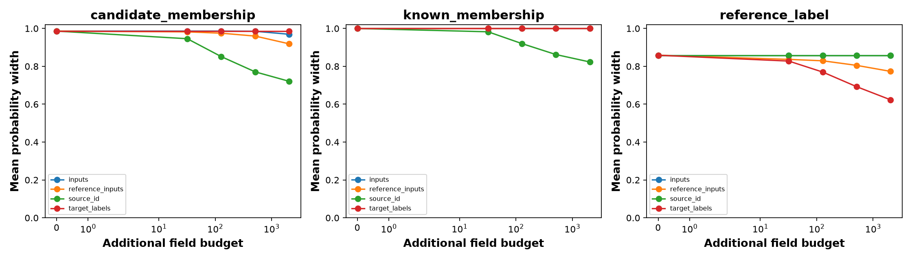

# CAMELYON17 image acquisition pilot

This page collects the saved acquisition figure, its interpretation, and complementary classification, OOD detection, data-split, and source-law diagnostics.

**Result:** acquiring source identities reduces membership ambiguity most among the tested channels, while stratified tumor labels reduce the reference-label probability width. Nevertheless, intervals remain broad, and reference/evaluation source-cell laws differ substantially. This completed pilot does not establish method superiority or a neural acquisition counterexample.

**Notebook coverage:** [executed.ipynb](executed.ipynb) embeds the acquisition figure in section 5 and displays split counts, classification accuracy, OOD metrics, and acquisition summaries as tables. The [source snapshot](source_notebook.ipynb) has no saved figures. The README embeds the sole saved plot below and includes the complementary numerical results, including the source-law audit that the notebook exports without displaying.

See the [generated result report](RESULTS.md), [machine-readable result](result.json), [sources and their roles](SOURCES.md), and [editable notebook](../../camelyon17_acquisition.ipynb).

## Data, sources, and training

The task uses real CAMELYON17 histopathology images and the recorded tumor label (`tumor = 1`). Known sources are hospitals 0 and 3; the specified candidate source is hospital 2. This is hospital/domain novelty, not held-out-class novelty.

**Source codes in the CSV files are remapped:** internal source 0 means hospital 0, internal source 1 means hospital 3, and internal source 2 means hospital 2. In particular, the `source = 1` accuracy row is hospital 3.

Patients are assigned to fit/reference/evaluation roles by a seeded identity hash, targeting approximately 60%/20%/20% per source. All images of a patient remain in one role. This is a custom group-disjoint split, not the official WILDS benchmark split.

| Hospital | Role | Available records | Patients | Selected images |
|---|---|---:|---:|---:|
| 0 | evaluation | 13,637 | 1 | 2,000 |
| 0 | fit | 26,940 | 5 | 2,000 |
| 0 | reference | 18,859 | 1 | 2,000 |
| 2 | evaluation | 4,556 | 1 | 2,000 |
| 2 | fit | 67,756 | 7 | 2,000 |
| 2 | reference | 12,742 | 1 | 2,000 |
| 3 | evaluation | 21,284 | 2 | 2,000 |
| 3 | fit | 98,515 | 6 | 2,000 |
| 3 | reference | 10,039 | 2 | 2,000 |

The audited pool contains 274,328 records from 26 patients. The pilot selects 18,000 images: 2,000 per hospital and role, without class balancing. There are only **four evaluation patients**: one each from hospitals 0 and 2, and two from hospital 3. Image counts are not counts of independent patients. Equal image caps also change the source proportions relative to the original pool.

A frozen ImageNet-pretrained ResNet18 produces 512-dimensional features. CE and DAPPr heads train for 30 epochs on the 4,000 known-source fit images with matched initialization/minibatch seeds. Candidate-source labels are excluded from neural training. CE uses 30 MC-dropout passes through Probly. Four KMeans cells are fitted using known-source fit features only. This is a frozen-encoder pilot rather than end-to-end benchmark training.

Provenance: [data audit](data_audit.json), [split counts](split_counts.csv), [selected images](selected_images.csv), [encoder metadata](encoder.json), and [protocol](protocol.json). The recorded transport source is a pinned third-party CAMELYON17 mirror; it is not independently verified as an official copy. FMoW and matching parameters appearing in the shared protocol/source narrative do not constitute FMoW results or a matched-counterexample test in this run.

## Acquisition targets and observations

The compatible set contains nonnegative joint source/cell masses summing to one. Reference observations constrain source-conditional cell laws, deployment inputs constrain cell marginals, and identities constrain source proportions. Linear-fractional optimization produces endpoints within that set.

| Target | Probability being bounded |
|---|---|
| `candidate_membership` | P(source = 2 given cell): membership in the specified candidate hospital |
| `known_membership` | P(source = 0 given cell and membership in either known source); not the overall probability of being ID |
| `reference_label` | Tumor probability at the cell under fixed, equal known-source reference weights, using source-and-cell-conditional target rates; not deployment tumor prevalence |

Baseline information consists of 128 reference inputs per source, 128 deployment inputs, 32 deployment identities, and 16 target labels per known-source/cell stratum. Acquisition resamples real records with replacement, conditional on the retained empirical populations. Five repeats share the fixed feature/cell map; they are not five independent model fits.

| Acquisition arm | Added fields at displayed budget b | Information updated |
|---|---|---|
| `inputs` | b | Deployment cell frequencies |
| `source_id` | b | Deployment source proportions |
| `reference_inputs` | 3 × floor(b/3) | Reference cell laws across all three sources, including the candidate |
| `target_labels` | 8 × floor(b/8) | Tumor rates within two known sources × four cells |

Budgets are 0, 32, 128, 512, and 2,048. At the maximum, reference acquisition adds 2,046 fields; other arms add 2,048. The reference service supplies stratum selection, and unrequested fields are hidden. This field accounting is not a measured clinical acquisition cost.

## Acquisition figure and interpretation

[Open acquisition figure](acquisition_bounds.png) · [Summary data](acquisition_summary.csv) · [All interval endpoints](acquisition_intervals.csv)

Panels run left to right: candidate membership, known membership, and reference-label probability. Each point averages widths **equally across four cells and five repeats** (20 intervals), rather than weighting cells by image frequency. The horizontal axis uses a symmetric-log scale. There are no repeat-range or confidence bands.

| Added acquisition | Candidate membership width | Known membership width | Reference-label width |
|---|---:|---:|---:|
| Baseline | 0.986048 | 1.000000 | 0.858547 |
| Inputs, budget 2,048 | 0.969357 | 1.000000 | 0.858547 |
| Reference inputs, budget 2,048 | 0.918922 | 1.000000 | 0.773306 |
| Source identities, budget 2,048 | 0.720980 | 0.822966 | 0.858547 |
| Target labels, budget 2,048 | 0.986048 | 1.000000 | 0.623074 |

Source identities reduce candidate width from 0.986048 to 0.720980 and known-membership width from 1 to 0.822966. Inputs alone make little difference; references improve candidate width to 0.918922 but leave mean known-membership width at 1. Target labels reduce reference-label width from 0.858547 to 0.623074, while leaving membership intervals unchanged. Inputs and identities leave the reference-label target unchanged because its source weights are fixed.

These responses depend on what each channel observes. The residual widths remain large: this run does not show that any target is precisely identified. The three widths concern different probabilities and are not an additive epistemic/aleatoric decomposition. No exact input-only population floor is computed here.

### Feasibility and denominator checks

There are 1,200 intervals: five repeats × four arms × five budgets × four cells × three targets. None are empty. In 366 cases (30.5%), possible zero conditioning mass triggers the explicit `[0, 1]` undefined-denominator policy; the remaining 834 have status `ok`. The largest recorded solver residual is approximately `3.99e-14`.

At maximum budget, undefined-denominator fractions are:

| Arm | Candidate membership | Known membership | Reference label |
|---|---:|---:|---:|
| inputs | 0% | 75% | 15% |
| reference_inputs | 0% | 25% | 0% |
| source_id | 0% | 15% | 15% |
| target_labels | 30% | 75% | 15% |

The pooled mean width in [result.json](result.json) is 0.916455, but it pools different targets, cells, actions, and budgets and is not a single scientific uncertainty score. There are no truth/inclusion columns in the saved acquisition interval table, so this run does not report empirical target coverage. No empty sets and small solver residuals do not establish that the model transfers between patients.

## Source-law transfer diagnostic

The method assumes source-conditional cell laws transfer from reference to evaluation populations. The exported audit shows differences that matter for interpreting that assumption.

| Hospital (internal source) | Reference cell probabilities, cells 0–3 | Evaluation cell probabilities, cells 0–3 | Total variation distance |
|---|---|---|---:|
| 0 (0) | 0.1570, 0.3235, 0.2735, 0.2460 | 0.1260, 0.0430, 0.4225, 0.4085 | 0.3115 |
| 3 (1) | 0.2705, 0.5835, 0.1165, 0.0295 | 0.1465, 0.7830, 0.0580, 0.0125 | 0.1995 |
| 2 (2) | 0.3080, 0.1150, 0.0045, 0.5725 | 0.6695, 0.0425, 0.0055, 0.2825 | 0.3625 |

Total variation here is calculated directly from [source_cell_law_audit.csv](source_cell_law_audit.csv) as half the sum of absolute cell-probability differences. These are descriptive distances, not hypothesis tests. For example, hospital 0 puts 32.35% of reference images in cell 1 but only 4.30% of evaluation images there. Group separation prevents patient leakage; it does not enforce stable cell laws.

The saved per-box error allocation is approximately `3.84615e-5`, from a 0.05 union allocation across the run. Its interpretation is conditional empirical-resampling box coverage. Reference/evaluation transfer requires the additional source-law assumption, and the audit provides reason to question that assumption here. The bounds therefore do not establish 95% coverage for new patients or clinical populations.

## Complementary classification results

[accuracy.csv](accuracy.csv) reports 2,000 evaluation images per hospital and method.

| Hospital | Role | CE accuracy | DAPPr accuracy |
|---|---|---:|---:|
| 0 | Known | 94.90% | 93.95% |
| 3 | Known | 92.30% | 93.65% |
| 2 | Candidate | 60.05% | 62.15% |

Both heads perform substantially worse on the candidate hospital. The small number of evaluation patients limits generalization; these are custom-split patch accuracies, not official WILDS benchmark scores. Candidate hospital labels are used for evaluation, not neural training.

## Complementary OOD detection results

OOD is hospital 2 (2,000 images); ID combines hospitals 0 and 3 (4,000 images). Higher scores indicate greater OOD suspicion. The following are the saved tie-correct metrics from [ood_scores.csv](ood_scores.csv).

| Score | OOD AUROC | OOD AUPR | FPR at 95% TPR |
|---|---:|---:|---:|
| mc_mi | 0.689740 | 0.548468 | 0.792000 |
| mc_width | 0.685306 | 0.543880 | 0.792000 |
| dappr_eu | 0.597348 | 0.358643 | 0.725750 |
| negative_max_softmax | 0.623507 | 0.435243 | 1.000000 |

MC MI and finite-sample probability-envelope width have the highest AUROC in this run, approximately 0.690 and 0.685. False-positive rates at the reported 95% detection point remain high. These descriptive rankings have no patient-level confidence intervals and do not establish general superiority or acquisition sufficiency.

The CSV also includes ID-oriented AUPR and raw Probly AUROC. The notebook records a tie-handling issue in the installed Probly version: for negative maximum softmax, raw AUROC is 0.658022 versus tie-correct 0.623507. Use the tie-correct `auroc` column for these comparisons.

MC envelopes bound class probabilities only over the 30 sampled predictors; they have no population coverage guarantee. DAPPr's scalar is K/sum(alpha). Source-compatible bounds instead concern source membership or the reference-label event. Sharing a lower/upper software interface does not make those quantities estimates of the same object or equal-information competitors.

## Complete artifact index

| Artifact | Contents |
|---|---|
| [executed.ipynb](executed.ipynb), [source_notebook.ipynb](source_notebook.ipynb) | Executed notebook and archived source |
| [RESULTS.md](RESULTS.md), [result.json](result.json), [execution_status.json](execution_status.json) | Run summary and completion status |
| [SOURCES.md](SOURCES.md), [protocol.json](protocol.json), [bounds_definition.json](bounds_definition.json) | Foundations, frozen protocol, target definitions, and guarantee scope |
| [data_audit.json](data_audit.json), [split_counts.csv](split_counts.csv), [record_index.csv.gz](record_index.csv.gz) | Dataset provenance, patient counts, and full record partition |
| [selected_images.csv](selected_images.csv) | Selected image identities, sources, roles, and labels |
| [encoder.json](encoder.json), [features.npz](features.npz), [feature_scaler.pt](feature_scaler.pt) | Encoder metadata, cached features, and scaling state |
| [ce_head.pt](ce_head.pt), [dappr_head.pt](dappr_head.pt), [training_history.csv](training_history.csv) | Trained heads and training history |
| [accuracy.csv](accuracy.csv), [ood_scores.csv](ood_scores.csv), [image_scores.csv](image_scores.csv) | Classification/detection metrics and per-image scores |
| [mc_representation.npz](mc_representation.npz) | Saved MC predictive representation |
| [cell_centers.npy](cell_centers.npy), [reference_cells.csv](reference_cells.csv), [evaluation_cells.csv](evaluation_cells.csv) | Frozen cell map and record-to-cell assignments |
| [source_cell_law_audit.csv](source_cell_law_audit.csv) | Reference/evaluation source-law diagnostic |
| [acquisition_record_ids.json](acquisition_record_ids.json) | Resampled record streams, retained for acquisition auditing |
| [acquisition_intervals.csv](acquisition_intervals.csv), [acquisition_summary.csv](acquisition_summary.csv) | All endpoints, widths, statuses, residuals, and aggregate curves |
| [source_representation.npz](source_representation.npz) | Baseline source-membership representation for repeat 0 |
| [wilds_vision.py](wilds_vision.py), [wilds_records.py](wilds_records.py) | Archived training, acquisition, and dataset code |
| [source_acquisition.py](source_acquisition.py), [probability_bounds.py](probability_bounds.py) | Compatible-set solver and representation adapters |
| [beta_acquisition.py](beta_acquisition.py), [wilds_counterexample.py](wilds_counterexample.py), [build_wilds_notebooks.py](build_wilds_notebooks.py) | Additional shared implementation and notebook-builder snapshots; their presence is not a counterexample result |
| [versions.json](versions.json), [artifact_manifest.json](artifact_manifest.json) | Package versions and original artifact hashes; the manifest predates this README |

The acquisition PNG is the only standalone figure saved in this run; no PDF version is present. Accuracy, detection, source-law, and failure-status results are included above as tables so the README can be read without Jupyter.
