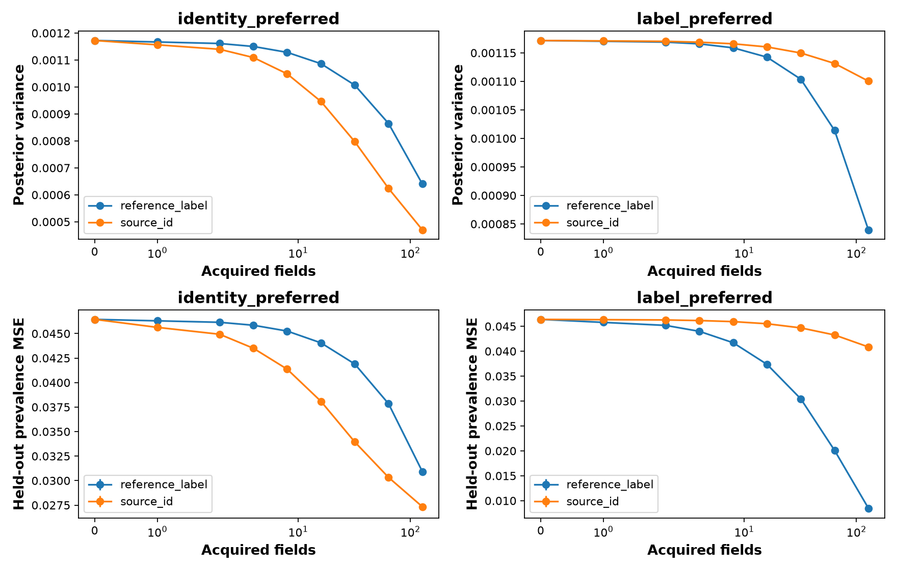

# CAMELYON17 real-record acquisition counterexample

This page collects the acquisition figure, its interpretation, the selected information states, exact held-out results, and complementary population and numerical checks.

**Result:** 39 pairs among 600 candidate information states met the fixed matching criteria. The selected pair has nearly identical predictive MI, means, and variances, yet opposite useful acquisitions. Both prespecified held-out one-step advantages are positive, so this run records `confirmed: true`.

This is a **selected near-match under a declared Beta model**, using recorded hospital identities and tumor labels. The target is population tumor prevalence. The calculation does not condition on image pixels and is not a neural prediction counterexample or an exact-equality theorem.

**Notebook coverage:** [executed.ipynb](executed.ipynb) embeds the sole saved figure in section 3 and displays split counts, the result report, and selected states. Additional exported tables are summarized below. The [source notebook](source_notebook.ipynb) has no embedded figures. See also the [editable notebook](../../camelyon17_counterexample.ipynb), [RESULTS.md](RESULTS.md), [SOURCES.md](SOURCES.md), and [post-run review](REVIEW.md). The review covers companion experiments too; their image-model results are not results of this counterexample run.

## Data and the shared target

Only the two known hospitals enter the counterexample: hospital 0 is internal source 0, and hospital 3 is internal source 1. Hospital 2 is retained in the full dataset audit but excluded from this two-source search and validation. The source codes in CSV files are therefore not all hospital numbers.

The custom split assigns whole patients by a seeded identity hash, aiming for approximately 60% fit, 20% reference, and 20% evaluation per source. The counterexample uses fit records for initial states and evaluation records for validation; reference records are not used by this calculation. It uses the full eligible record pools, not the companion image pilot's 2,000-image caps.

| Hospital | Fit records / patients | Evaluation records / patients | Fit tumor rate | Evaluation tumor rate |
|---|---:|---:|---:|---:|
| 0 | 26,940 / 5 | 13,637 / 1 | 28.2220% | 92.7550% |
| 3 | 98,515 / 6 | 21,284 / 2 | 65.5149% | 0.1456% |

Sources: [split_counts.csv](split_counts.csv), [population_rates.csv](population_rates.csv). There are only **three evaluation patients** in these two hospitals. Resampling their records does not produce new independent patients. These are custom-split empirical populations, not official WILDS benchmark scores or clinical prevalence estimates.

Let W be the proportion of internal source 1 and Theta_s its source-specific tumor rate. Both information states estimate the same quantity:

`T = (1 − W) × Theta_0 + W × Theta_1`.

Independent Beta(1,1) priors on W, Theta_0, and Theta_1 are updated with recorded observations. Acquiring a random deployment identity updates W. Acquiring a `reference_label` chooses one of the two known sources with equal probability and reveals a tumor label from that source, updating its Theta. During validation these labels come from **evaluation** records despite the action name. Both actions have unit field cost by assumption.

## Search protocol and selected pair

The fixed grid combines six initial identity budgets (0, 2, 8, 32, 128, 512), five initial label budgets per source (2, 8, 32, 128, 512), and 20 repetitions: 600 states. Qualification requires:

- Relative MI difference at most 1%.
- Absolute predictive-mean difference at most 0.02.
- Relative target-variance difference at most 10%.
- Opposite preferred actions, each with at least a twofold posterior Bayes-value margin.

Relative differences use the average of the two values as denominator. The pair with smallest MI discrepancy is selected, breaking ties by state IDs, without using evaluation outcomes. [protocol.json](protocol.json), [candidate_states.csv](candidate_states.csv), and [qualifying_pairs.csv](qualifying_pairs.csv) retain the search and all 39 qualifying pairs. That count is not an estimate of how common this behavior is in natural populations.

| Quantity | State 390: identity preferred | State 566: label preferred |
|---|---:|---:|
| Initial identities | 32 | 512 |
| Initial labels per source | 512 | 128 |
| Posterior mean of T | 0.578622110 | 0.578479497 |
| Posterior variance of T | 0.001172469768 | 0.001171679121 |
| Predictive MI (nats) | 0.002407061568 | 0.002407470826 |
| One-step identity Bayes value | 2.5699229e-05 | 9.44366631e-08 |
| One-step label Bayes value | 2.61067433e-07 | 4.28236552e-06 |

The MI relative difference is **0.0170009%**, well below the 1% cutoff. The posterior means differ by approximately 0.000142613. Identity Bayes value exceeds label value by about 98.44× in state 390; label value exceeds identity value by about 45.35× in state 566.

These Bayes values are expected posterior-variance reductions under each state's model, not the measured held-out MSE improvements. The two states also start with different amounts of information; equal unit costs apply to subsequent acquisitions, not their historical observation totals.

The saved Beta shapes, ordered as W, Theta_0, Theta_1, are:

- State 390: Beta(26,8), Beta(133,381), Beta(348,166).
- State 566: Beta(403,111), Beta(36,94), Beta(86,44).

See [selected_states.csv](selected_states.csv) and [initial_observation_ids.json](initial_observation_ids.json) for the exact states and sampled record identities.

## Exact held-out one-step result

The selected states are frozen before validation. The code enumerates possible next observations using actual held-out source proportions and tumor rates, then evaluates squared error against the **same held-out prevalence** for both states. This expectation is exact for the finite empirical population; it is independent of the 2,000-repeat trajectory estimate.

| State | Initial squared error | Expected error after one identity | Expected error after one label | Advantage of preferred action |
|---|---:|---:|---:|---:|
| 390: identity preferred | 0.046447498 | 0.045685367 | 0.046297713 | 0.000612346 |
| 566: label preferred | 0.046386047 | 0.046330043 | 0.045774677 | 0.000555366 |

Sources: [heldout_exact_one_step.csv](heldout_exact_one_step.csv) and [result.json](result.json). Each advantage is the other action's expected error minus the preferred action's expected error. **Both are positive**, satisfying the prespecified confirmation rule. It does not require an exact match of uncertainty values or constitute a patient-population significance test.

## Acquisition figure

[Open full-size PNG](acquisition_curves.png) · [Summary data](acquisition_summary.csv) · [Per-repetition trajectories](trajectories.csv.gz)

Columns correspond to state 390 (identity preferred) and state 566 (label preferred). The top row shows mean posterior variance; the bottom shows mean squared error against the fixed held-out prevalence. The horizontal axis is acquired fields on a symmetric-log scale. Each sweep repeatedly acquires one channel; it is not an adaptive mixed-action policy.

There are 2,000 paired repetitions at budgets 0, 1, 2, 4, 8, 16, 32, 64, and 128. Streams are shared across the selected states. Error bars in the MSE panels are **±1.96 Monte Carlo standard errors**, describing empirical resampling variability rather than patient-population confidence intervals. The variance panels have no error bars.

At 128 acquired fields:

| State | Acquisition | Mean posterior variance | Held-out MSE | MSE Monte Carlo SE |
|---|---|---:|---:|---:|
| 390 | reference_label | 0.000640381 | 0.030923418 | 0.000048477 |
| 390 | source_id | 0.000470191 | 0.027338975 | 0.000105744 |
| 566 | reference_label | 0.000839662 | 0.008499711 | 0.000056776 |
| 566 | source_id | 0.001100504 | 0.040857732 | 0.000030070 |

Identities give lower held-out MSE in state 390, while labels give lower MSE in state 566, at every saved positive budget through 128. The posterior-variance curves have the same ordering here. This supports the selected acquisition-response reversal, while the distinction between model uncertainty and actual error remains important under the population shift below.

## Complementary credible enclosures and population shift

The train and evaluation tumor rates differ dramatically, including reversal of which hospital has the higher tumor rate. Weighting the evaluation rates by their record counts gives held-out prevalence **0.363105**. Both initial posterior means are approximately 0.579, explaining their large initial squared errors despite posterior variances near 0.00117.

| State | Lower target bound | Upper target bound | Width |
|---|---:|---:|---:|
| 390 | 0.450397852 | 0.686987828 | 0.236589976 |
| 566 | 0.462620967 | 0.689706103 | 0.227085136 |

These [95% posterior credible enclosures](target_credible_enclosures.csv) bound each of the three Beta components with a Bonferroni allocation and evaluate T at all component-box vertices. Their posterior-content guarantee is conditional on the model. They are not confidence intervals for new patients, MI bounds, or support/identification intervals; Beta support remains [0,1].

**Neither initial enclosure contains the held-out prevalence.** This is material evidence of the limit of transporting the fitted posterior to the shifted evaluation population. Narrow model uncertainty does not establish low held-out error, and the successful action-ordering check does not establish calibration under patient shift.

## Numerical and provenance checks

Predictive MI is `h(E[T]) − E[h(T)]`, computed by Gauss–Jacobi quadrature. The selected states are rechecked at twice the quadrature order (48); the maximum absolute change is approximately `1.67e-15`, below the code's `1e-7` convergence threshold.

| State | Quadrature MI | Probly MI from 100,000 posterior samples |
|---|---:|---:|
| 390 | 0.002407061568 | 0.002397022728 |
| 566 | 0.002407470826 | 0.002408587624 |

The [Probly check](probly_check.csv) is a sampled cross-check, not an exact identity; selection uses quadrature values. No sampling standard errors for these MI estimates are exported.

The saved [post-run audit](postrun_audit.json) reports 18 implementation tests passed and notes that citations, integrity hashes, and the review were added after execution without changing numeric outputs. This README reports that historical check; creating it does not rerun the experiment. [Input mirror hashes](input_mirror_sha256.json) record agreement for all 21 listed files with the pinned mirror, confirming mirror integrity rather than independent equivalence to the official dataset archive.

## Scope of the conclusion

The selected real-record states have near-matched static uncertainty summaries but different useful observation channels. This supports the mechanism illustrated by the [exact toy counterexample](../acquisition_counterexample_20261029T192454214626Z/README.md) under the stated model and protocol.

It does not show identical full predictive distributions, failure of MI as a disagreement measure, failure of DAPPr training, or that static probability bounds repair acquisition choice. No neural model is fitted in this counterexample. The strong train/evaluation shift, only three known-source evaluation patients, a searched pair, specified Beta priors, and equal acquisition costs limit broader claims. Clinical prevalence and population-level acquisition benefits are not established.

## Complete artifact index

| Artifact | Contents |
|---|---|
| [executed.ipynb](executed.ipynb), [source_notebook.ipynb](source_notebook.ipynb) | Executed narrative/figure and archived source |
| [RESULTS.md](RESULTS.md), [result.json](result.json), [execution_status.json](execution_status.json) | Confirmation result and execution status |
| [REVIEW.md](REVIEW.md), [postrun_audit.json](postrun_audit.json) | Historical review and implementation-check record, including companion experiments |
| [SOURCES.md](SOURCES.md), [protocol.json](protocol.json), [target_definition.json](target_definition.json) | Foundations, matching/validation rules, and positive event |
| [data_audit.json](data_audit.json), [split_counts.csv](split_counts.csv), [record_index.csv.gz](record_index.csv.gz) | Provenance, patient counts, and full record partition |
| [population_rates.csv](population_rates.csv) | Fit/held-out counts and tumor rates for the two included sources |
| [candidate_states.csv](candidate_states.csv), [qualifying_pairs.csv](qualifying_pairs.csv), [selected_states.csv](selected_states.csv) | Complete search and selected posterior parameters |
| [initial_observation_ids.json](initial_observation_ids.json) | Record IDs used to construct candidate states |
| [heldout_exact_one_step.csv](heldout_exact_one_step.csv) | Exact expected squared errors after one acquisition |
| [target_credible_enclosures.csv](target_credible_enclosures.csv), [probly_check.csv](probly_check.csv) | Initial probability enclosures and MI cross-check |
| [acquisition_summary.csv](acquisition_summary.csv), [trajectories.csv.gz](trajectories.csv.gz) | Aggregate responses and all 72,000 trajectory rows |
| [acquisition_record_ids.npz](acquisition_record_ids.npz) | Paired held-out record IDs, selected label sources, and observed outcomes |
| [beta_acquisition.py](beta_acquisition.py), [wilds_counterexample.py](wilds_counterexample.py), [wilds_records.py](wilds_records.py) | Archived model, search/validation, and data implementations |
| [test_wilds_acquisition.py](test_wilds_acquisition.py) | Saved implementation tests |
| [wilds_vision.py](wilds_vision.py), [source_acquisition.py](source_acquisition.py), [probability_bounds.py](probability_bounds.py), [build_wilds_notebooks.py](build_wilds_notebooks.py) | Shared companion code and notebook-builder snapshots; not evidence of neural training in this run |
| [versions.json](versions.json), [input_mirror_sha256.json](input_mirror_sha256.json), [artifact_manifest.json](artifact_manifest.json) | Package versions and integrity records; the artifact manifest predates this README |

The acquisition PNG above is the only standalone figure in this run. No PDF is saved. Other results are provided here as tables and linked to their full numerical artifacts.
