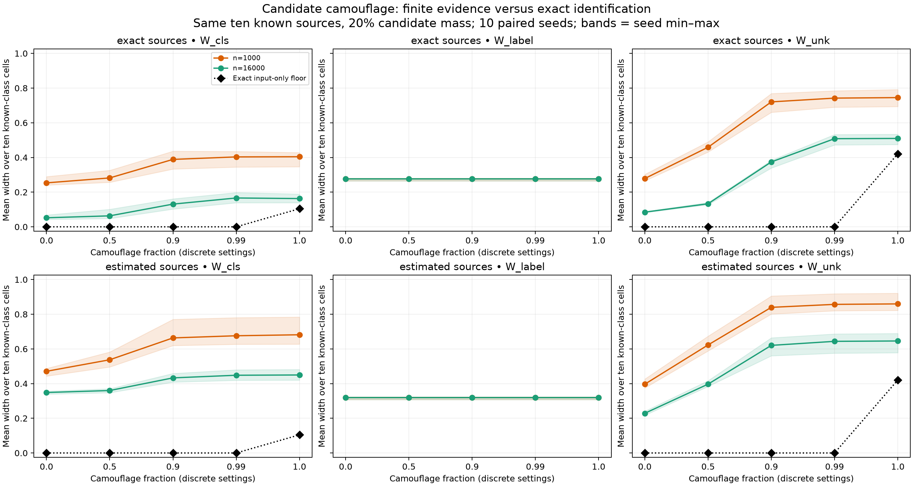

# Candidate camouflage: statistical uncertainty versus nonidentification

This implements the first proposal in `../next-to-dos.md` in a separate
workbook. The candidate becomes progressively harder to distinguish from known
digit sources while the frozen model, partition and target definitions remain
unchanged. At near-complete camouflage finite-data intervals are broad despite
zero exact identification floors. At complete camouflage, positive floors are
verified analytically. Broad observed intervals alone cannot distinguish those
two explanations.

## Design fixed before running

Use the original MNIST-trained CNN's saved eleven-cell source laws: ten
individual digits plus an EMNIST-letter candidate. There is no even/odd source
aggregation or retraining. Known-source laws A_0,...,A_9 remain fixed. Define

q_lambda = (1-lambda) q_EMNIST + lambda (A_0+...+A_9)/10.

Lambda takes values 0, .5, .9, .99, 1. This is probability-space camouflage,
not morphing or perturbing actual images. Candidate identity remains distinct
in the generative model even when its observable cell law becomes a known
mixture. Matching candidate references are supplied for each lambda. This
isolates distinguishability rather than candidate-reference misspecification.

Candidate prevalence stays .2. Known digit weights are .8*(1,...,10)/55.
Within each of ten seeds, known references and target labels are identical
across lambda. Common uniform streams pair candidate and deployment draws
across lambda; deployment budgets n=1000 and n=16000 use nested prefixes.
Source and deployment streams are independent.

Two source-information arms are compared using the same joint-mass interval
construction and deployment observations:

- **Exact sources:** all source laws fixed to their empirical population values.
- **Estimated sources:** 1000 reference inputs per known digit and 6500 candidate
  reference inputs, with simultaneous CP bounds on their cell laws.

Both retain finite deployment evidence. A separate exact-source AND exact-log
LP computes the input-only identification floors for W_cls and W_unk.

## Three epistemic targets

- W_cls: membership of the cell-associated digit conditional on known status.
  For the outlier cell, the target digit is fixed from the clean known rows.
- W_unk: candidate-source membership conditional on the cell.
- W_label: fixed-uniform-anchor binary target probability over known sources.
  Target rates are simulated as linspace(.1,.9,10), with 512 observed target
  labels per source and known flip probability .2. These are not digit identity
  labels or a real semantic downstream outcome.

Estimated-source membership intervals include uncertainty in source-cell laws;
they are not the legacy image pipeline's plug-in W_cls. The same target and
confidence-set construction are used across all arms. The four evidence
allocations are .0125 each: known source laws, candidate law, deployment log,
and target labels. The source allocations remain unused in the exact arm.
No deployment source identities are provided.

## Results

Mean W_unk across the ten known-class cells at n=16000:

| Camouflage lambda | Exact sources, finite log | Estimated sources, finite log | Exact input-only floor |
|---|---:|---:|---:|
| 0 | .085 | .229 | 0 |
| .5 | .133 | .397 | 0 |
| .9 | .374 | .620 | 0 |
| .99 | .508 | .644 | 0 |
| 1 | .510 | .646 | .421 |

At lambda=1, the corresponding W_cls values are .163, .450 and .104.
Increasing n from 1000 to 16000 reduces estimated-source W_unk from .397 to
.229 at lambda=0, and from .860 to .646 at lambda=1. Even complete camouflage
permits contraction of statistical slack; it cannot remove the structural
floor using inputs alone.

W_label averages .276 with exact sources and .319 with estimated sources,
independent of lambda and deployment budget. Its evidence is unchanged. This
invariance is a consequence of the reference-anchor definition, not independent
evidence of a uniquely identified epistemic decomposition.

Plots use discrete, equally spaced configuration positions; x tick labels show
the actual lambda values. Connecting lines guide the eye. Bands are min–max
over ten seed-level cell averages, not confidence intervals. The exact floor
is zero for every lambda<1 in this model, not a gradual rise between .99 and 1.
Means exclude the outlier cell; its separate results and all per-cell endpoints
are retained in CSVs. These are equal-cell averages, not prevalence-weighted
averages over deployment images.

## Why .99 and 1 mean different things

For lambda<1, the original full-rank source matrix remains full rank: the
candidate retains a distinguishable component. The minimum singular value
decreases from .296 at lambda=0 to .00297 at .99, and the condition number
increases from 3.54 to 351.1. Exact identification remains possible, but finite
sampling error leaves much larger uncertainty about the source mixture.

At lambda=1 the rank drops from 11 to 10. Write beta_k=.1 and
s_k=w_k+.1*w_candidate. Every vector

(w'_0,...,w'_9,w'_candidate) = (s_0-.1*t,...,s_9-.1*t,t)

for 0<=t<=min_k(s_k/.1)=.3454545 produces exactly the same deployment cell law.
The true candidate mass .2 is one member of this observational equivalence set.
Evaluating each posterior at its two endpoint mixtures reproduces every LP
identification interval, with mean widths .104477 for W_cls and .420843 for
W_unk over known cells. These widths cannot be eliminated by collecting more
unlabelled inputs while the same source laws and observables are used.

The finite-data curves at .99 and 1 are very similar, although one setting is
identified and the other is not. A flat or broad finite-data curve does not
establish a positive identification floor. Here the exact diagnostic supplies
that distinction because the synthetic generative model is known.

## Validation, scope and next step

All 6600 interval records were finite, ordered and retained their generating
targets; no empty regions occurred. Independent checks recomputed targets and
endpoint identities, verified fixed known references and nested logs, checked
zero floors in full-rank cases, and matched the complete-camouflage intervals
to analytic endpoint mixtures. This is ten paired simulation seeds around one
fixed empirical model, not a general coverage or real-image camouflage claim.

Run `run.py`, then `validate.py` in the reach-aistats environment. The workbook
contains raw intervals, exact floors, matrix conditioning, per-cell/per-seed
summaries, draw counts, source matrices/configuration/input hash, validation
JSON and PNG/PDF plots. Shared interval helpers are imported from the existing
digit-source and controlled MNIST workbooks; those experiments are unchanged.

A targeted follow-up is to add reliable deployment source identities at lambda
.99 and 1 while holding everything else fixed. That tests which additional
information resolves the ambiguity. More reference inputs and deployment inputs
should also be swept separately to distinguish finite-reference limitations
from the exact input-only floor; current reference budgets were fixed.
