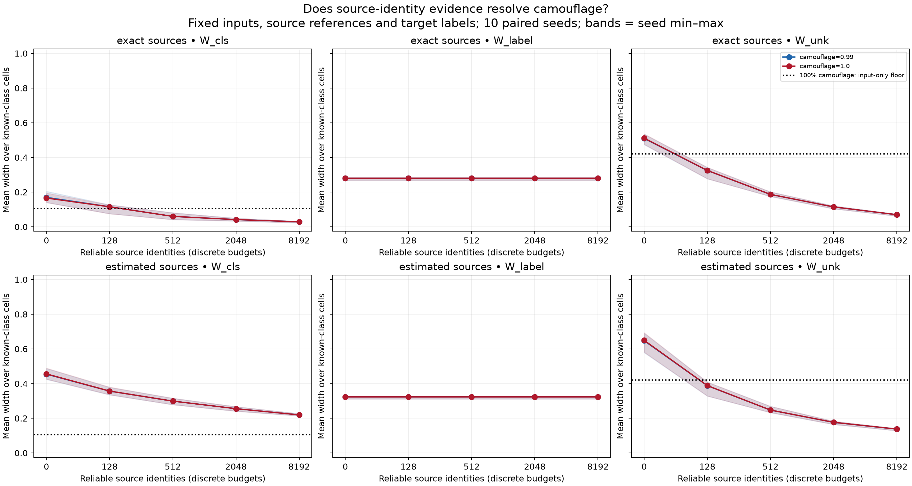

# Source identities under candidate camouflage

Completed 2026-10-21. Follow-up to [candidate camouflage](../camouflage_2026-10-21/RESULTS.md).

Reliable external source identities reduce class-membership and candidate-membership
ambiguity even when the candidate cell law is exactly a mixture of known laws.
This demonstrates the value of an additional evidence channel in a controlled
model; it does not demonstrate discovery of unknown classes from inputs alone.

## Setup

- Reuse the original frozen MNIST CNN and its 11-cell partition; no new training.
- Keep ten individual digit sources and one declared candidate source, with
  candidate deployment prevalence 0.2 and the parent's unequal digit weights.
- Candidate law: `q_lambda = (1-lambda) q_EMNIST + lambda mean(q_digits)`.
  Test lambda 0.99 and 1.0. This is a probability-space simulation, not image morphing.
- Reuse the parent's exact saved reference and deployment counts: 1,000 references
  per digit, 6,500 candidate references, and 16,000 deployment inputs.
- Reproduce the parent's 512 binary target-label observations per digit, with
  source-specific rates from 0.1 to 0.9 and a known 0.2 flip probability.
- Add independent iid deployment source identities at nested budgets
  0, 128, 512, 2,048, and 8,192. These include identities of candidate observations.
  The identity stream is shared across camouflage levels and reference modes.
- Compare exact source laws against source laws estimated from finite references,
  across ten paired simulation seeds. These are not training seeds.

Identity counts give simultaneous binomial bounds on deployment mixture weights.
The coherent joint-mass solver imposes these as bounds on source row sums, alongside
the existing source-law and deployment-cell constraints. Identities are assumed
reliably observable through external provenance; the experiment does not obtain
them by classifying camouflaged inputs.

Each of five evidence families receives error budget 0.01: known references,
candidate references, deployment cells, target labels, and source identities.
The identity share remains unused at zero identities. This preserves identical
allocations within this experiment but makes the baseline slightly wider than
the parent experiment, which used four shares of 0.0125. Coverage accounting is
for a fixed experimental setting, not simultaneous over the entire budget sweep.

## Results



Mean widths over the ten known-class cells, then over ten seeds, at **100% camouflage**:

| Source laws | Identity observations | W_cls | W_label | W_unk |
| --- | ---: | ---: | ---: | ---: |
| Exact | 0 | 0.166 | 0.280 | 0.511 |
| Exact | 128 | 0.115 | 0.280 | 0.325 |
| Exact | 512 | 0.060 | 0.280 | 0.187 |
| Exact | 2,048 | 0.042 | 0.280 | 0.115 |
| Exact | 8,192 | 0.029 | 0.280 | 0.070 |
| Estimated | 0 | 0.456 | 0.324 | 0.650 |
| Estimated | 128 | 0.357 | 0.324 | 0.389 |
| Estimated | 512 | 0.299 | 0.324 | 0.248 |
| Estimated | 2,048 | 0.255 | 0.324 | 0.177 |
| Estimated | 8,192 | 0.220 | 0.324 | 0.138 |

The 99% curves nearly overlap the 100% curves. At 8,192 identities, estimated-law
mean widths are 0.220 / 0.324 / 0.138 for W_cls / W_label / W_unk at either level
to three decimals. These finite-budget curves cannot distinguish weak
identifiability at 99% from exact nonidentifiability at 100% using inputs alone.

The plot's bands show seed minima and maxima, not confidence intervals. Cells
receive equal weight. The outlier cell is reported separately in the CSVs:
at 100% camouflage with estimated laws, its W_cls remains 0.669 and W_unk 0.250
at 8,192 identities. The known-cell averages do not describe every region.

## Interpretation

1. **Extra evidence can resolve ambiguity that more inputs cannot.** At full
   camouflage, the parent's exact input-only mean identification floors are
   0.104 for W_cls and 0.421 for W_unk. With exact source laws, identity acquisition
   takes both mean widths below those floors. With estimated laws, mean W_unk
   crosses its floor, while W_cls remains above its floor at the tested budgets.
   There is no contradiction: identities constrain weights that input mixtures
   alone cannot distinguish.
2. **Finite references still matter.** At the largest identity budget, estimated
   source laws leave substantially wider intervals than exact laws. Acquiring
   identities does not remove uncertainty about where each source falls in the
   partition. Finite deployment and identity evidence also remain.
3. **W_label is invariant by definition in this intervention.** Its target uses
   a fixed uniform reference-source anchor and source-specific binary target
   rates, rather than deployment mixture weights. Source identities therefore
   do not enter its calculation. Its flat curve is a consistency check, not
   independent empirical proof of epistemic disentanglement. Source identities
   and binary target labels are different observations.

W_cls concerns the selected digit's membership conditional on known status and
cell; W_unk concerns declared candidate membership conditional on cell. The latter
is the manuscript's candidate-membership target, not a generic semantic novelty
detector. Source laws are correctly specified here, and target labels are synthetic.

## Validation and reproduction

`validate.py` passed four analytic solver checks, verified all target values and
interval arithmetic, checked label invariance and nested identity sample counts,
and confirmed that adding identities never expands an interval relative to the
same zero-identity baseline. Positive-budget confidence sets need not be nested
with one another merely because their samples are nested.

All 6,600 recorded intervals contained their simulated targets; no feasible sets
were empty. Ten seeds and dependent intervals are insufficient to establish
general calibration. Details: [validation.json](validation.json).

Run from this directory with the `reach-aistats` environment:

```bash
python run.py
python validate.py
```

The script depends on the parent workbook and its helper modules. Parent config
and draw hashes are recorded in [config.json](config.json). Raw endpoints, targets,
statuses, and coverage are in [intervals.csv](intervals.csv); summaries are in
[summary.csv](summary.csv), [per_seed_summary.csv](per_seed_summary.csv), and
[per_cell_summary.csv](per_cell_summary.csv). Identity counts are saved in
[identity_draws.json](identity_draws.json). The plot is also available as
[PDF](identity_response.pdf).

Next: fix the identity budget and sweep reference budgets to isolate the remaining
source-law uncertainty. A separate target-label acquisition intervention would
test W_label's response. Noisy or unavailable candidate identities require their
own observation model before transferring this result to practice.
