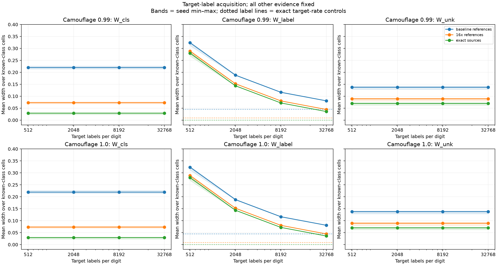

# Target-label acquisition under camouflage

Completed 2026-10-21. Follow-up to [reference acquisition](../camouflage_references_2026-10-21/RESULTS.md).

Increasing target-label observations reduces W_label. With finite references,
an exact-target-rate control still has positive width; with exact source laws
and exact target rates, the interval collapses.

## Setup

Reuse the frozen MNIST CNN, 11-cell partition, ten individual digit sources,
and candidate mixtures at 99% and 100% camouflage. No new model is trained.
Hold fixed the parent's 16,000 deployment-cell observations, 8,192 reliable
external source identities (including candidate identities), and five evidence
error-budget shares of 0.01 each.

Three fixed reference settings:

- Baseline: 1,000 references per digit and 6,500 candidate references.
- 16×: 16,000 per digit and 104,000 candidate references.
- Exact source laws, retaining finite deployment and identity evidence.

Within each setting, acquire 512, 2,048, 8,192, or 32,768 binary target labels
**per digit**. These are synthetic outcomes with source rates theta spanning
0.1 to 0.9 and known independent flip probability 0.2. They are not digit
identities, clinical outcomes, or newly annotated images. Reproduce the parent's
512 labels exactly and append independent draws using nested prefixes. Ten paired
simulation seeds vary observations, not training; labels are shared across
reference settings and camouflage levels.

Add an exact-theta control, encoded as budget -1 in CSVs. This is an oracle
comparison, not a finite acquisition budget. For finite budgets, use simultaneous
Hoeffding bounds on observed positive rates, invert the known noise channel
`p_observed = 0.2 + 0.6 theta`, and clip to [0,1].

W_label uses a fixed uniform reference-source anchor, known-source cell laws,
and source-specific target rates. W_cls and W_unk do not use target-label
evidence: their validated parent endpoints are reused, not recomputed. Their
flat curves illustrate this definition-level invariance.

## Results



Mean W_label over ten known-class cells and ten seeds at **100% camouflage**:

| Labels per digit | Baseline references | 16× references | Exact source laws |
| --- | ---: | ---: | ---: |
| 512 | 0.324 | 0.288 | 0.280 |
| 2,048 | 0.188 | 0.152 | 0.143 |
| 8,192 | 0.116 | 0.080 | 0.072 |
| 32,768 | 0.081 | 0.045 | 0.036 |
| Exact target rates | 0.045 | 0.009 | 0.000 |

W_label results are identical at 99% and 100% camouflage because its known-source
laws and label evidence are shared and its definition excludes the candidate.
The exact-law/exact-rate width is zero up to roundoff (~1e-16).
Bands are seed minima and maxima, not confidence intervals; dotted lines
are exact-target-rate benchmarks for each reference setting.

At full camouflage, unchanged W_cls / W_unk pairs are:

| Reference setting | W_cls | W_unk |
| --- | ---: | ---: |
| Baseline | 0.220 | 0.138 |
| 16× | 0.073 | 0.089 |
| Exact laws | 0.029 | 0.070 |

## Interpretation

Target-label acquisition addresses uncertainty in target rates. It cannot
remove uncertainty in known-source laws: exact rates still leave W_label 0.045
with baseline references and 0.009 with 16× references. These are benchmarks
conditional on fixed reference evidence, not structural nonidentifiability
floors with unlimited references.

Conversely, exact source laws leave W_label 0.280 at 512 labels and 0.036 at
32,768 labels. Both evidence sources matter. Positive label noise does not imply
irreducible width for theta: the known invertible observation channel permits
learning theta increasingly precisely. This is epistemic uncertainty about
rates, not outcome randomness.

Together with the identity and reference sweeps, this characterizes acquisition
responses under a correctly specified model. It does not establish three
independent uncertainty components: source-law uncertainty affects multiple
targets, and several invariances follow directly from their definitions.

## Validation and limits

All checks in [validation.json](validation.json) passed: 9,900 interval records,
no empty sets, and no missed simulated targets. Checks include reproduction of
the three parent baselines, independently calculated truths, unchanged class and
candidate endpoints, valid nested label counts, and collapse with exact laws and
rates. Reused endpoints and paired data mean these are not 9,900 independent
coverage trials; ten seeds do not establish general calibration.

This is a probability-space simulation with synthetic source-conditioned labels,
known noise, and reliable external identities. It does not test unknown noise
rates, labeling bias, or real reference/deployment shift. Known-cell means do
not summarize the outlier cell, which is separately reported in the CSVs.
Error allocations apply per setting, not simultaneously across the sweep.

## Reproduction and artifacts

Run here using the `reach-aistats` environment:

```bash
python run.py
python validate.py
```

Dependencies include the parent reference, identity, and camouflage workbooks
and helpers. [config.json](config.json) records input hashes and budgets;
[label_draws.json](label_draws.json) stores label counts;
[intervals.csv](intervals.csv) stores endpoints and targets;
[summary.csv](summary.csv) and [per_seed_summary.csv](per_seed_summary.csv) store
aggregates. An exportable [PDF plot](label_response.pdf) is included.

The acquisition controls now cover identities, references, and target labels.
A useful next stress test is a deliberately mismatched candidate law, assessing
compatibility, coverage, and narrow-but-wrong intervals. That challenges the
assumptions supporting these controls rather than repeating another correctly
specified acquisition sweep.
