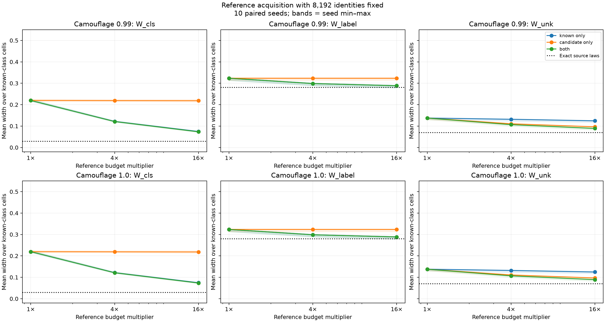

# Reference acquisition under camouflage

Follow-up to [source-identity acquisition](../camouflage_identities_2026-10-21/RESULTS.md), executed 2026-10-21.

## Question and setup

How much uncertainty remains because source-cell laws were estimated from finite
references, after collecting 8,192 reliable source identities?

Reuse the frozen MNIST CNN, its 11-cell partition, ten individual digit sources,
and the candidate law `q_lambda = (1-lambda) q_EMNIST + lambda mean(q_digits)`.
Test 99% and 100% camouflage. The candidate has deployment weight 0.2; all source
laws and weights are the same as in the parent controls. No new model is trained.

Hold fixed within each seed and camouflage level:

- 16,000 deployment-cell observations from the saved parent experiment;
- 8,192 reliable external source identities, including candidate identities;
- 512 synthetic binary target-label observations per digit, with source rates
  0.1 through 0.9 and known flip probability 0.2;
- five evidence-family error allocations of 0.01 each.

Increase references at multipliers 1, 4, and 16, with three acquisition arms:

| Arm | References per known digit | Candidate references |
| --- | --- | --- |
| Known only | 1,000 → 4,000 → 16,000 | 6,500 |
| Candidate only | 1,000 | 6,500 → 26,000 → 104,000 |
| Both | 1,000 → 4,000 → 16,000 | 6,500 → 26,000 → 104,000 |

An exact-source-law control retains the same finite deployment, identity, and
target-label evidence. Its nonzero widths are not input-only identification
floors. The baseline and exact control reproduce the prior workbook's 8,192-identity
results. New independent reference draws are appended to the saved baseline
counts, with nested prefixes and common random numbers across camouflage levels.
Ten seeds vary observations, not training. All acquisitions sample fixed saved
cell laws: 104,000 references are simulated observations, not new images.

## Results



Mean known-cell widths at **100% camouflage**, with identities fixed at 8,192:

| Reference evidence | W_cls | W_label | W_unk |
| --- | ---: | ---: | ---: |
| Baseline (1×) | 0.220 | 0.324 | 0.138 |
| Known only, 16× | 0.075 | 0.288 | 0.125 |
| Candidate only, 16× | 0.218 | 0.324 | 0.097 |
| Both, 4× | 0.121 | 0.299 | 0.107 |
| Both, 16× | 0.073 | 0.288 | 0.089 |
| Exact source laws | 0.029 | 0.280 | 0.070 |

The 99% camouflage curves show the same qualitative pattern.

**The remaining class-membership uncertainty is strongly affected by known-source
reference uncertainty.** Increasing digit references alone reduces mean W_cls
from 0.220 to 0.075; increasing candidate references alone barely changes it.
This is evidence about this model and budget regime, not a universal independence
between candidate evidence and W_cls: all sources share joint-mass constraints.

**Candidate references mainly help candidate membership.** Candidate-only
acquisition reduces W_unk from 0.138 to 0.097, compared with 0.125 for known-only
acquisition. Increasing both brings it to 0.089, closer to the exact-source
benchmark of 0.070. Remaining uncertainty is not solely reference uncertainty:
deployment and source-identity evidence are still finite.

**Label uncertainty responds to known references too.** W_label falls from 0.324
to 0.288 as known references grow, approaching 0.280 with exact laws. The remaining
exact-law width comes from the fixed finite target-label evidence under the
specified noisy-label observation model. Candidate-only acquisition leaves
W_label exactly unchanged by definition. These epistemic widths are therefore
not three mutually exclusive sources of estimation error: known-source-law
uncertainty affects more than one target.

The next focused intervention is to hold the source references, identities, and
deployment inputs fixed and vary binary target-label acquisition. This would test
the remaining W_label uncertainty directly; it should leave the current W_cls
and W_unk calculations unchanged because target-label evidence does not enter them.

## Definitions and limits

W_cls bounds selected known-source membership conditional on cell and known
status. W_unk bounds declared candidate membership conditional on cell. W_label
uses the fixed uniform reference-source anchor and source-specific binary target
rates. Therefore known-source references can affect W_label, while candidate
references cannot. This is a consequence of the target definition.

The three acquisition arms do not have equal annotation costs: ten digit sources
are sampled in the known-only arm, versus one candidate source in the candidate-only
arm. These comparisons isolate information sources rather than optimize cost.
Reference laws are correctly specified, identities are reliable external evidence,
and no reference/deployment distribution shift is introduced. This is a mechanism
test, not evidence of semantic unknown discovery or general real-data calibration.

Plot values average equally over ten known-class cells and then over seeds;
bands show seed minima and maxima, not confidence intervals. The outlier cell
is separately reported in the CSVs. Nested observations do not guarantee nested
confidence intervals across positive budgets. Error allocation applies to each
setting, not simultaneous inference over all arms and budgets.

## Reproduction and artifacts

Using the `reach-aistats` environment, run from this directory:

```bash
python run.py
python validate.py
```

Dependencies include the parent camouflage and identity workbooks and their
helpers. [config.json](config.json) records input hashes and budgets.
[reference_draws.json](reference_draws.json) stores acquired cell counts;
[intervals.csv](intervals.csv) stores endpoints, truths, statuses and coverage;
[summary.csv](summary.csv) and [per_seed_summary.csv](per_seed_summary.csv) store
aggregates. The plot is available as [PDF](reference_response.pdf).

Validation checks target arithmetic, reference count totals and nesting,
candidate-only label invariance, and equality of baseline and exact-control
endpoints with the previous workbook. See [validation.json](validation.json).
All 6,600 recorded intervals covered their simulated targets, and no feasible
sets were empty. This total includes repeated baseline arms; it is not 6,600
independent calibration trials. Ten paired seeds do not establish general coverage.
