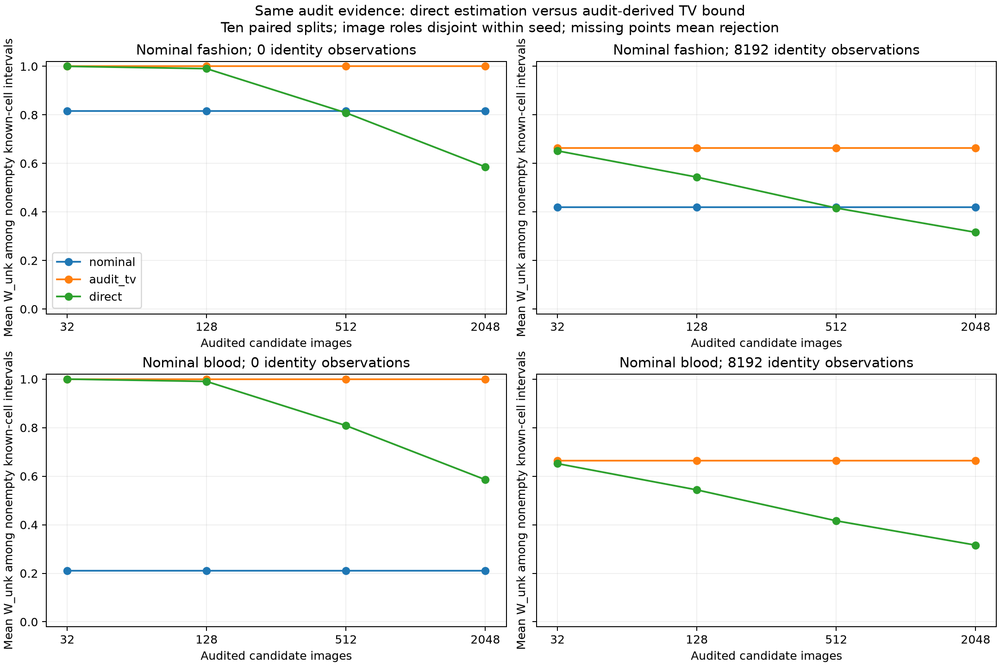

# Independent candidate auditing versus direct estimation

Date: 2026-10-22. Tests the [proposed audit protocol](../candidate_tv_2026-10-22/BUDGET_JUSTIFICATION.md)
against the essential simpler comparator at equal audited-image cost.

## Design and what is real

Score all cached official test images with the existing frozen MNIST CNN and cell
partition: 10,000 MNIST, 10,000 Fashion, and 3,421 Blood images. No retraining or
partition refitting. Image hashes and model/partition hashes are saved. The source
population is uniform over these cached images within each source (each digit
separately, all Fashion or Blood images naturally weighted). This differs from
earlier class-balanced Blood candidate laws.

For each of ten seeds, uniformly permute each image source without replacement.
Roles are disjoint by image ID within each dataset and seed:

- Known reference: 200 images per MNIST digit.
- Nominal candidate reference: 512 Fashion or 512 Blood images.
- Actual candidate audit: nested 32, 128, 512, or 2,048 Fashion images.
- Deployment: 4,000 images, exactly 800 Fashion and 3,200 digits, with digit counts
  approximately proportional to 1 through 10 (exact counts in config).
- Reserved probes: 100 per digit, 2,000 Fashion, 2,000 Blood; not used in inference.

Fashion reference, audit and deployment images are distinct, even in the matched
case. The same audits and deployment images are used across nominal candidates,
methods, and audit budgets. Different seeds reuse the finite image populations;
the ten splits are not mutually disjoint.

Image inputs, reference counts and audit observations are real cached observations.
The mixture composition is deliberately designed, not a naturally observed deployment.
The optional 8,192 source-identity observations are **synthetic iid identity-only
draws** at the designed mixture weights; the zero-identity control is included.
The 512 binary target labels per digit remain synthetic with known flip rate 0.2.
This is a controlled finite-image sampling pilot, not completed real-world
validation or a meaningful clinical target-label study.

Truth uses a census of the full finite image populations to define source-cell
laws and target probabilities. It is used only for evaluation, not budget choice
or inference. The census includes sampled images; it is not an independent estimate
of an infinite-population posterior. Reserved probes are logged for separation
checks; this report does not claim a separate probe-task performance evaluation.

## Confidence accounting

Use simultaneous coordinate Hoeffding bounds, which are valid for uniform sampling
without replacement from a finite population. For the stratified deployment sum,
independent source strata each satisfy the same Hoeffding exponential bound;
combining strata gives the n=4,000 bound around the designed weighted marginal.
Reference, audit and log streams need not be independent for a union bound over
their confidence events. The interval methods do not use the true per-source log
counts as identity evidence; counts are retained for evaluation and reproducibility.

Allocate 0.01 to the audit and 0.008 each to known references, nominal references,
deployment cells, target labels and optional identities: total 0.05. Unused shares
are reserved for direct estimation and the zero-identity control. Guarantees apply
per fixed setting, not simultaneously over all unadjusted budgets/seeds. Hoeffding
bounds can be conservative; these results are not directly comparable numerically
with the previous Clopper–Pearson iid simulations.

## Methods and dominance check

1. Nominal: use the supplied Fashion/Blood references, ignoring candidate audit data.
2. Audit-TV: compute `U=min(1, 0.5 sum max(u_audit-l_nominal, u_nominal-l_audit))`,
   then allow candidate TV distance U to any normalized nominal law in its box.
3. Direct: replace the nominal candidate row with the audit confidence box.

Both audit methods receive exactly the same candidate audits. Direct may ignore
the nominal data because it need not assume they match the deployed candidate.

**Direct-set containment is guaranteed by this construction.** For every normalized
audit law a and nominal law r in their coordinate boxes, TV(a,r)<=U. Therefore
every candidate law in the direct region is admitted by the Audit-TV region.
All other constraints and targets are identical. Direct target intervals cannot
be wider, and a nonempty direct region implies a nonempty Audit-TV region. This
is an algebraic limitation of this conservative budget construction, not an
unexpected empirical discovery and not a theorem against all robust methods.

## Results

**Direct estimation is more informative than this audit-derived TV procedure.**
For wrong Blood nominal references, mean W_unk over known-class cells is:

| Audited images | Audit-TV, no identities | Direct, no identities | Audit-TV, 8,192 synthetic identities | Direct, 8,192 synthetic identities |
| --- | ---: | ---: | ---: | ---: |
| 32 | 1.000 | 1.000 | 0.664 | 0.652 |
| 128 | 1.000 | 0.990 | 0.664 | 0.544 |
| 512 | 1.000 | 0.808 | 0.664 | 0.416 |
| 2,048 | 1.000 | 0.586 | 0.664 | 0.316 |

Both audit methods cover all recorded targets, with no rejected runs. Direct
intervals are identical under nominal Fashion and Blood because they use the
same actual Fashion audit observations. Audit-TV curves also coincide here:
the conservative radius is so broad that other constraints determine the extrema.

For Blood references the TV upper bound is 1 at every budget/seed. For matching
Fashion, its mean is 1 at 32/128 images, 0.775 at 512, and 0.654 at 2,048. This
is highly conservative despite zero true model error. Reference sampling error
and the coordinatewise TV bound both contribute. Increasing audit size alone
does not remove uncertainty in the fixed 512-image nominal reference sample.

Nominal wrong-Blood inference without identities remains compatible but covers
only 69/100 known-cell candidate intervals, with mean width 0.211; with identities
it rejects all ten seeds. Matching nominal references cover, but do not contract
with audit budget because they ignore audit observations. These values differ
from previous studies because source laws, budgets and confidence bounds changed;
only comparisons within this pilot are paired.

Validation passed across **480 runs and 15,840 interval records**, including image
disjointness, saved scores, recomputed audit bounds, independently calculated
truths and direct-set containment. No audit upper bound missed actual finite-pool
TV error, and neither audit method missed a target. Conservative bounds and
correlated finite-pool trials limit calibration conclusions.

## Research decision

Do not promote this conservative audit-to-TV construction as a method improvement.
It discards information by compressing an audit confidence region into a single
radius, and direct estimation already gives a contained region. This does not
refute sensitivity reporting without audits, externally justified error bounds,
or other ways of combining evidence.

Keep direct estimation as a required baseline and return to the central objective:
what information distinguishes the three epistemic targets, and whether this
supports a useful acquisition or visual decision. Meaningful target labels,
representation/training variation and actual acquisition costs remain outstanding.

## Reproduction

In reach-aistats, run `python prepare.py`, `python run.py`, `python validate.py`.
The original model, partition and cached images must be available. Key files:
[config.json](config.json), [input_hashes.json](input_hashes.json),
[image_cells.csv](image_cells.csv), [image_assignments.csv](image_assignments.csv),
[counts.json](counts.json), [audit_bounds.csv](audit_bounds.csv),
[intervals.csv](intervals.csv), [summary.csv](summary.csv),
[compatibility.csv](compatibility.csv), [validation.json](validation.json).
Plot also available as [PDF](audit_comparison.pdf).

Mean widths weight ten known-class cells equally, with outlier results separately
in CSVs. Rejected runs have no interval and are excluded from width/coverage
means; read those statistics with compatibility.csv. Ten paired seeds do not
establish general calibration, and the same image populations have already been
used in exploratory research. A final confirmatory study needs fresh data/splits.
