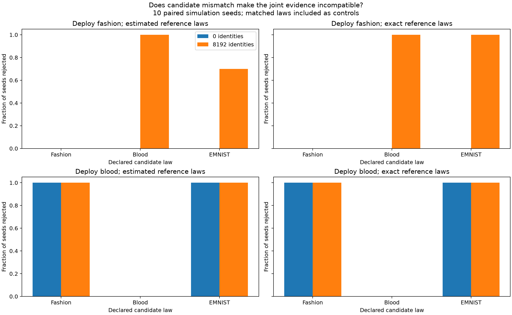
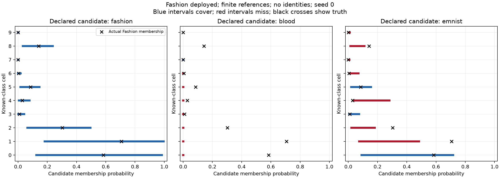

# Candidate-law misspecification

Experiment dated 2026-10-21. Tests whether a wrong candidate reference law causes
model rejection or leaves nonempty intervals that miss the actual target.

## Design

Reuse the original frozen MNIST CNN, 11-cell partition, and ten individual digit
sources. Deploy 80% known digits (weights proportional to 1 through 10) and 20%
Fashion or Blood. For each deployment, declare Fashion, Blood, or EMNIST as the
candidate law. The matching law is a positive control. Fashion and Blood laws
average cell frequencies equally across their dataset classes, as in the earlier
digit-source workbook. No model is retrained and no new images are sampled.

Ten paired seeds simulate iid cell observations from those saved laws. Each has
16,000 deployment observations, 1,000 references per digit, 6,500 candidate
references drawn from the **declared** law, and 512 synthetic binary target labels
per digit (rates 0.1–0.9, known flip probability 0.2). Compare estimated and exact
declared laws, and zero versus 8,192 reliable external source identities. Reserve
five error shares of 0.01, including unused shares for oracle or absent evidence.

Identities refer to the actual deployed source, including the actual candidate.
In mismatched cases, REACH incorrectly assigns that candidate the declared law.
Thus identities can reveal a contradiction between mixture weights and input
frequencies. They are not predictions inferred from the model.

Within a deployed world, deployment inputs, known references, target labels,
and identities are shared across declarations and modes. Common uniforms pair
candidate references across laws. Across deployed worlds, common uniforms pair
the simulations but do not make cell observations identical.

## Evaluation

Report global incompatibility once per run. An empty joint-mass set is rejection,
not a zero-width interval. For nonempty intervals, report width, coverage of the
**actual deployed-world target**, and narrow-but-wrong counts using the descriptive
threshold width ≤ 0.1 (chosen before examining the results).

W_unk is interpreted as membership of the actual deployed candidate, so its
coverage tests the validity of using the declared law as a proxy. This is not
membership of a separate absent Fashion/EMNIST source. W_cls conditions on known
status and cell. W_label uses the fixed uniform known-source anchor and synthetic
target rates; it excludes candidate/deployment evidence and can remain defined
even when the joint deployment model is rejected. Its interval is not a certificate
that the rejected joint model is valid.

## Results

Rejections out of ten seeds, with **estimated** reference laws:

| Deployed candidate | Declared law | No identities | 8,192 identities |
| --- | --- | ---: | ---: |
| Fashion | Fashion (matched) | 0/10 | 0/10 |
| Fashion | Blood | 0/10 | 10/10 |
| Fashion | EMNIST | 0/10 | 7/10 |
| Blood | Blood (matched) | 0/10 | 0/10 |
| Blood | Fashion | 10/10 | 10/10 |
| Blood | EMNIST | 10/10 | 10/10 |

Exact declared laws give the same rejection pattern except Fashion/EMNIST with
identities, which rejects 10/10. Exact knowledge of a wrong law does not repair
misspecification: without identities, neither mismatched Fashion case rejects,
even with exact declared laws.

For **Fashion deployment, estimated laws, and no identities**, candidate-membership
results over ten known cells × ten seeds are:

| Declared law | Mean W_unk | Intervals covering truth | Narrow-but-wrong intervals |
| --- | ---: | ---: | ---: |
| Fashion | 0.249 | 100/100 | 0/100 |
| Blood | 0.000985 | 20/100 | 80/100 |
| EMNIST | 0.188 | 23/100 | 45/100 |

These coverage fractions are descriptive over dependent intervals, not independent
coverage trials. With identities, the three surviving Fashion/EMNIST estimated-law
runs have mean W_unk 0.071, coverage 3/30, and 25/30 narrow-but-wrong known-cell
intervals. Rejection is useful, but failure to reject does not establish validity.

This endpoint plot uses seed zero rather than selecting a particularly bad seed.
W_cls can fail too: with exact Blood laws but Fashion deployed and no identities,
30/100 known-cell class intervals miss their target, with mean W_cls 0.014.
W_label is unchanged and covers throughout because this intervention changes
neither its known-source model nor its target-label channel.

**Interpretation:** a wrong source family can explain cell frequencies using the
wrong mixture weights and return confidently wrong membership intervals. External
identities constrain those weights and can expose the contradiction. Detection
is asymmetric: deploying Blood with Fashion references is not equivalent to
deploying Fashion with Blood references. Compatibility depends on the entire
mixture family and the representation, not merely whether dataset names differ.

All 80 matched runs were compatible and their recorded intervals covered their
targets. Of 160 mismatched runs, 117 rejected; 416 nonempty interval records missed
their targets across all targets and cells. Those totals pool different settings
and should not be interpreted as general error rates. Four numerical retries
resolved to infeasible statuses; none remained unresolved. Validation passed
for all 7,920 records, including a deliberately contradictory analytic case.

## Reproduction and limitations

Run `python run.py`, `python validate.py`, and `python plot_failures.py` here using the
`reach-aistats` environment. Dependencies include the digit-source configuration
and the identity workbook's solver/helpers. [config.json](config.json) saves all
source laws and the input hash. [draws.json](draws.json) saves evidence counts.
[compatibility.csv](compatibility.csv) and [rejection_summary.csv](rejection_summary.csv)
record rejection per run and setting. [intervals.csv](intervals.csv) contains
endpoints, true targets, statuses and coverage; [summary.csv](summary.csv) reports
nonempty-interval statistics separately from rejected runs.

The solver retries numerical/unknown statuses with dual simplex and presolve off;
it never interprets an unknown status as rejection. Retries are recorded in
[solver_retries.json](solver_retries.json). The adaptation is local to this workbook.
[validation.json](validation.json) records arithmetic, truth, rejection, label
invariance, count-total, and analytic contradiction checks.

These are finite-pool probability-space simulations with one frozen representation,
correct known-source laws, synthetic labels and reliable external identities.
Results are conditional on the partition and declared family. Coverage guarantees
under correct specification do not extend to mismatched laws. Ten paired seeds
and dependent intervals are insufficient to establish general calibration or a
universal mismatch detector. Known-cell means exclude the separately reported
outlier cell. All budgets and the 0.1 narrowness threshold are fixed for this study.
