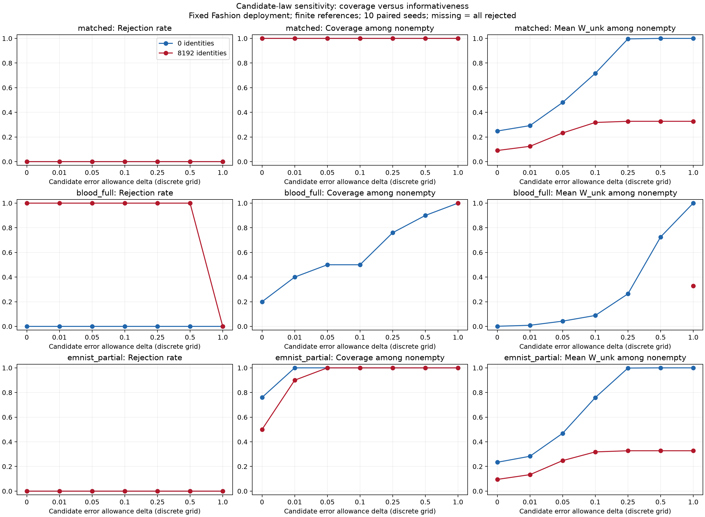

# Candidate-law sensitivity baseline

Date: 2026-10-22. First implementation of roadmap step 3, not a completed novel
robust inference method or a calibrated deployment procedure.

## Method and conditional guarantee

Let the nominal candidate's coordinate confidence bounds be [l_c,u_c]. Replace
them by `[max(0,l_c-delta), min(1,u_c+delta)]`, retaining normalized source rows,
joint masses, known-reference constraints, deployment evidence and identities.
Delta is a bound on **maximum absolute cell-probability error (L-infinity)**,
not total variation or the interpolation parameter t of the previous study.

If the nominal row lies in its confidence box and the actual candidate law differs
from that row by at most delta in every coordinate, then the actual row lies in
the expanded box. On the remaining evidence events, the actual joint masses
remain feasible and target intervals include truth. This follows by the triangle
inequality and confidence-set inclusion. It requires correct known-source laws,
reliable identities, and the stated candidate-error bound. It is not unconditional
robustness to arbitrary misspecification.

Larger delta produces nested feasible regions: rejection can disappear and
nonempty intervals can only expand. At delta=1 the candidate row is unrestricted
apart from normalization. W_label is unaffected because it excludes the candidate.
Its validated parent endpoints are reused and this invariance is by definition.
This is a transparent coordinate-box baseline; it may be conservative compared
with a coupled ambiguity set. No novelty is claimed for expanding confidence boxes.

## Fixed design

Three cases reuse the exact saved draws of the graded mismatch study:

- Matching Fashion references (negative control for unnecessary robustness).
- Fully wrong Blood references (strong mismatch, previously rejected with identities).
- 40% interpolation from Fashion toward EMNIST (previously wrong but compatible).

Actual deployment remains 80% known MNIST digits and 20% Fashion. References:
1,000 per known digit, 6,500 candidate. Deployment inputs: 16,000. Binary target
labels: 512 per digit. Source identities: 0 or 8,192. Ten paired simulation seeds,
frozen CNN/partition, five error shares of 0.01. No new images or model training.

Sweep **delta = 0, 0.01, 0.05, 0.1, 0.25, 0.5, 1**, saved before execution.
Every delta is reported; none is selected using hidden deployment truth. Actual
L-infinity error and minimum expansion needed to contain the true row are saved
separately as oracle diagnostics, used only to interpret results. They are not
observable calibration rules. A successful delta in this simulation is not a
recommended real-world setting.

## Results

For the partially wrong EMNIST candidate (t=0.4), with **8,192 identities**:

| Delta | Mean W_unk, known cells | Covered / 100 | Rejected / 10 |
| --- | ---: | ---: | ---: |
| 0 | 0.095 | 50 | 0 |
| 0.01 | 0.134 | 90 | 0 |
| 0.05 | 0.247 | 100 | 0 |
| 0.1 | 0.318 | 100 | 0 |
| 1 | 0.327 | 100 | 0 |

Coverage recovers in these draws at a cost in precision. Delta=0.05 is **not** a
validated calibration choice: the actual L-infinity law error is about 0.0636.
Finite reference bounds and target-specific geometry can permit coverage with a
smaller allowance; observed coverage is not proof that the model-error assumption
holds. Delta=0.1 is the first grid point exceeding that actual error, used here
only as an oracle evaluation check.

For fully wrong Blood references, actual L-infinity error is about 0.7782. With
identities, all runs remain incompatible through delta=0.5 and become compatible
at delta=1, the first tested budget exceeding that error. At delta=1, all known-cell
targets cover and mean W_unk is 0.327. Without identities, all runs are compatible
even at delta=0, but coverage goes from 20/100 to 100/100 only at delta=1 on this
grid; mean W_unk expands from 0.001 to **1.000**. No continuous threshold between
0.5 and 1 is inferred from this coarse sweep.

The matched control quantifies the cost of unnecessary robustness. With identities,
mean W_unk grows from 0.090 at delta=0 to 0.233 at delta=0.05 and 0.327 at delta=1,
while all intervals already covered at delta=0. Without identities, the matched
control becomes vacuous at delta>=0.5. At delta=1 every case has the same candidate
constraints and other evidence, so its intervals coincide across cases.

**Conclusion:** a bounded-error region can recover target inclusion under the
stated assumptions, but expanding coordinate boxes can lose most useful information.
Reliable identities preserve some informativeness even with an unrestricted candidate
law. Replacing rejection with a broad interval is a sensitivity choice, not evidence
that the nominal candidate explanation became correct.

Validation passed for 420 runs and 13,860 interval records: nominal endpoints
reproduce the parent study, intervals nest as delta grows, truths are independently
checked, and rejection matches feasibility. All 7,920 records at grid budgets at
least as large as actual candidate error covered, with no empty sets; this is an
evaluation conditional on known simulation truth, not independent calibration evidence.

Next within roadmap step 3: compare a coupled TV ambiguity region against this
coordinate-box baseline using explicit assumptions; determine how a budget could
be justified from independent audited evidence or leave it as a sensitivity axis.
No evidence here justifies estimating that budget from compatibility alone.

## Reproduction and artifacts

Run `python run.py` and `python validate.py` here using the reach-aistats environment.
Dependencies include the graded mismatch workbook and its parent solver helpers.
Input hashes, grid, and cases are in [config.json](config.json).
Endpoints and target errors: [intervals.csv](intervals.csv).
Aggregates: [summary.csv](summary.csv), [rejection_summary.csv](rejection_summary.csv).
Per-run feasibility: [compatibility.csv](compatibility.csv).
Evaluation-only error budgets: [oracle_diagnostics.csv](oracle_diagnostics.csv).
Checks: [validation.json](validation.json), [solver_retries.json](solver_retries.json).
Exportable plot: [sensitivity.pdf](sensitivity.pdf).

Coverage and width are reported among nonempty intervals, alongside rejection.
Known-cell means weight the ten cells equally; outlier results are separate in
the CSVs. Missing plot points mean all runs rejected. Cells and delta settings
share data; counts are not independent calibration trials. Ten seeds and one
finite-cell representation do not establish general real-image performance.
