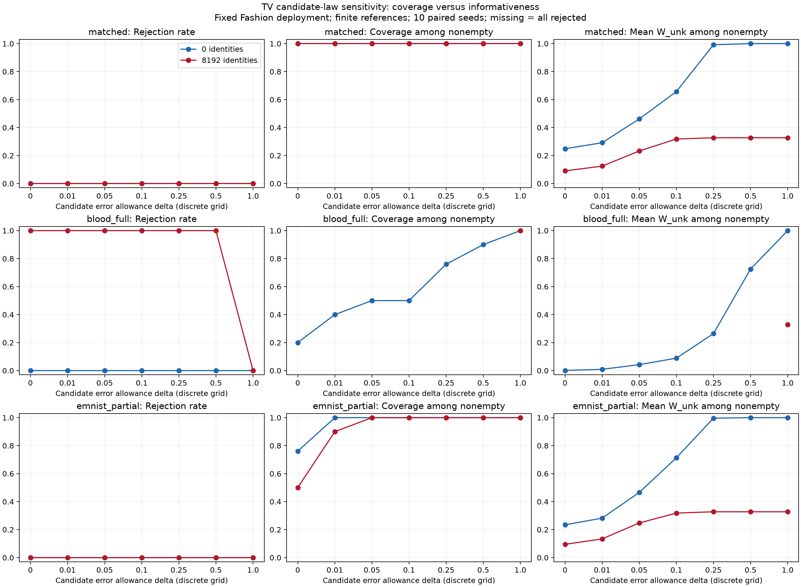
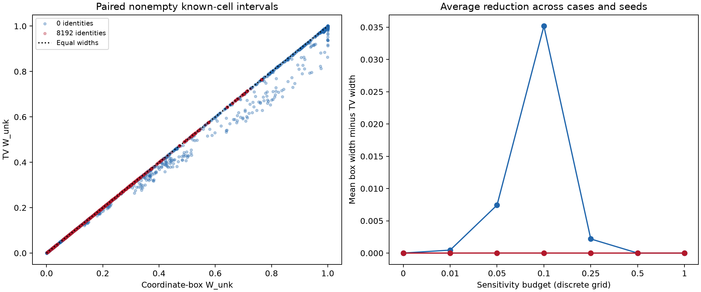

# Coupled total-variation sensitivity

Date: 2026-10-22. Paired comparison with the [coordinate-box baseline](../candidate_sensitivity_2026-10-22/RESULTS.md).

## Region and assumptions

Candidate deployment law q may differ by TV at most delta from **some normalized
nominal law r inside its reference confidence box**. This propagates reference
sampling uncertainty as well as the specified law error. It does not put a TV
ball solely around a plug-in estimate.

Let w_u be candidate weight and Z_uc its deployed joint masses. Introduce nominal
joint masses V_c=w_u r_c and nonnegative absolute-deviation auxiliaries E_c:

```
sum_c V_c = w_u
l_c w_u <= V_c <= h_c w_u
-E_c <= Z_uc - V_c <= E_c
sum_c E_c <= 2 delta w_u
```

Keep known-source constraints, all deployed row normalization, deployment-column
constraints and identity bounds. Everything is linear in joint masses, including
when w_u=0. Posterior endpoints use a Charnes–Cooper transformation. Undefined
possible denominators retain the established [0,1] policy; empty sets are rejection.

On the reference confidence event and the assumption TV(q_actual,q_nominal)<=delta,
the actual joint masses satisfy these constraints. Together with the other evidence
events this yields inclusion for defined targets. The method remains conditional
on the error assumption; no data-driven delta is calibrated in this study.

For distributions, maximum coordinate error <= TV. Hence the TV region is contained
in the coordinate-expanded region at the **same numerical delta**. This comparison
is a tightening of an outer relaxation **under a TV assumption**, not dominance
under the original weaker L-infinity assumption. Conversely an L-infinity allowance
epsilon only implies the loose TV bound min(1,d*epsilon/2) with d cells. Norms are
not interchangeable. At delta=0 both constructions recover the nominal region;
at delta=1 both allow any normalized candidate law.

## Paired experiment

Use exactly the previous three cases (matched, fully wrong Blood, and 40% EMNIST
interpolation), seven delta values 0/.01/.05/.1/.25/.5/1, ten seeds, estimated
references and 0/8,192 identities. Fashion deployment stays fixed. All source
references, deployment counts, identities and target-label observations are reused.
W_label is unchanged by definition. No model retraining or new image collection.

Actual TV errors are evaluation-only diagnostics, never used to choose a budget.
The saved minimum coordinate-box expansion is explicitly a coordinate diagnostic,
not a TV calibration estimate. See [budget justification](BUDGET_JUSTIFICATION.md)
for a proposed independent-audit protocol and its necessary direct-estimation baseline.

## Results





**Coupling gives localized tightening, not a broad improvement in these settings.**
Across 13,860 paired records, there are no differences in rejection status or
target inclusion. Among 12,540 paired nonempty records (including invariant label
intervals), average width reduction is 0.00209; 470 shrink by more than 0.01.
These are dependent interval comparisons, not independent trials.

| Target / region | Mean width reduction | Largest reduction |
| --- | ---: | ---: |
| W_cls, known cells | 0.00286 | 0.42634 |
| W_cls, outlier | 0.00446 | 0.05215 |
| W_unk, known cells | 0.00377 | 0.16285 |
| W_unk, outlier | 0.00208 | 0.01993 |
| W_label | 0 | 0 |

The largest reduction is a single class-membership interval (partial EMNIST,
seed 3, cell 5, delta=0.1, no identities): width 0.99944 becomes 0.57309. This
illustrates a local benefit, not the typical gain. For known-cell W_unk the
mean reduction peaks near 0.035 at delta=0.1 when averaging cases and seeds
without identities. With 8,192 identities, W_unk is essentially unchanged.

TV and coordinate regions match at delta=0 and delta=1 as expected. Therefore
this coupling does not solve the severe-mismatch vacuity at unrestricted delta,
nor does it calibrate a usable error budget. Previous coverage/rejection findings
remain intact, including wrong nonempty intervals when the assumed allowance is
too small.

The actual partial-EMNIST TV error is 0.09784, whereas its maximum coordinate
error was 0.06359. Full Blood mismatch has both errors approximately 0.77817.
These evaluation diagnostics underline why equal numerical budgets are different
assumptions. All 7,920 records at budgets covering actual TV error included truth
and were nonempty; this finite simulation check is not a calibration procedure.

All six analytic tests and the 420-run/13,860-record validation passed, including
TV containment in the box region, monotonic expansion, and paired endpoint controls.
Equivalent nominal LPs differed by about 2e-9 in one checked endpoint; cross-solver
baseline validation uses 1e-7 tolerance, consistent with numerical optimization.

## Next decision

Do not claim a major method improvement from this coupling. The more important
unresolved issue is obtaining a defensible error allowance. The proposed
[independent audit protocol](BUDGET_JUSTIFICATION.md) gives a conservative TV upper
bound and specifies confidence accounting. It remains unexecuted. Its essential
baseline is **direct candidate-law estimation from the same audit samples**; a
sensitivity method must justify its value against that simpler use of the evidence.

## Reproduction and checks

Run `python check_solver.py`, `python run.py`, `python validate.py`, and
`python compare.py` here using reach-aistats. The paired runner reuses the graded
mismatch inputs and saves their hashes in [config.json](config.json).
The new [solver.py](solver.py) is local; existing inference code is unchanged.

Six analytic checks cover two-cell extrema, zero candidate weight, and infeasibility.
Validation additionally checks reproduction at delta=0, equality with the box
baseline at delta=1, nesting over delta, and containment in box intervals at equal
budgets. See [solver_checks.json](solver_checks.json) and [validation.json](validation.json).
Endpoints, truths and statuses are in [intervals.csv](intervals.csv); aggregates
are in [summary.csv](summary.csv), with rejection in [rejection_summary.csv](rejection_summary.csv).

Means weight known cells equally. Outlier results are separate in CSVs. Coverage
is conditional on nonempty intervals and must be read with rejection. Ten seeds,
paired cells, and repeated budgets are not independent calibration trials.
Narrower intervals under a stronger but wrong assumption can worsen coverage.
No novelty or practical calibration is established by this comparison alone.
