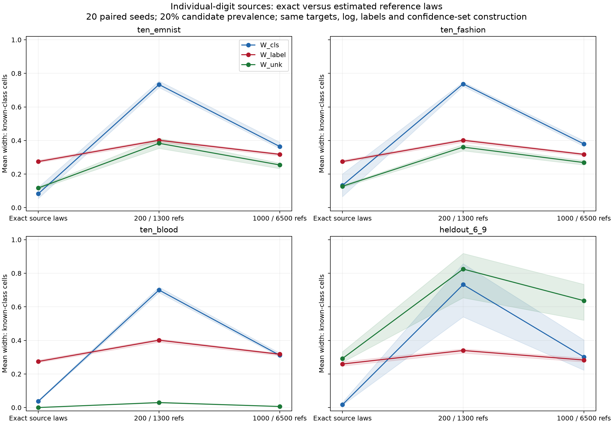
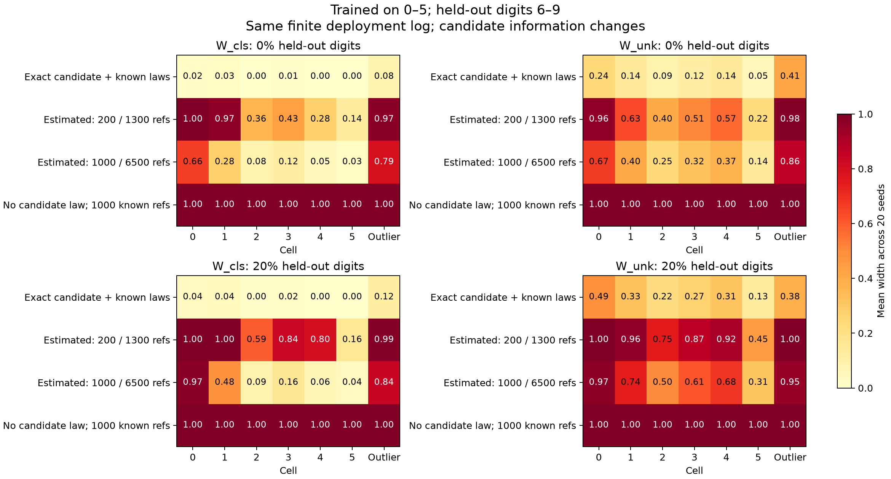

# Individual-digit sources and held-out digits

Both requested experiments are complete. The main comparison restores ten
individual known digit sources. A separate CNN is trained only on 0–5 and
evaluated on 6–9 (MNIST has no digit 10). Estimated source laws materially widen
the three epistemic targets; the exact-source results did not establish a fix
for finite-reference inference.

## What is held fixed in the reference comparison

For each dataset/seed, exact and estimated cases share the model, partition,
individual-digit sources, deployment weights, 8192 deployment observations,
512 target-label observations per known source, target definitions, alpha
allocation, and joint-mass optimization. Only the source-law constraints change.
There are 20 paired seeds. The ten-source experiments use the original frozen
MNIST model and 11-cell partition. Candidate laws are matched to EMNIST,
Fashion or Blood. No even/odd aggregation is used.

The held-out experiment uses six individual known sources and a seven-cell
partition fitted to its new model. Its candidate is an equal-weight mixture of
digits 6,7,8,9. This identifies aggregate candidate membership, not which of
the four unseen digits generated an observation.

Known-source weights are proportional to 1,...,K and normalized to total known
mass. Main runs contain 20% candidate mass. Held-out runs also include a clean
0% control. These fixed choices are documented so cross-workbook differences
are not attributed solely to restoring ten sources.

Cases:

- **Exact:** source laws fixed to empirical population matrices.
- **Estimated 200:** 200 cell references per known digit and 1300 candidate
  references, drawn independently from the same empirical population laws.
- **Estimated 1000:** 1000 per known digit and 6500 candidate references;
  these samples extend the smaller-budget prefixes.
- **Unrestricted unknown (held-out only):** estimated known laws, but no
  candidate law or candidate reference observations used by the interval
  solver. The candidate row can be any normalized probability vector.
- **Known-only test:** check whether the log is compatible with mixtures of
  known rows alone; this reports rejection, not a novelty posterior.

These are finite-pool simulation acquisitions, not new images. Reference and
deployment source laws match by construction. Candidate references are supplied
only after the model/partition are frozen. Tests of train/test source-law shift,
additional model-training seeds and arbitrary candidate discovery remain open.

## Targets and uncertainty construction

W_cls bounds the cell-associated known digit's posterior conditional on known
status. The outlier probe uses a fixed known digit chosen from the true known
row probabilities, identically across reference modes. W_unk bounds aggregate
candidate membership. Both are optimized over a common joint-mass confidence
set with normalized rows and log constraints. Source uncertainty is included
when rows are estimated; these are not the earlier plug-in W_cls values from
the legacy image audit.

W_label bounds the reference-anchored binary target probability. The uniform
anchor is fixed across known digit sources. Target rates are explicitly
synthetic, theta=linspace(.1,.9,K), with known symmetric flip rate .2. They are
not digit identities or medical outcomes. Reference target labels estimate
theta separately from reference inputs estimating source-cell laws. Estimated
rows affect W_label through the anchor shares; its log-independence is retained.

All four simultaneous evidence allocations are .0125: known rows, candidate
row, deployment log, target labels. Counts use Bonferroni Clopper–Pearson bounds;
target rates use Hoeffding bounds with known-flip correction. Exact rows leave
their budget unused. The source-row box for W_label is projected onto the
probe coordinate respecting normalization, and the resulting fractional
optimization uses the extremal target rates.

This is the coherent joint-mass construction for the paper's epistemic targets,
not a verbatim reproduction of its coordinate-relaxed optimizer. Crucially,
the same construction is used across exact and estimated arms here. The core
legacy REACH engine was not silently replaced.

## Ten-source results

Mean widths over known-class cells, then seeds (outlier results are separate):

| Candidate | Reference laws | W_cls | W_label | W_unk |
|---|---|---:|---:|---:|
| EMNIST | Exact | .083 | .275 | .117 |
| EMNIST | 200 / 1300 | .733 | .401 | .383 |
| EMNIST | 1000 / 6500 | .364 | .318 | .254 |
| Fashion | Exact | .132 | .275 | .127 |
| Fashion | 200 / 1300 | .737 | .401 | .361 |
| Fashion | 1000 / 6500 | .380 | .318 | .269 |
| Blood | Exact | .037 | .275 | .00015 |
| Blood | 200 / 1300 | .700 | .401 | .030 |
| Blood | 1000 / 6500 | .312 | .318 | .0063 |

Finite reference uncertainty matters even with unchanged targets and geometry.
Increasing source references reduces all three mean widths, including W_label
through its uncertain source-cell anchor. This is a cross-effect, not a failed
attempt at exclusive uncertainty channels.

Blood's tiny known-cell novelty mean must not hide its outlier result:
outlier W_unk is .019 with exact laws, .371 with smaller reference samples,
and .144 with larger reference samples. The empirical exact zeros no longer
force zero novelty width in known cells when rows are estimated.

## Fresh classifier trained on digits 0–5

Architecture: two convolutional layers (16/32 channels), 64-dimensional feature
embedding and **six-output** classification head. Fresh initialization, five
epochs, Adam lr=.001, seed 20261021. Training uses 3000 images per known digit
(18000 total). Partition fitting uses a disjoint 1000 per known digit (6000
total), PCA-16, LDA and a 99th-percentile distance outlier threshold. Digits
6–9 appear in neither stage. Saved assignment indices verify this exclusion.

On the original MNIST test set:

- Known-digit accuracy: **98.89%**.
- Known-digit outlier fraction: **0.75%**.
- Held-out-digit outlier fraction: **5.34%**.
- Mean held-out-digit softmax confidence: **0.783**.
- Held-out digits with softmax confidence >.9: **39.25%**.

Thus most unseen digits enter known-class cells and many receive confident
known-class predictions. This model has no output for 6–9; confidence on those
images cannot be interpreted as correct recognition of their classes.

At 20% held-out prevalence, mean widths across the six known-class cells:

| Reference information | W_cls | W_label | W_unk |
|---|---:|---:|---:|
| Exact known/candidate laws | .017 | .259 | .292 |
| 200 known / 1300 candidate refs | .732 | .340 | .825 |
| 1000 known / 6500 candidate refs | .302 | .283 | .637 |
| No candidate law; 1000 known refs | 1.000 | .283 | 1.000 |

The outlier novelty widths are .382 (exact), .997 (smaller references) and
.954 (larger references). This held-out-digit problem remains difficult with
finite references, including matched candidate information.

Without a candidate law, membership intervals are [0,1] in these runs, including
the clean control. An arbitrary unknown source can explain the deployment
distribution by itself. Known-class conditional denominators can vanish, which
invokes the stated vacuity policy. This is an information limitation of this
unrestricted model, not evidence that novel digits are absent.

The known-only test rejects the 20%-held-out mixtures in **20/20 runs with exact
known laws**, but **0/20 with either finite-reference budget**. It rejects none
of the clean runs. Finite reference uncertainty permits explanations using
known sources alone; known-only compatibility is not proof of no novelty.

For context, at 20% candidate mass the ten-source known-only test rejects Blood
in all runs at both finite budgets, and EMNIST/Fashion only at the larger
reference budget (20/20 versus 0/20 at the smaller). This measures model-family
compatibility, not a classifier's ability to label the candidate images.

## Validation and reproduction

10,140 interval records passed independent checks: targets recomputed from
saved population matrices, interval identities, coverage indicators, unique
records, paired logs, nested reference draws, candidate-independence of the
label target, training/partition exclusion of 6–9 and analytic LP cases.
Every reported target was included in these runs. This is descriptive evidence
from 20 simulation seeds and one training seed, not general population coverage.

Run in order with the reach-aistats Python environment:

1. `prepare.py` — fresh six-class model, partition, predictions and source laws.
2. `run.py` — paired ten-source and held-out inference experiments.
3. `validate.py` — independent mathematical and artifact checks.
4. `plot_heldout.py` — held-out heatmap and per-digit classifier diagnostics.

Models, source laws, partition, training assignments, raw endpoints, statuses,
per-cell/per-seed summaries, draw counts, hashes and configuration are saved in
this directory. The old two-source conceptual experiment remains a separate
control. These results bridge its assumptions toward finite-reference inference
without claiming that the realistic problem is solved.
