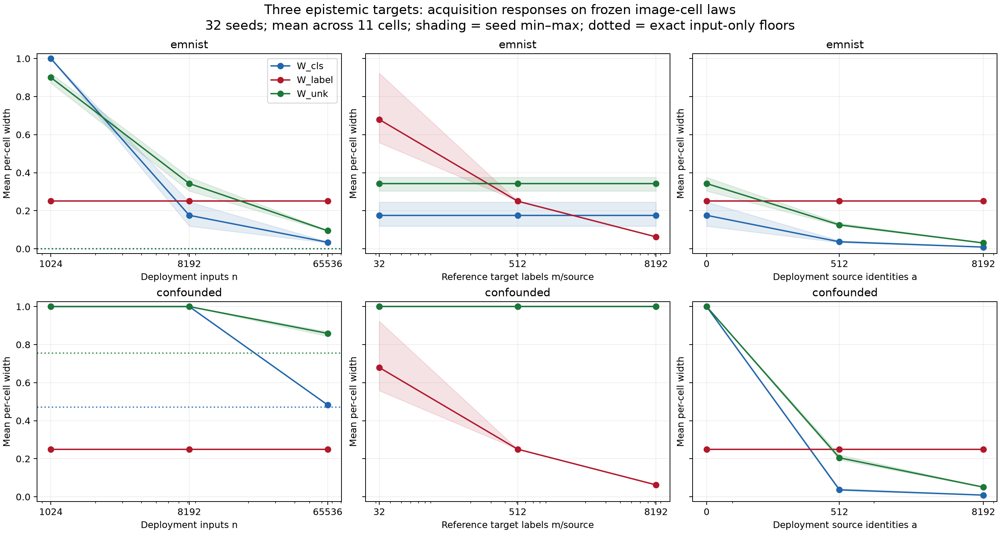

# Three epistemic targets: PDF-aligned acquisition experiment

This experiment implements Section 2, equations (2)–(5), of
`workbook/AISTATS2027_REACH_.pdf` with exact source distributions. Its three
targets are W_cls, W_label and W_unk. W_joint from the older image audit is not
the third target here. The objective is to distinguish information that resolves
each ambiguity, including genuine positive limits under input-only acquisition.

## Explicit semi-synthetic construction

The frozen original MNIST encoder and its 11-cell partition are retained.
Saved deployment-pool digit laws are averaged into two sources: balanced even
digits and balanced odd digits. Deployment weights are (.55,.25,.20).

- **EMNIST world:** candidate source has the saved balanced EMNIST-letter cell
  law. The three source rows have rank 3 and membership is identifiable with
  exact inputs.
- **Confounded world:** candidate law is exactly half of each known-source law.
  This is a constructed observationally indistinguishable source, not a claim
  that actual EMNIST letters have that distribution. The matrix has rank 2.

The binary target Y is simulated independently of the cell given the source,
with known-source rates theta=(.2,.8). It is not digit parity, a semantic image
annotation, or a medical outcome. Reference target labels have independently
flipped observations with known eta=.2. This supplies the paper's separate
target-label channel; eta is held fixed and no aleatoric quantity is estimated.
Deployment source annotations are reliable and include candidate identities.

Source laws are treated as exact empirical probabilities; no reference-input
uncertainty is included in this first control. Draws are iid from these laws,
not new independently collected images. Candidate discovery is not tested.

## Definitions

For each cell c, W_cls bounds known-source-0 membership conditional on known
status. W_unk bounds candidate-source membership among all sources. Both vary
deployment weights over the PDF's coordinate confidence region. Optional source
identity observations constrain the weights directly.

W_label bounds sum_k pi_k(c) theta_k with fixed reference weights rho=(.5,.5),
where pi_k(c)=rho_k A_k(c)/sum_j rho_j A_j(c). Only the independent target-label
stream estimates theta. The label intervals use the PDF's known-flip correction.
These are distinct, nonadditive epistemic targets.

There are 32 simulation seeds. Independent streams supply deployment cells,
reference target labels and source identities; budgets reuse stream prefixes.
Baseline is n=8192 deployment inputs, m=512 target labels per known source, a=0
identities. Sweeps change only one budget:

- n: 1024, 8192, 65536.
- m: 32, 512, 8192 per source.
- a: 0, 512, 8192.

Alpha=.05 is split into four .0125 allocations following the PDF; the unused
reference allocation remains unused. Acquisitions count observations, not equal
cost. No acquisition recommendation or stopping rule is inferred.

## Results

Means below equally weight all 11 cells within seed, then average seeds. The
per-cell CSV preserves heterogeneity; these are not deployment-weighted means.

| Intervention | World | W_cls | W_label | W_unk |
|---|---|---:|---:|---:|
| Baseline | EMNIST | .176 | .250 | .343 |
| n=65536 | EMNIST | .034 | .250 | .095 |
| m=8192 | EMNIST | .176 | .063 | .343 |
| a=8192 | EMNIST | .009 | .250 | .030 |
| Baseline | Confounded | 1.000 | .250 | 1.000 |
| n=65536 | Confounded | .483 | .250 | .859 |
| m=8192 | Confounded | 1.000 | .063 | 1.000 |
| a=8192 | Confounded | .009 | .250 | .051 |

Dotted lines are exact input-only identification floors. Shading is seed
min–max, not a confidence interval. Baseline points across the three columns
represent the same evidence despite different horizontal coordinates.

**The confounded widths should remain positive under inputs alone.** With
s0=.65 and s1=.35, every weight vector
(.65-t/2,.35-t/2,t), 0<=t<=.7, generates exactly the same deployment cell law.
Optimizing the target over this set gives mean exact floors .471 for W_cls and
.756 for W_unk. The LP values agree with closed-form endpoint calculations for
every cell. Finite n=65536 widths remain above those floors. In the EMNIST
world both exact floors are numerical zero.

Reliable identities reduce membership widths below the input-only floors
because they constrain the latent source composition directly. More reference
target labels reduce W_label (.680 at m=32 to .063 at m=8192) without identifying
that composition. More deployment inputs leave W_label unchanged.

These invariances follow from the definitions with exact A. They are useful
implementation controls, not independent empirical proof of disentanglement.
The positive input-only floors and their removal by source identities are the
substantive identification contrast. With estimated A, reference inputs can
affect all three widths; this experiment does not claim exclusive channels in
that setting.

## Validation and scope

All 14,784 intervals are finite, ordered, and contain their generating target.
There are no empty sets; 1,408 membership records invoke the specified
zero-denominator [0,1] policy. Cells and repeated budgets share samples. The
replication unit is the seed; zero observed failures in 32 seeds is not a
general coverage guarantee. LP residuals, definition-level invariances and
analytic identification floors passed checks.

Run `run.py` in the reach-aistats environment. The script writes raw intervals,
per-cell and per-seed summaries, exact floors, plots, configuration including
the source matrices and input hash, and validation results. The existing core
audit and paper text were not modified.

This establishes a concept-aligned control using real image-derived source
laws and a simulated target channel. The next extension should introduce
estimated source laws and reference-input acquisitions while retaining these
three targets, then test actual image-domain shifts separately. A real-world
application of W_label requires a defensible observed target Y distinct from
source identity; the synthetic target here is explicitly an experimental tool.
