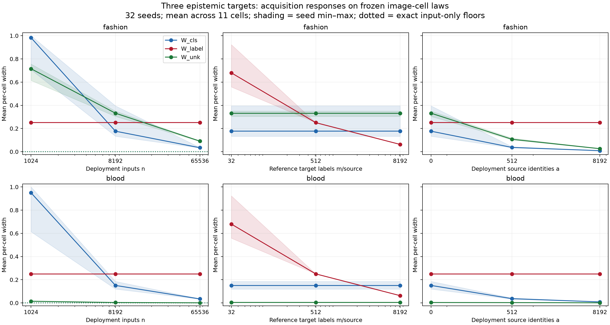

# Three epistemic targets with Fashion and Blood

Both candidate datasets were tested using the PDF-aligned definitions of W_cls,
W_label and W_unk. The original MNIST encoder, 11-cell partition, balanced
even/odd known-source laws, weights (.55,.25,.20), simulated target rates
(.2,.8), known target-label flip rate .2, and acquisition budgets remain fixed.
Each dataset provides its own declared candidate distribution. No EMNIST
candidate reference is substituted for Fashion or Blood.

These are exact empirical-source controls, not unknown-source discovery. The
Fashion law averages ten class histograms from 5,000 saved evaluation images;
Blood averages eight class histograms from 1,712 images. Class weights are
equal rather than their natural frequencies. Independent simulation draws are
made from these frozen laws. Empirical zero probabilities are treated as exact.

Reference target labels remain simulated binary outcomes independent of the
cell given the known source. They are neither garment labels nor medical
outcomes. W_label is the same fixed-anchor known-source target in both domains.

## Acquisition responses

32 seeds per domain; baseline n=8192 deployment inputs, m=512 target labels per
known source, a=0 source identities. Each intervention changes one budget.
Means equally weight all 11 cells, then seeds. They are not averages weighted
by the frequency of observed deployment inputs.

| Domain | Intervention | W_cls | W_label | W_unk |
|---|---|---:|---:|---:|
| Fashion | Baseline | .177 | .250 | .332 |
| Fashion | n=65536 | .034 | .250 | .091 |
| Fashion | m=8192 | .177 | .063 | .332 |
| Fashion | a=8192 | .009 | .250 | .026 |
| Blood | Baseline | .151 | .250 | .00351 |
| Blood | n=65536 | .034 | .250 | .00106 |
| Blood | m=8192 | .151 | .063 | .00351 |
| Blood | a=8192 | .009 | .250 | .00114 |

Both source matrices have rank 3. The exact input-only membership floors are
numerical zero for every cell, unlike the deliberately confounded control in
the parent experiment. Additional deployment inputs and source identities
reduce membership widths. Target-label acquisitions reduce W_label. These
selective responses follow the exact-source definitions; they do not establish
independence of the channels when source distributions must also be estimated.

## Why Blood has a small novelty width

A small W_unk means the candidate-membership probability is well constrained.
It does not mean that the input belongs to the training distribution.

In the saved, class-balanced Blood law, 99.9569% of mass falls in the outlier
cell; .0431% falls in cell 1. The remaining nine candidate cell probabilities
are exactly zero in this finite-pool control. Their novelty posteriors are
therefore identically zero, contributing zero widths to the all-cell mean.

At the outlier cell, baseline interval endpoints averaged over seeds are:

| Candidate | Mean lower | Mean upper | True cell novelty probability |
|---|---:|---:|---:|
| Blood | .9298 | .9608 | .9485 |
| Fashion | .0204 | .9169 | .8032 |

These are mean endpoints from 32 intervals, not a newly calibrated pooled
interval. Blood is confidently attributed to the declared candidate in that
cell. Fashion has substantially more source overlap: only 22.14% of candidate
mass falls in the outlier cell and its remaining mass spans many known-class
cells. Its membership remains less precisely determined at the baseline.

The narrow Blood widths depend on knowing its empirical candidate law exactly.
They do not show that an MNIST classifier recognizes blood-cell types, nor
establish open-set detection. Estimated reference laws would replace empirical
zeros with nonzero upper bounds and may materially widen the intervals.

## Checks and reproduction

All 14,784 intervals were finite, ordered and contained their generating target;
no empty sets or zero-denominator policies occurred. Definition-level invariance
checks and exact-floor checks passed. Coverage is descriptive for 32 seeds and
these fixed empirical laws; cells and budgets are dependent within seeds.

From the parent directory run `run.py --fashion-blood` using the reach-aistats
environment. Outputs include raw endpoints, truth, statuses, per-cell and
per-seed summaries, exact floors, configuration with input hashes and candidate
provenance, validation JSON, and PNG/PDF figures. The original EMNIST/confounded
outputs remain separate and the core REACH implementation is unchanged.

The appropriate follow-up is finite reference-input acquisition with these same
three targets, measuring how uncertainty in the known and candidate cell laws
affects their responses. Interval endpoints should remain visible alongside
widths to distinguish confident novelty from confident known membership.
