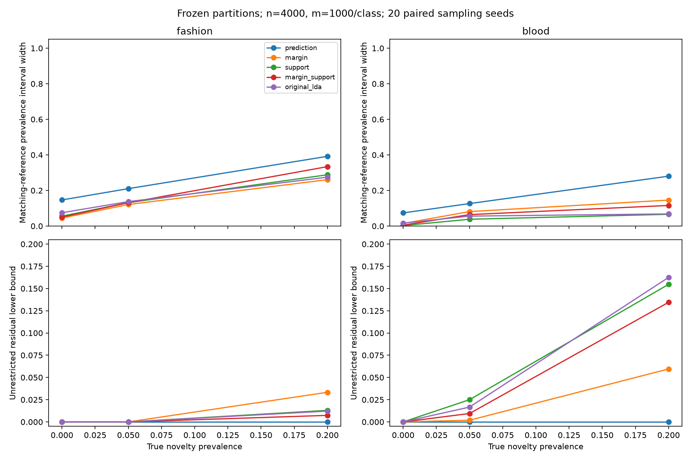

# Frozen margin/distance partitions on Fashion and Blood — 2026-10-20

## Main finding

The boundary insight transfers selectively. Margin bins modestly help Fashion at
the larger budget; support-distance bins help Blood, especially at 5% novelty.
The combined 40-cell partition is usually worse than a simpler partition here.
The gain in geometric information does not automatically outweigh the confidence
penalty and sparse counts introduced by subdividing cells.

Do not replace the original partition with the combined partition on the basis
of the boundary stress test. The evidence favors retaining the original baseline
and testing simpler, budget-aware summaries. Fashion at 5% novelty remains
unresolved at both tested budgets.

## What stayed fixed and what was tested

The MNIST DigitNet encoder, the boundary experiment's linear dropout head, and
all calibration thresholds are reused without fitting or tuning on Fashion or
Blood. Checkpoint and dataset hashes are recorded in config.json. The partitions
are exactly the boundary experiment's five designs:

| Partition | Cells | Observations retained |
| --- | ---: | --- |
| prediction | 10 | Head's predicted digit |
| margin | 20 | Predicted digit × margin below/above 2.648625 |
| support | 20 | Predicted digit × minimum Mahalanobis distance below/above 32.471179 |
| margin_support | 40 | Predicted digit × both binary indicators |
| original_lda | 11 | Original LDA digit/outlier assignments |

The original LDA uses its own saved head and threshold; the other four share the
new linear head. Comparisons among those four isolate the added indicators. A
comparison against original_lda also changes the class-assignment rule.

Each condition uses 20 sampling seeds, novelty prevalence 0%, 5%, or 20%, and
budgets (n=1,000, m=200/class) or (n=4,000, m=1,000/class). Matching or letter
references contain 1,300 draws. Known-source prevalences vary by seed using the
same Dirichlet construction as the earlier pilot. Novel classes are equally
weighted within each domain. Reference and deployment draws are independent,
with replacement, from fixed empirical test populations. Budgets use nested
prefixes; partitions use exactly the same image draws. No new independent images
were acquired. This is a finite-pool inference experiment, not a claim of coverage
on future images or a train/test reference-shift experiment.

We ran 4,800 region evaluations: five partitions × two domains × three prevalence
levels × two budgets × twenty seeds × four inference conditions:

1. **Matching references:** coherent joint count region, with a reference sample
   from the same Fashion/Blood finite population as deployment novelty.
2. **Unrestricted residual:** coherent joint count region with no assumptions
   about the residual source's distribution.
3. **Letter references:** the deliberately mismatched original novelty assumption.
4. **Known-only MMD:** compatibility of the known-source mixture using the existing
   MMD-radius formula, with .025 failure allocation for logs and .025 for references.

The count regions use exact binomial cell bounds with simultaneous Bonferroni
allocation. Total failure budget is .05: log .025, known references .025 for
unrestricted residual; log .025, known .0125, novel .0125 for matching/letters.
Every source row and deployment marginal belongs to the same joint probability
model. The target here is **global source prevalence**, not the earlier workbook's
per-cell novelty posterior. Their interval widths must not be directly compared.

## Main comparison: matching-reference prevalence intervals

Mean interval widths at **20% true novelty**:

| Partition | Fashion: n=1000, m=200 | Fashion: n=4000, m=1000 | Blood: n=1000, m=200 | Blood: n=4000, m=1000 |
| --- | ---: | ---: | ---: | ---: |
| prediction | 0.453 | 0.392 | 0.306 | 0.280 |
| margin | 0.401 | **0.261** | 0.302 | 0.146 |
| support | 0.418 | 0.288 | **0.149** | **0.066** |
| margin_support | 0.474 | 0.334 | 0.260 | 0.116 |
| original_lda | **0.366** | 0.275 | 0.155 | 0.068 |

Fashion's margin-only improvement over LDA at the larger budget is modest and
inconsistent: mean width difference -0.0139, narrower in 12/20 paired seeds, with
differences ranging from -0.0675 to +0.0672. The combined partition is narrower
than LDA in only 2/20 seeds. At the smaller budget, LDA has the narrowest mean
Fashion interval among these choices, and all Fashion intervals include zero.

For Blood at 20% novelty, support-only's mean interval at the larger budget is
[0.165, 0.231], compared with LDA's [0.162, 0.230]. This is a small width improvement,
not a major advantage over the existing outlier cell. It is narrower in 13/20 seeds.

At **5% novelty**, the larger-budget intervals tell a more useful story:

| Partition | Fashion mean interval | Blood mean interval |
| --- | --- | --- |
| prediction | [0.000, 0.210] | [0.000, 0.126] |
| margin | [0.000, 0.121] | [0.003, 0.084] |
| support | [0.000, 0.132] | **[0.026, 0.064]** |
| margin_support | [0.000, 0.131] | [0.010, 0.074] |
| original_lda | [0.000, 0.137] | [0.015, 0.071] |

Blood support-only improves width over LDA in all 20 paired seeds at this setting:
mean difference -0.0176, range [-0.0293, -0.0108]. Its lower endpoint is positive
in all seeds. All Fashion partitions still include zero in every seed. At the
smaller budget, both domains' 5% matching intervals include zero in every seed.

## What can be said without knowing the novel distribution?

The unrestricted source's upper prevalence endpoint is always 1: an arbitrary
source could explain all observations. The informative output is its lower bound,
interpreted as **mass unexplained by any mixture of clean known sources**.

At 20% novelty and the larger budget:

| Partition | Fashion mean lower bound | Blood mean lower bound |
| --- | ---: | ---: |
| prediction | 0.000 | 0.000 |
| margin | **0.033** | 0.060 |
| support | 0.013 | 0.155 |
| margin_support | 0.007 | 0.135 |
| original_lda | 0.012 | **0.163** |

The criterion matters: support-only has slightly narrower matching-reference
intervals for Blood, but original LDA gives a stronger unrestricted lower bound
at 20%. Neither result supports a universal best partition. At 5% Blood novelty,
support-only gives a mean unrestricted lower bound of 0.025 versus LDA's 0.017;
Fashion lower bounds are zero for every partition at that prevalence.

These lower bounds do not identify the cause of residual mass. In this simulation
the cause is the injected Fashion/Blood source; in deployment, conditional shift
or other model mismatch could also explain it.

## Reference mismatch still matters

Letter references can produce tighter intervals that are invalid for the true
Fashion/Blood prevalence. Across all letter-reference records, 182/1,200 regions
are empty; treating empty sets as failures, only 77.8% of records cover truth.
These records are dependent across partitions/budgets, so this percentage is a
diagnostic summary, not an independent coverage estimate.

At 20% Blood novelty and the larger budget, margin, support, and combined regions
reject the letter model in 20/20 seeds. LDA rejects it in 19/20; the one feasible
interval is approximately [0.463, 0.519], excluding the true 0.20. Predicted-class
cells reject none, yet their intervals cover the true prevalence in only 10/20.

For Fashion at the same setting, support/letter intervals are feasible in all
seeds but cover truth in only 8/20. Feasibility is not validation of the reference
assumption. Narrowing intervals while retaining an incorrect novelty model can
make the answer more confidently wrong.

## Why this differs from the boundary experiment

The frozen head's natural-frequency score diagnostics are:

| Domain | Low-margin fraction | Beyond support threshold | Quiet (low TU and EU) |
| --- | ---: | ---: | ---: |
| MNIST | 9.0% | 5.0% | 89.3% |
| Fashion | 72.7% | 51.1% | 8.9% |
| Blood | 49.8% | 100.0% | 3.1% |

Blood already separates almost completely by distance. Adding margin subdivisions
mostly spends confidence budget on distinctions it does not need. Fashion's margin
signal is useful, but a 5% mixture changes the known population only slightly;
the simultaneous source/log bounds still admit a clean-source explanation.

The count regions for finer partitions are not constructed as nested refinements
of the coarse confidence regions: their multiplicity corrections and individual
cell bounds change. More observed detail therefore need not yield a narrower
region. MMD sensitivity also depends on how mass is distributed among cells:
splitting an outlier mass over class-specific cells changes its Euclidean signal.
For example, the known-only MMD test detects 20% Blood novelty in 16/20 larger-budget
LDA runs, but only 3/20 support runs. The count-based unrestricted region detects
it in all 20 for both partitions. Geometry and region construction both matter.

## Validation, limits, and reproduction

All 1,200 matching-reference intervals and all 1,200 unrestricted intervals contain
their declared finite-pool prevalence in this run. All clean controls have zero
positive detection flags. These checks do not establish general 95% population
coverage. Only one frozen encoder, one head and twenty sampling seeds were used.
The best observed partitions are descriptive comparisons, not a prospectively
validated rule for selecting a partition for an unknown deployment domain.

Historical LDA assignments match for all 5,001 audited MNIST and 1,712 Blood rows.
One of 5,000 audited Fashion rows changes cells: index 4603 has recomputed distance
42.083016 versus historical 42.073533, straddling threshold 42.079752. The cause was
not conclusively isolated; no old assignment was substituted. All methods use the
same recomputed populations, and the discrepancy is recorded explicitly.



From REACH_AISTATS, with the reach-aistats environment:

```bash
python workbook/fashion_blood_partitions_2026-10-20/run.py
python workbook/fashion_blood_partitions_2026-10-20/validate.py
```

`regions.csv` stores all runs, `summary.csv` stores grouped results, and
`paired_width_differences.csv` compares each partition against LDA on the same
draws. `cell_populations.npz`, `draw_manifest.json`, checkpoint/data hashes, and
the deterministic seed scheme record the inputs. The validation checks unchanged
thresholds, artifact hashes, pairing, cell ranges, interval identities, empty-set
handling and clean controls. No model retraining or dataset downloads occurred.

The next useful methodological test is coarser or jointly constrained summaries
that preserve useful margin/distance information without paying for every class
cross-product separately. This experiment does not yet implement or validate such
a revision, and does not justify choosing CLIP as the next fix.
