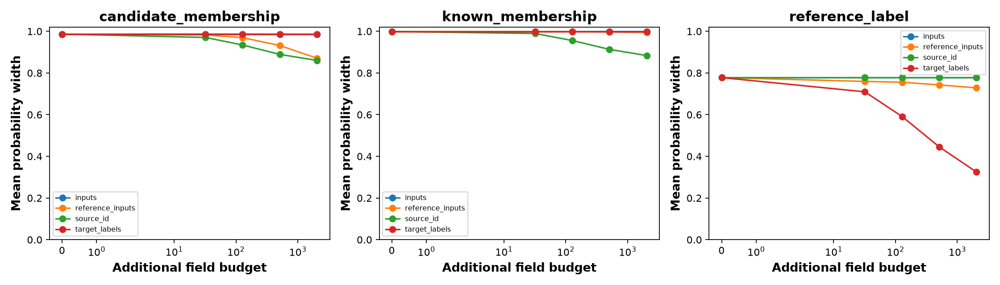

# FMoW image acquisition pilot

This README presents the results saved **in this run folder**, using its executed notebook and archived implementation to explain the figures and tables. It does not import results from companion experiments.

**Result:** source identities reduce membership widths, while stratified target labels reduce the reference-label width most strongly. Membership intervals remain broad. All 1,200 intervals contain their corresponding fixed empirical targets, but that descriptive check does not establish population calibration or method superiority.

**Notebook coverage:** [executed.ipynb](executed.ipynb) embeds the acquisition figure in section 5 and displays split counts, accuracy, OOD metrics, and acquisition summaries. The [source snapshot](source_notebook.ipynb) has no embedded figures. Additional exported diagnostics, including empirical containment and source-law drift, are summarized below. See [RESULTS.md](RESULTS.md), [result.json](result.json), and [SOURCES.md](SOURCES.md) for the run report and recorded foundations.

## Dataset, sources, and selected population

Internal source codes are **0 = Americas**, **1 = Europe**, and **2 = Asia**. Americas and Europe are known sources; Asia is the specified candidate source. This is region/domain novelty, not held-out-class novelty. Full class labels are retained for classification.

The experiment uses observations before 2016. Later observations remain in the record audit but are excluded from image selection and acquisition. It therefore tests region shift under a custom split, not the official WILDS temporal benchmark.

Groups are locations rounded to 0.01 degrees, assigned to fit/reference/evaluation roles by a seeded identity hash, targeting approximately 60%/20%/20%. Repeated observations within a group stay together. The following counts are from [split_counts.csv](split_counts.csv) before the notebook filters later years; they are not the selected image counts.

| Region | Role | Audited records | Audited groups | Selected pre-2016 images | Groups represented in selection |
|---|---|---:|---:|---:|---:|
| Americas | evaluation | 8,474 | 2,701 | 2,000 | 1,259 |
| Americas | fit | 24,919 | 8,106 | 2,000 | 1,669 |
| Americas | reference | 8,372 | 2,701 | 2,000 | 1,272 |
| Asia | evaluation | 6,451 | 2,248 | 2,000 | 1,177 |
| Asia | fit | 19,203 | 6,748 | 2,000 | 1,605 |
| Asia | reference | 6,547 | 2,248 | 2,000 | 1,168 |
| Europe | evaluation | 11,395 | 4,244 | 2,000 | 1,493 |
| Europe | fit | 35,459 | 12,732 | 2,000 | 1,749 |
| Europe | reference | 11,970 | 4,244 | 2,000 | 1,493 |

The [data audit](data_audit.json) contains 132,790 retained records and 45,972 groups. The pilot samples 18,000 images without class balancing: 2,000 per source and role. Equal source caps change source proportions relative to the original pool. The selected evaluation images represent 1,259 Americas, 1,493 Europe, and 1,177 Asia groups; repeated images are not additional independent locations. Selected group counts above are calculated directly from [selected_images.csv](selected_images.csv).

The [post-run audit](postrun_audit.json) separately records 32 local Parquet files with 141,696 rows and 14,612,709,837 bytes before the retained-record audit. [input_local_sha256.json](input_local_sha256.json) stores local hashes; they were **not verified against upstream hashes**. The shared source list mentions possible mirror transport, but the actual protocol records a local FMoW data root.

## Training and probability targets

A frozen ImageNet-pretrained ResNet18 produces 512-dimensional features. CE and DAPPr heads use the same features and matched initialization/minibatch seeds, trained for 30 epochs on the 4,000 known-source fit images. Candidate labels are excluded from neural training; reference/evaluation labels do not select epochs. CE predictions use 30 MC-dropout passes through Probly. Four KMeans cells are fitted using known-source fit features only.

For acquisition, the binary target is **class 42**, saved in [bounds_definition.json](bounds_definition.json). The archived code selects the modal class among selected known-source fit images, breaking ties by label order, before evaluating held-out labels. This binary event is separate from the multiclass classification task.

| Acquisition target | Probability being bounded |
|---|---|
| `candidate_membership` | P(Asia given cell), relative to this specified candidate region |
| `known_membership` | P(Americas given cell and membership in Americas or Europe); not the probability of being ID |
| `reference_label` | P(class 42 given cell) under fixed equal known-source reference weights, using source-and-cell-conditional label rates |

The method optimizes probability ratios over a compatible set of joint source/cell masses. Reference observations constrain source-conditional cell laws, deployment inputs constrain cell marginals, and identities constrain source proportions. The label target uses reference populations and fixed weights; it is not the deployment class prevalence. These three widths are not an additive uncertainty decomposition.

## Acquisition design

Baseline information is 128 reference inputs per source, 128 deployment inputs, 32 deployment identities, and 16 labels per known-source/cell stratum. Each sweep adds one channel while retaining the others. Observations resample real records with replacement, conditional on the selected empirical populations; they are not newly collected satellite images.

| Arm | Added fields at displayed budget b | What is learned |
|---|---|---|
| `inputs` | b | Deployment cell frequencies |
| `source_id` | b | Deployment source proportions |
| `reference_inputs` | 3 × floor(b/3) | Cell laws for all three sources |
| `target_labels` | 8 × floor(b/8) | Class-42 rates across two known sources × four cells |

The budgets are 0, 32, 128, 512, and 2,048, with five acquisition repeats and a fixed feature/cell map. At budget 2,048, reference acquisition adds 2,046 fields; the other arms add 2,048. A reference service supplies stratum selection, and unrequested fields are hidden. This field accounting does not measure real-world collection costs.

## Acquisition figure and interpretation

[Open full-size PNG](acquisition_bounds.png) · [Summary](acquisition_summary.csv) · [All endpoints](acquisition_intervals.csv)

Panels run left to right: candidate membership, known membership, and reference label. Each plotted value is the unweighted mean over **four cells × five repeats**, not an image-frequency-weighted mean. The horizontal axis uses a symmetric-log scale. No confidence or repeat-range bands are plotted.

| Setting | Candidate membership width | Known membership width | Reference-label width |
|---|---:|---:|---:|
| Baseline | 0.986577 | 0.999092 | 0.777869 |
| Inputs, budget 2,048 | 0.985926 | 0.998975 | 0.777869 |
| Reference inputs, budget 2,048 | 0.870758 | 0.994621 | 0.728479 |
| Source identities, budget 2,048 | 0.860340 | 0.883706 | 0.777869 |
| Target labels, budget 2,048 | 0.986577 | 0.999092 | 0.324436 |

At the maximum budget, identities reduce candidate width from 0.986577 to 0.860340 and known-membership width from 0.999092 to 0.883706. Reference acquisition also reduces candidate width, to 0.870758, but barely changes known-membership width. Deployment inputs alone make little difference in this configuration.

Target labels most strongly reduce reference-label width, from 0.777869 to approximately 0.324. They leave membership intervals unchanged. Inputs and identities leave the reference-label target unchanged because its source weights are fixed. The remaining membership widths are large; contraction alone does not establish precise identification or superiority over neural uncertainty scores.

## Empirical containment and numerical checks

There are 1,200 interval queries: five repeats × four arms × five budgets × four cells × three targets. All have finite endpoints and contain the corresponding empirical target in [empirical_target_diagnostics.csv](empirical_target_diagnostics.csv). The [containment summary](empirical_containment_summary.csv) reports 20/20 contained intervals in each of its 60 settings.

The targets in that check come from different populations:

- Membership targets use the selected **evaluation** records within each cell.
- The reference-label target uses the selected **reference** records with equal known-source weights.

This is descriptive containment of fixed empirical targets, not estimated coverage for new locations. Wide intervals, including `[0, 1]` fallbacks, make containment easier. Repeated settings share observations and are not independent validation trials.

There are no empty feasible sets. Of the 1,200 intervals, 140 (11.67%) use the explicit `[0, 1]` policy because conditioning mass could be zero; 1,060 have status `ok`. Maximum recorded solver residual is approximately `2.26e-14`.

| Arm at budget 2,048 | Candidate undefined fraction | Known undefined fraction | Label undefined fraction |
|---|---:|---:|---:|
| inputs | 0% | 40% | 5% |
| reference_inputs | 0% | 0% | 0% |
| source_id | 0% | 5% | 5% |
| target_labels | 5% | 40% | 5% |

The pooled mean width is 0.889324 in [result.json](result.json); it mixes distinct targets, budgets, and channels and should not be treated as a single epistemic score.

## Source-law transfer diagnostic

The saved empirical total-variation distances between reference and evaluation source-cell laws are:

| Source | Total variation |
|---|---:|
| Americas | 0.0135 |
| Europe | 0.0125 |
| Asia | 0.0145 |

These distances are half the sum of absolute differences across the four cells; see [source_law_drift.csv](source_law_drift.csv) and [source_cell_law_audit.csv](source_cell_law_audit.csv). They are small in this selected finite representation, but do not prove stable natural-population laws or exclude differences hidden by the coarse cells.

The per-box error allocation is approximately `3.84615e-5`, from a 0.05 union allocation across the run. Its interpretation is conditional empirical-resampling box coverage. Transferring reference constraints to evaluation or new locations additionally requires stable source-cell laws. This is not an unconditional 95% new-location coverage result, and no exact input-only identification floor is computed.

## Complementary classification results

Each method is evaluated on the same 2,000 images per region. These multiclass accuracies are saved in [accuracy.csv](accuracy.csv).

| Region | Role | CE accuracy | DAPPr accuracy |
|---|---|---:|---:|
| Americas | Known | 24.25% | 26.90% |
| Europe | Known | 24.05% | 26.00% |
| Asia | Candidate | 12.00% | 13.10% |

DAPPr has higher observed accuracy in each region in this run, while both heads perform worse on Asia. These are frozen-encoder pilot results without location-level uncertainty intervals or multiple model-training seeds; they do not establish general superiority.

## Complementary OOD detection results

OOD means Asia (2,000 images); ID combines Americas and Europe (4,000 images). Higher scores indicate greater OOD suspicion. The table uses the tie-correct `auroc` column from [ood_scores.csv](ood_scores.csv).

| Score | OOD AUROC | OOD AUPR | FPR at 95% TPR |
|---|---:|---:|---:|
| mc_mi | 0.573703 | 0.402949 | 0.899750 |
| mc_width | 0.545837 | 0.364235 | 0.912000 |
| dappr_eu | 0.560500 | 0.378526 | 0.919500 |
| negative_max_softmax | 0.525669 | 0.343479 | 0.892500 |

MC MI has the highest observed AUROC, 0.573703, but all four AUROCs are close to 0.5 and false-positive rates at the reported 95% detection point are high (about 0.89–0.92). The CSV also saves ID-oriented AUPR and raw Probly AUROC; raw/tie-correct differences here are at most `1.25e-7`.

MC widths describe the finite envelope across 30 sampled class-probability predictors, without a population coverage guarantee. DAPPr uses its scalar K/sum(alpha). Source-compatible widths concern different events and use different information. These numbers cannot be interpreted as an equal-information comparison of the same uncertainty quantity, and detection metrics do not establish an acquisition counterexample.

## Reproducibility and limits

[postrun_audit.json](postrun_audit.json) reports 18 historical implementation tests passed and a mixed-ISO timestamp parsing fix with unchanged protocol thresholds. [execution_status.json](execution_status.json) records completion. This README summarizes saved evidence; it does not rerun training or those tests.

The experiment has a single frozen-encoder configuration, a coarse four-cell representation, five empirical acquisition repeats, a specified candidate region, and field-based acquisition costs. It does not test arbitrary unknown-source detection, estimate aleatoric uncertainty, establish temporal-shift performance, or prove neural acquisition insufficiency. The folder's shared [REVIEW.md](REVIEW.md) covers other runs; only this run's artifacts are summarized here.

## Complete artifact index

| Artifacts | Contents |
|---|---|
| [executed.ipynb](executed.ipynb), [source_notebook.ipynb](source_notebook.ipynb) | Executed notebook and archived source |
| [RESULTS.md](RESULTS.md), [result.json](result.json), [execution_status.json](execution_status.json) | Run report and completion status |
| [SOURCES.md](SOURCES.md), [protocol.json](protocol.json), [bounds_definition.json](bounds_definition.json) | Recorded foundations, design, and target definitions |
| [REVIEW.md](REVIEW.md), [postrun_audit.json](postrun_audit.json) | Shared historical review and audit |
| [data_audit.json](data_audit.json), [split_counts.csv](split_counts.csv), [record_index.csv.gz](record_index.csv.gz), [selected_images.csv](selected_images.csv) | Provenance, full partition, and selected records |
| [encoder.json](encoder.json), [features.npz](features.npz), [feature_scaler.pt](feature_scaler.pt) | Frozen encoder metadata, features, and scaling state |
| [ce_head.pt](ce_head.pt), [dappr_head.pt](dappr_head.pt), [training_history.csv](training_history.csv) | Trained heads and history |
| [accuracy.csv](accuracy.csv), [ood_scores.csv](ood_scores.csv), [image_scores.csv](image_scores.csv), [mc_representation.npz](mc_representation.npz) | Classification/detection outputs and MC representation |
| [cell_centers.npy](cell_centers.npy), [reference_cells.csv](reference_cells.csv), [evaluation_cells.csv](evaluation_cells.csv) | Cell map and record assignments |
| [source_cell_law_audit.csv](source_cell_law_audit.csv), [source_law_drift.csv](source_law_drift.csv) | Reference/evaluation laws and drift |
| [acquisition_record_ids.json](acquisition_record_ids.json), [acquisition_intervals.csv](acquisition_intervals.csv), [acquisition_summary.csv](acquisition_summary.csv) | Sampled records, endpoints/statuses, and curves |
| [empirical_target_diagnostics.csv](empirical_target_diagnostics.csv), [empirical_containment_summary.csv](empirical_containment_summary.csv) | Empirical targets and containment checks |
| [source_representation.npz](source_representation.npz) | Baseline source-membership bounds for repeat 0 |
| [wilds_vision.py](wilds_vision.py), [wilds_records.py](wilds_records.py), [source_acquisition.py](source_acquisition.py), [probability_bounds.py](probability_bounds.py) | Archived training, data, solver, and representation code |
| [beta_acquisition.py](beta_acquisition.py), [wilds_counterexample.py](wilds_counterexample.py), [build_wilds_notebooks.py](build_wilds_notebooks.py), [test_wilds_acquisition.py](test_wilds_acquisition.py) | Shared code/build/test snapshots; their presence does not imply counterexample results in this run |
| [versions.json](versions.json), [input_local_sha256.json](input_local_sha256.json), [artifact_manifest.json](artifact_manifest.json) | Versions and integrity records; the original manifest predates this README |

The acquisition PNG is the only standalone figure saved here; no PDF is present. The complementary results above are tables so they can be read without opening Jupyter.
