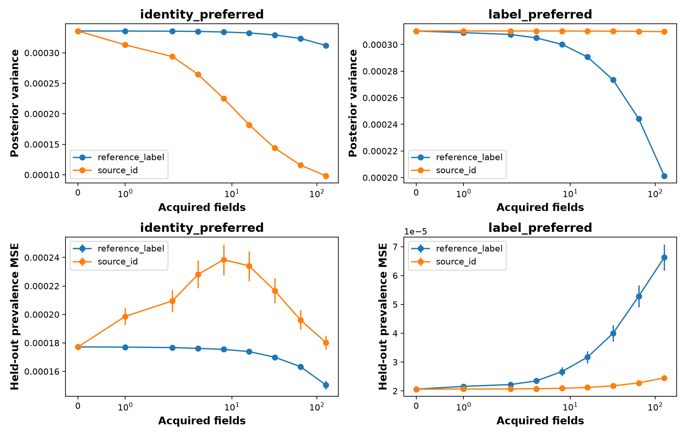

# FMoW real-record counterexample search

This README presents only the evidence saved in this run folder, using its executed notebook and archived code to interpret the figure and complementary tables.

**Outcome: the prespecified held-out confirmation failed (`confirmed: false`).** Among 600 information states, 32 pairs met the fixed near-matching criteria. However, both selected states' one-step held-out preferences oppose the model-predicted preferences. The states must not be relabeled after evaluation to turn this into a successful confirmation.

This experiment estimates a population class prevalence from recorded region identities and labels. It does not condition on image pixels, train a neural model, or provide an exact-equality theorem.

**Notebook coverage:** [executed.ipynb](executed.ipynb) embeds the sole saved figure in section 3 and displays split counts, the result report, and selected states. The [source snapshot](source_notebook.ipynb) has no embedded figures. Additional saved tables are summarized below. See [RESULTS.md](RESULTS.md), [result.json](result.json), and [SOURCES.md](SOURCES.md). The shared [REVIEW.md](REVIEW.md) covers other experiments too; their results are not included here.

## Data and target

The two included sources are **Americas (internal source 0)** and **Europe (internal source 1)**. Asia appears in the full record audit but is excluded from this two-source search and validation. Only pre-2016 records are used. Fit records construct initial states; evaluation records supply held-out observations. The calculation does not use the reference-role records or impose the shared notebook's image-pilot cap.

Spatial groups are latitude/longitude locations rounded to 0.01 degrees. A seeded identity hash assigns whole groups to fit/reference/evaluation roles, targeting approximately 60%/20%/20%; repeated observations within a group stay together. This is a custom group-disjoint split, not the official WILDS temporal benchmark.

The binary event is **class 42**, selected as the modal known-source training class with a deterministic label tie-break before held-out evaluation, as recorded in [target_definition.json](target_definition.json).

| Region | Eligible fit records / groups | Eligible held-out records / groups | Fit class-42 rate | Held-out class-42 rate |
|---|---:|---:|---:|---:|
| Americas | 20,312 / 7,182 | 6,640 / 2,353 | 14.6121% | 13.0723% |
| Europe | 32,063 / 11,684 | 10,236 / 3,904 | 6.6089% | 5.3634% |

Counts and rates come from [population_rates.csv](population_rates.csv); eligible group counts above are calculated from [record_index.csv.gz](record_index.csv.gz) after applying the archived code's source, role, and pre-2016 filters. [split_counts.csv](split_counts.csv) describes the broader audit before temporal filtering and should not be confused with these eligible counts.

Both states estimate the same target:

`T = (1 − W) × Theta_0 + W × Theta_1`,

where W is the Europe proportion and Theta_s is the class-42 rate within source s. Weighting held-out rates by their record counts gives the fixed empirical prevalence **0.083965395**. This is a prevalence in the retained empirical population, not all global imagery.

## Model, channels, and search criteria

Independent Beta(1,1) priors on W, Theta_0, and Theta_1 are updated using recorded observations. One `source_id` acquisition reveals a random deployment source identity and updates W. One `reference_label` acquisition selects Americas or Europe with equal probability, then reveals a label from that source and updates its Theta. During validation, these labels come from evaluation records despite the action name. Both actions have unit field cost by assumption.

Predictive epistemic MI is `h(E[T]) − E[h(T)]`. The model's acquisition values are expected reductions in posterior variance of T under its posterior predictive law. Those expectations differ from error against a fixed held-out prevalence under the actual empirical observation law.

The fixed search scans six initial identity budgets (0, 2, 8, 32, 128, 512), five label budgets **per source** (2, 8, 32, 128, 512), and 20 repetitions: 600 candidate states. A pair must meet all of these conditions:

- MI relative difference at most 1%.
- Predictive-mean absolute difference at most 0.02.
- Target-variance relative difference at most 10%.
- Opposite model-preferred actions, each with at least a twofold value margin.

Relative differences divide by the average of the two values. Selection minimizes MI discrepancy, then breaks ties by state IDs, without evaluation outcomes. [protocol.json](protocol.json), [candidate_states.csv](candidate_states.csv), and [qualifying_pairs.csv](qualifying_pairs.csv) preserve the rules and all 32 matches. Their frequency is not a population prevalence estimate of such behavior.

## Selected information states

| Quantity | State 287: model identity-preferred | State 561: model label-preferred |
|---|---:|---:|
| Initial identities | 8 | 512 |
| Initial labels per source | 512 | 128 |
| Posterior mean of T | 0.097276265 | 0.088506435 |
| Posterior variance of T | 0.000335805145 | 0.000310214773 |
| Predictive MI (nats) | 0.001911019217 | 0.001912249414 |
| Identity posterior Bayes value | 2.2710412e-05 | 2.51246744e-09 |
| Label posterior Bayes value | 7.57981317e-08 | 1.17684603e-06 |

The MI relative difference is **0.0643531%**, mean difference is 0.008769829, and variance relative difference is 7.92247%. These satisfy the matching thresholds but are not equality of the full predictive distributions.

The Beta shapes, ordered as W, Theta_0, Theta_1, are:

- State 287: Beta(6,4), Beta(83,431), Beta(28,486).
- State 561: Beta(330,184), Beta(16,114), Beta(9,121).

See [selected_states.csv](selected_states.csv) and [initial_observation_ids.json](initial_observation_ids.json). The states have different historical information totals; the equal-cost assumption applies to each subsequent acquisition.

## Exact held-out endpoint: both predicted preferences fail

For each frozen state, the code enumerates possible next observations using actual held-out source proportions and label rates, then calculates expected squared error of the updated posterior mean against the same held-out prevalence. This finite-population expectation does not depend on Monte Carlo trajectories.

| Model-selected state | Initial squared error | Expected error after identity | Expected error after label | Empirically lower-error action |
|---|---:|---:|---:|---|
| 287: identity preferred | 0.000177179259 | 0.000198071749 | 0.000176917265 | Label |
| 561: label preferred | 0.000020621049 | 0.000020657365 | 0.000021405815 | Identity |

Source: [heldout_exact_one_step.csv](heldout_exact_one_step.csv).

The prespecified identity advantage is `error(label) − error(identity)` in state 287: **−0.000021154485**. The label advantage is `error(identity) − error(label)` in state 561: **−0.000000748450**. Confirmation requires both to be positive; both are negative, so [result.json](result.json) records failure.

In state 287, an identity observation actually increases expected error relative to the initial estimate. In state 561, both actions slightly increase expected error, though identities increase it less. Thus “preferred” in the saved role names means model-selected preference, not demonstrated held-out benefit. Different empirical best actions do not rescue the prespecified test by reversing those labels after the fact.

## Acquisition figure

[Open full-size PNG](acquisition_curves.png) · [Summary data](acquisition_summary.csv) · [All trajectories](trajectories.csv.gz)

The left column is state 287 (`identity_preferred`); the right is state 561 (`label_preferred`). The top row shows mean posterior variance; the bottom shows mean squared error against the fixed held-out prevalence. The horizontal axis is acquired fields on a symmetric-log scale.

There are 2,000 paired repetitions at budgets 0, 1, 2, 4, 8, 16, 32, 64, and 128. Each sweep repeatedly acquires one channel; it is not an adaptive mixture of actions. Streams are paired across states. MSE error bars are **±1.96 Monte Carlo standard errors**, not population confidence intervals over new locations. No error bars appear on the posterior-variance panels.

The top panels favor the model-selected channels: identities reduce variance more in state 287, labels in state 561. The bottom panels show the opposite MSE ordering at every saved positive budget. Posterior concentration and lower held-out error are distinct outcomes.

At 128 acquired fields:

| State | Acquisition | Mean posterior variance | Held-out MSE | MSE Monte Carlo SE |
|---|---|---:|---:|---:|
| 287 | reference_label | 0.000311995 | 0.000150428 | 0.000001493 |
| 287 | source_id | 0.000098335 | 0.000180275 | 0.000002523 |
| 561 | reference_label | 0.000201308 | 0.000066263 | 0.000002329 |
| 561 | source_id | 0.000309718 | 0.000024509 | 0.000000103 |

The curves therefore reinforce the distinction behind the failed endpoint. Posterior Bayes action values average over the declared posterior model; held-out MSE depends on the actual observation law and initial estimation error. They need not rank actions identically. The empirical source rates differ between fit and evaluation, but this run does not separately identify which part of the mismatch causes each effect.

## Complementary target-probability enclosures

| State | Lower bound | Upper bound | Width |
|---|---:|---:|---:|
| 287 | 0.042460817 | 0.173041926 | 0.130581109 |
| 561 | 0.038274954 | 0.160133696 | 0.121858742 |

These [95% posterior credible enclosures](target_credible_enclosures.csv) bound the three Beta parameters with a Bonferroni allocation and evaluate the target at all component-box vertices. Both contain the fixed held-out prevalence. This two-state containment check does not establish calibration or correct action choice.

The enclosures concern the probability T, not MI. Their posterior-content interpretation is conditional on the model; they are not new-location confidence intervals or support/identification intervals. Beta support remains [0,1].

## Numerical checks and provenance

MI is integrated by Gauss–Jacobi quadrature and rechecked at twice the order (48). The maximum change for the selected states is approximately `2.78e-16`, below the archived `1e-7` convergence threshold.

| State | Quadrature MI | Probly MI from 100,000 posterior samples |
|---|---:|---:|
| 287 | 0.001911019217 | 0.001900505516 |
| 561 | 0.001912249414 | 0.001899761804 |

The [Probly values](probly_check.csv) are sampled cross-checks, not exact matches; the search uses quadrature. No standard errors for these sampled MI estimates are exported.

The [data audit](data_audit.json) retains 132,790 records and 45,972 groups across the three audited regions, including records outside this counterexample's filters. [postrun_audit.json](postrun_audit.json) records 32 local Parquet files, 141,696 rows before retained-record filtering, 14,612,709,837 bytes, and 18 historical tests passed. It notes a mixed-ISO timestamp parsing fix with protocol thresholds unchanged. [input_local_sha256.json](input_local_sha256.json) contains local hashes not verified against upstream.

[execution_status.json](execution_status.json) records successful execution; that is separate from scientific confirmation, which failed. Creating this README does not rerun the archived experiment or tests.

## Interpretation limits

This run found a selected near-match under its Beta model, but did **not** confirm the predicted held-out acquisition reversal. It does not establish that MI is wrong, that DAPPr fails, that static bounds solve acquisition choice, or that uncertainty summaries universally suffice. There is no neural model evaluation in this calculation.

Observations are resampled from fixed empirical records. Repeated records and budgets do not supply independent new locations, and the error bars quantify resampling rather than geographic-population uncertainty. The prior family, binary event, two channels, equal costs, searched pair, and pre-2016 custom split delimit the result. No temporal-benchmark or global-prevalence claim follows.

## Complete artifact index

| Artifacts | Contents |
|---|---|
| [executed.ipynb](executed.ipynb), [source_notebook.ipynb](source_notebook.ipynb) | Executed notebook and source snapshot |
| [RESULTS.md](RESULTS.md), [result.json](result.json), [execution_status.json](execution_status.json) | Negative confirmation result and execution status |
| [SOURCES.md](SOURCES.md), [protocol.json](protocol.json), [target_definition.json](target_definition.json) | Foundations, frozen matching/validation rules, and event |
| [REVIEW.md](REVIEW.md), [postrun_audit.json](postrun_audit.json) | Shared historical review and audit; other runs' results are outside this README |
| [data_audit.json](data_audit.json), [split_counts.csv](split_counts.csv), [record_index.csv.gz](record_index.csv.gz), [population_rates.csv](population_rates.csv) | Provenance, partition, and eligible source counts/rates |
| [candidate_states.csv](candidate_states.csv), [qualifying_pairs.csv](qualifying_pairs.csv), [selected_states.csv](selected_states.csv) | Complete search, matches, and selected posterior shapes |
| [initial_observation_ids.json](initial_observation_ids.json) | Record IDs constructing the candidate states |
| [heldout_exact_one_step.csv](heldout_exact_one_step.csv) | Exact one-step held-out error comparisons |
| [target_credible_enclosures.csv](target_credible_enclosures.csv), [probly_check.csv](probly_check.csv) | Probability enclosures and MI cross-check |
| [acquisition_summary.csv](acquisition_summary.csv), [trajectories.csv.gz](trajectories.csv.gz), [acquisition_record_ids.npz](acquisition_record_ids.npz) | Aggregate curves, 72,000 trajectory rows, and paired record IDs/outcomes |
| [beta_acquisition.py](beta_acquisition.py), [wilds_counterexample.py](wilds_counterexample.py), [wilds_records.py](wilds_records.py) | Archived model, search/validation, and data code |
| [test_wilds_acquisition.py](test_wilds_acquisition.py) | Saved tests |
| [wilds_vision.py](wilds_vision.py), [source_acquisition.py](source_acquisition.py), [probability_bounds.py](probability_bounds.py), [build_wilds_notebooks.py](build_wilds_notebooks.py) | Shared companion implementation and notebook-builder snapshots; not evidence of image-model training here |
| [versions.json](versions.json), [input_local_sha256.json](input_local_sha256.json), [artifact_manifest.json](artifact_manifest.json) | Versions and integrity records; the original manifest predates this README |

The acquisition PNG is the only standalone figure saved in this folder. No PDF is present. Complementary numerical results are included above as tables and linked to their full artifacts.
