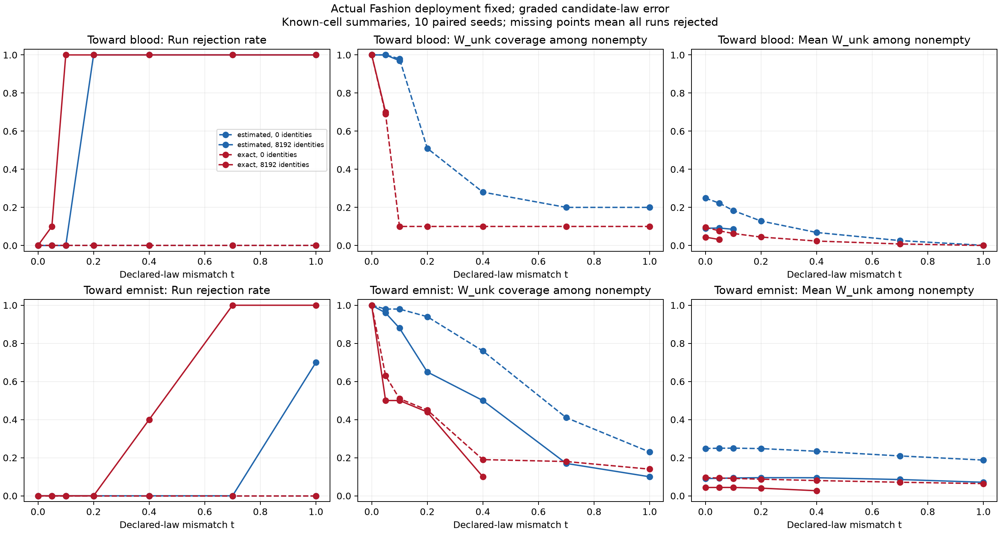

# Graded candidate mismatch

Date: 2026-10-22. Implements step 2 of the [CVPR roadmap](../CVPR_ROADMAP.md),
following the [initial contribution audit](../contribution_audit_2026-10-22/AUDIT.md).

## Fixed design

Actual deployment is always 80% known MNIST digits and 20% Fashion, with the
previous unequal digit weights. The declared candidate law varies as
`q_t = (1-t) q_Fashion + t q_bad`, where q_bad is Blood or EMNIST and
t = 0, 0.05, 0.1, 0.2, 0.4, 0.7, 1. This grid was saved before execution.
The deployment law and membership targets do not change with t.

Reuse the original frozen CNN and 11-cell partition. Within each of ten paired
seeds, keep 16,000 deployment observations, 1,000 references per digit, 512 binary
target labels per digit, and the source-identity stream fixed. Draw 6,500 candidate
references from q_t with common uniforms across t. Compare estimated versus exact
declared source laws, and 0 versus 8,192 reliable external identities. Error shares
remain 0.01 per evidence family. No models are retrained or new images collected.
The seed prefix and draws reproduce the preceding matched/full-mismatch study.

All three targets are recorded for every cell. Narrow-but-wrong means width ≤ 0.1
and exclusion of the truth. Truth distance is zero when the interval contains the
target, otherwise the distance to its closest endpoint; it is undefined for
rejected runs. Compatibility is a global property and counted once per run.

Population diagnostics additionally compute minimum TV distance from actual p
to the declared mixture convex hull, allowing arbitrary weights. This is distinct
from the residual with actual weights fixed, which equals
`0.2 * t * TV(q_bad, q_Fashion)`. These oracle diagnostics explain geometry; they
are not finite-sample detection rules. Fitted candidate prevalence in population.csv
is one minimizing solution and need not be unique.

## Results



**The wrong mixture family can fit the input law exactly at every tested level.**
Minimum population TV residual is zero (solver tolerance 1e-8) for both directions
at all seven grid points when weights are free. At full Blood mismatch, a fitted
candidate prevalence of 0.0431 replaces the actual 0.2; at full EMNIST mismatch it
is 0.1382. These alternative weights explain why additional unlabeled inputs alone
cannot establish the correct candidate interpretation in this representation.

Without identities, no finite run rejects, even with exact declared laws. For
estimated laws, candidate intervals over known cells show:

| Direction | t | Mean W_unk | Covered / 100 | Rejected runs / 10 |
| --- | ---: | ---: | ---: | ---: |
| Matching | 0 | 0.249 | 100 | 0 |
| Blood | 0.2 | 0.129 | 51 | 0 |
| Blood | 0.4 | 0.068 | 28 | 0 |
| Blood | 1.0 | 0.001 | 20 | 0 |
| EMNIST | 0.2 | 0.248 | 94 | 0 |
| EMNIST | 0.4 | 0.234 | 76 | 0 |
| EMNIST | 1.0 | 0.188 | 23 | 0 |

**Identity evidence exposes some mismatches but can also tighten wrong intervals
before rejection.** With estimated laws and 8,192 identities:

- Toward Blood, first observed known-cell misses occur at t=0.1 (97/100 covered,
  no rejection); all runs reject from t=0.2 onward on this grid.
- Toward EMNIST, t=0.2 covers 65/100 with no rejection; t=0.4 covers 50/100 with
  no rejection and mean width 0.095; t=0.7 covers 17/100 with no rejection.
- At full EMNIST mismatch, seven runs reject. Of the 30 surviving known-cell
  intervals, three cover, with mean width 0.071. This is survivor-conditioned
  coverage and must be read alongside rejection, not compared as an unconditional rate.

At t=0.4 toward EMNIST, adding identities reduces mean width from 0.234 to 0.095,
while coverage drops from 76/100 to 50/100. More evidence under a wrong model need
not improve interval validity. This is outside the correct-specification guarantee.

Exact declared laws with identities reject all runs at t>=0.1 toward Blood and
t>=0.7 toward EMNIST; partial rejection starts earlier. They still do not protect
against wrong intervals at smaller misspecifications. The first estimated-law
EMNIST misses at t=0.05 include extremely small errors (maximum truth distance
about 4e-6 without identities); substantial failures at larger t are more persuasive
than declaring an exact onset from this coarse grid and limited seeds.

All 18,480 interval records and 560 runs passed validation. Matched controls had
no rejections or misses; both matched and full-mismatch endpoints reproduce the
previous workbook. This validates implementation and pairing, not nominal coverage
under the intentionally incorrect laws. The result supports proceeding to a
sensitivity-region method rather than treating compatibility as a correctness test.

## Interpretation and limits

Coverage and width panels use nonempty intervals over known cells. Missing points
mean all runs rejected, not perfect coverage or zero width. Outlier-cell results
are separately available in summary.csv. The two t=0 directions repeat the same
control; they are not independent replicates. Ten seeds and correlated cells do
not provide precise population coverage estimates. A first failure at a grid
point does not locate the exact continuous threshold.

W_label uses independent reference evidence and remains invariant because that
evidence is unchanged. Its availability after deployment rejection does not
validate the rejected deployment model. Source identities are assumed reliable
and refer to actual candidate membership. Results remain conditional on this
finite-cell representation, synthetic target-label model, and saved source laws.

## Reproduction

Using the reach-aistats environment in this directory:

```bash
python run.py
python validate.py
```

Inputs and design: [config.json](config.json), [draws.json](draws.json).
Outputs: [intervals.csv](intervals.csv), [summary.csv](summary.csv),
[compatibility.csv](compatibility.csv), [rejection_summary.csv](rejection_summary.csv),
[population.csv](population.csv), [PDF plot](failure_boundary.pdf).
Checks: [validation.json](validation.json), [solver retry log](solver_retries.json).
The runner depends on the parent candidate-mismatch workbook and its helpers.
