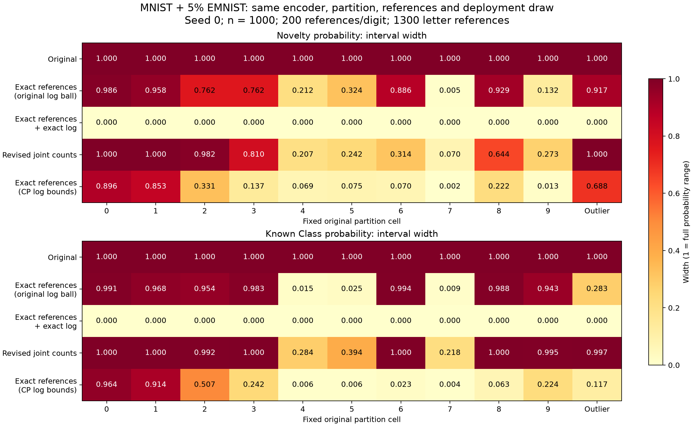

# Controlled MNIST–EMNIST diagnosis

Follow-up completed: [100 paired acquisition draws at two budgets](repeated/RESULTS.md).
That experiment shares a common finite-pool source law between references and
deployment to isolate confidence-set behavior from reference/deployment shift.

The original partition identifies both targets when the finite-pool source
probabilities and deployment probabilities are exact. The original wide
intervals are therefore not an unavoidable nonidentification problem in this
saved run. Finite-reference uncertainty and the deployment confidence-set
construction both matter. The revised construction helps, but does not solve
every cell.

## Controlled comparison

Use the original saved seed-0 run: 5% EMNIST letters mixed with MNIST digits,
1,000 deployment observations, 200 references per digit, 50 references per
letter (1,300 total). Encoder, original 11-cell partition, mixture weights,
observations, reference estimates and per-cell targets are held fixed.
Oracle rows deliberately replace estimates with saved deployment-pool truth.
No training, new image acquisition, or model selection was performed.

Targets: novelty probability conditional on the cell (original W_unk_joint),
and the original predicted class's probability conditional on the cell AND
known status (original W_joint). The outlier cell retains the original saved
predicted class. These are not global novelty prevalence intervals.

Mean widths over the ten known-class cells, equally weighted:

| Construction | Novelty | Known class |
|---|---:|---:|
| Original REACH | 1.000 | 1.000 |
| Exact references, original finite-log L2 ball | 0.595 | 0.687 |
| Exact references and exact deployment marginal | 0.000 | 0.000 |
| Revised coherent joint counts, finite references/log | 0.554 | 0.788 |
| Exact references, cellwise CP log bounds | 0.267 | 0.295 |

The final row is an additional diagnostic separating the log-region choice
from reference uncertainty. Its alpha allocation is the same as the revised
finite-reference construction. Neither exact-reference row is deployable.
The oracle region geometries are different and need not be nested.

## Interpretation

1. **No structural ambiguity in this finite-pool model.** The 11x11 source
   probability matrix has rank 11, condition number 3.542 and minimum singular
   value 0.296. Exact probabilities identify the weights and both cell targets;
   the exact LP intervals contain truth and collapse to numerical zero.
2. **Reference uncertainty is consequential.** Removing it shrinks the original
   mean novelty width from 1 to .595, but several cells remain almost vacuous.
   This intervention also removes reference/deployment empirical differences;
   it does not isolate sampling uncertainty from possible train/test shift.
3. **The log-region construction also matters.** With the same exact references
   and deployment observations, cellwise log bounds give mean novelty width
   .267 instead of .595 under the original global L2 ball. Known-class widths
   fall from .687 to .295. This is evidence to investigate the confidence-set
   construction before replacing the encoder.
4. **Finite-data revision is partial progress.** It reduces novelty width to
   .554 on average, but cells 0 and 1 remain essentially [0,1]. Known-class
   width averages .788. The outlier cell remains uninformative: novelty .9997,
   known class .9973. Averages alone conceal these failures.

## Construction, checks and limitations

The revised LP uses common joint masses Z[source,cell]. Row-normalized masses
obey reference bounds and column sums obey deployment bounds. The same Z
determines numerator and denominator. A feasible zero denominator returns
[0,1]; an infeasible set is reported separately. Charnes–Cooper converts each
conditional-probability optimization to an LP.

Known-reference and deployment bounds use simultaneous Bonferroni
Clopper–Pearson intervals (alpha .0125 and .025). Letter bounds use Hoeffding
with alpha .0125: the original letters were balanced across 26 strata, so
treating their pooled counts as one iid binomial sample would be unjustified.
The bounds assume suitable sampling and a shared source law between reference
and deployment populations. The pilot actually uses distinct train-reference
and test-deployment pools. This report does not establish population coverage
or eliminate reference/deployment shift. Reconstructed reference counts agree
exactly with saved probabilities and the stated sample sizes.

Both original endpoint pairs reproduced the saved outputs in all 11 cells
within 2e-5. All 110 intervals are finite and ordered; every interval contains
its finite-pool target in this single run. Cells share data and are not
independent replications, so this is not a coverage-rate estimate. LP equality
and inequality residuals passed 1e-6 checks. Five analytic sanity checks passed:
identifiable novelty, identifiable known class, indistinguishable sources,
zero cell mass, and incompatible source/marginal constraints.

Run `run.py` in the reach-aistats environment to regenerate CSVs, plot and input
hash/config. The original REACH implementation has not been replaced.

## Next decision

Prioritize the confidence-region construction, keeping this encoder as a
control. Before adopting the revision, run repeated paired acquisitions at
multiple joint reference/log budgets from a common finite-pool source model;
report per-cell coverage, empty sets, zero-mass cases and width distributions.
Then examine reference/deployment shift separately. A CLIP replacement is not
yet required by this diagnostic, and better representations could still help
finite-sample efficiency even when exact identification already holds.
