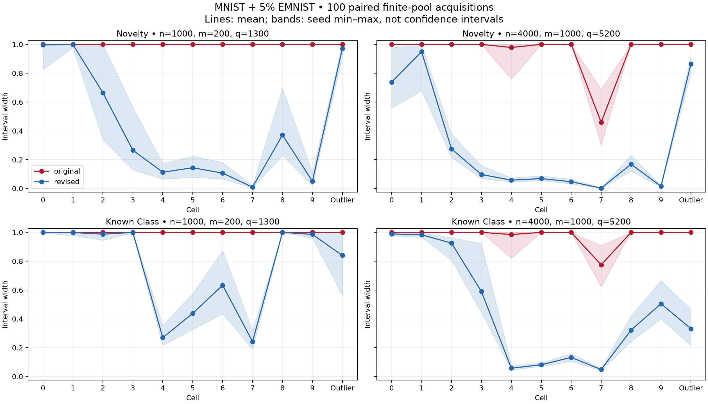

# Repeated MNIST–EMNIST acquisitions

The revised per-cell construction consistently tightens intervals with the
original encoder and partition. It responds to increased acquisition budgets,
where the original construction remains largely vacuous. Important cells
remain difficult, so this is evidence for developing the revision, not a claim
that the problem is solved.

## Design

100 independent simulation seeds, each with two nested acquisition budgets and
paired original/revised intervals. The 11-cell source laws and mixture weights
come from the original seed-0 deployment pool (5% EMNIST novelty). The encoder,
partition, mixture weights and predicted class assigned to every cell are fixed.
For each seed, draw known references, novelty references and deployment cells
independently from these source laws. Smaller budgets are prefixes of larger
draws. Both methods see exactly the same counts.

This is an iid finite-pool simulation, not new images or an end-to-end retraining
experiment. Unlike the original pilot, references and deployment share the same
source laws. Novelty references are iid from the balanced pooled letter law,
not a fixed number per letter. Thus pooled binomial CP bounds are appropriate
here; the earlier saved-run comparison required stratified-reference bounds.
Do not attribute differences from that earlier comparison solely to repetition.

Budgets (n deployment, m known references per digit, q total letter references):

- Smaller: n=1000, m=200, q=1300.
- Larger: n=4000, m=1000, q=5200.

Both constructions retain nominal alpha=.05. The revised joint-mass LP uses
simultaneous CP bounds with failure allocations .025 log, .0125 known, .0125
novel. It bounds the same two conditional targets as the original joint widths.
It does not reinterpret these as additive epistemic/aleatoric components.

## Results

Mean widths, equally averaging the ten known-class cells within each seed,
then averaging seeds:

| Budget | Method | Novelty probability | Known-class probability |
|---|---|---:|---:|
| Smaller | Original | 1.000 | 1.000 |
| Smaller | Revised | 0.372 | 0.756 |
| Larger | Original | 0.944 | 0.976 |
| Larger | Revised | 0.242 | 0.464 |

At the larger budget, revised seed-level means range from .186 to .283 for
novelty, and .442 to .490 for known class. The corresponding original ranges
are .919–.967 and .956–.991. Improvement is consistent across these seeds.

The outlier cell is separate from these means. Its revised novelty width is
.972 at the smaller budget and .865 at the larger budget, versus 1.000 for
the original. Revised known-class widths there are .840 and .332. Cells 0 and
1 remain especially difficult even at the larger budget. A small average width
must not be read as uniform informativeness across cells.

## Coverage and failure modes

All targets were covered in all 100 draws, for both methods and both budgets.
This includes simultaneous coverage across all 11 cells, and both targets
together. No empty sets occurred. The 8,800 records share data within seeds;
they are not 8,800 independent coverage trials.

For each fixed method/budget/target, the nominal two-sided 95% binomial interval
for the observed 100/100 simultaneous successes is [0.9638,1]. These are
pointwise descriptive Monte Carlo intervals, not a simultaneous guarantee over
all reported comparisons. The experiment was extended from 20 to 100 draws
after inspecting the first 20, so these intervals should not be treated as
sequentially valid certification. This validates one fixed empirical source
model, not general population calibration or robustness to source mismatch.

The revised LP's zero-denominator policy occurred in 2.5% of smaller-budget
known-class cell records and none of its larger-budget records. It did not
occur for revised novelty intervals. For the original known-class construction,
at least one endpoint solver invoked the zero-mass policy in 100% of smaller-
budget known-cell records and 87.2% at the larger budget. Original endpoint
statuses and revised common-set statuses are different diagnostics: the former
may concern different extremal denominator vectors.

Even without zero-mass policy, intervals can remain broad. The outlier novelty
interval is a clear example; removing that policy alone would not solve it.

## Reproduction and checks

Run `../repeat.py`, then `../validate_repeated.py` in the reach-aistats Python
environment. Outputs include all intervals and statuses, per-cell width and
coverage summaries, seed-level means, paired differences, simultaneous coverage,
exact acquisition counts, source-input hash, config and validation JSON.

Validation passed for all 8,800 records: unique keys, independently recomputed
targets and coverage indicators, endpoint/width identities, finite nonempty
intervals, sample totals and nested counts. The LP's five analytic checks also
passed (identified novelty/class, nonidentification, zero mass, incompatibility).
LP residual checks run during every optimized interval calculation.

## Decision

Continue developing the coherent joint-mass construction with this encoder as
a control. It improves the original per-cell targets without CLIP or a new
partition. The next diagnostic should isolate why cells 0/1 and the outlier
remain difficult (their probability mass, source overlap and bound widths),
then compare partitions using these same per-cell targets. Separately validate
reference/deployment shift and additional mixture weights/prevalences before
changing the main REACH implementation or claiming general coverage.
