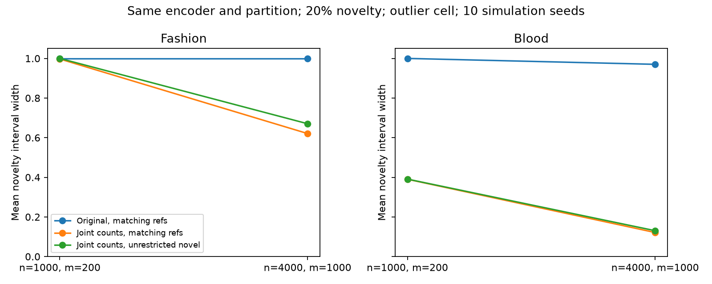

# Why REACH is uninformative here

The strongest evidence points to conservative confidence sets and a mismatched
novelty model. The encoder is a contributing issue for Fashion, but replacing it
is not necessary to demonstrate a substantial improvement on Blood. There are
also implementation bugs, corrected in the working implementation, which do not
explain the saved Fashion/Blood intervals.

## What this pipeline actually measures

The encoder is a small CNN trained to classify MNIST digits. Fashion and grayscale
BloodMNIST are introduced as novel sources against those digits. This is **not a
Fashion classifier or a medical classifier**. Blood novelty detection does not
test diagnostic uncertainty between blood-cell types.

The 64-dimensional CNN features are reduced through the frozen PCA/LDA head to
11 cells: ten digit regions and one outlier region. REACH operates on those cell
IDs. It does not receive the continuous distance or entropy values that produce
the good OOD AUROCs. Every image in the same cell receives the same cell-level
novelty interval. A better encoder helps only through the resulting source/cell
distributions; the partition can discard useful information too.

The target is P(novel source | cell), and the interval describes uncertainty about
that probability given finite references, deployment observations and assumptions.
It is different from predictive entropy, ranking images by OOD score, or measuring
intrinsic ambiguity between labels. A wide interval is epistemic ignorance about
the target under the declared model; it does not establish high aleatoric noise.
The existing W_label is a fixed-anchor sensitivity width, not a direct measurement
of irreducible aleatoric uncertainty.

## Why the current bounds lose information

At n=1000 and m=200 per known source, the original diagnostic gives log radius
0.12211 and reference radius 0.32551, added to 0.44762. The per-entry half-width
is 0.15401. This admits much larger movement than the probabilities of many cells.
Zero or rare observed events receive the same additive half-width as common events.

The source error is replaced by a maximum row radius; the calculation does not
retain the actual mixture-weight dependence of source errors. The posterior
calculation then varies entries using separate outer bounds. These extrema need
not correspond to source distributions that jointly reproduce the deployment
marginal. Zero surrogate denominators trigger an intentional [0,1] policy.
These are conservative relaxations, not evidence of a crashed optimizer.

The earlier oracle test already showed that the letter example is identifiable
with exact source distributions and exact deployment marginal. That does not
prove finite-sample precision or identification for every novelty source.

## Controlled experiment: change the inference, keep the representation

`investigate.py` constructs finite populations from the saved evaluation cell
histograms. It draws independent multinomial references and deployment counts,
using 10 seeds, 3 novel domains, 2 novelty prevalences, 2 budgets, and cells 0 and
10. There are 960 reported intervals across four conditions. Known references
and log counts are shared across methods within each trial; matching references
are also shared between original and revised matching methods.

The revised prototype uses simultaneous exact binomial (Clopper-Pearson) bounds
for each categorical probability. It allocates failure probability .025 to all
log cells, .0125 to all known-source entries and .0125 to all novel-source entries,
using Bonferroni within each block. It then optimizes joint masses
Z[source,cell] = w[source] A[source,cell]. Row bounds, row sums and observed column
bounds must all hold for the same Z. The posterior is Z[novel,cell]/sum_source Z.
Charnes-Cooper converts this ratio optimization to an LP.

Under the simulated iid sampling model with matching, stable source distributions,
the simultaneous event contains the true Z with probability at least .95 by a
union bound. On that event its posterior belongs to the computed interval for
positive-mass cells. This justification does not apply to mismatched references.
The unrestricted-novel condition drops restrictions on the novel row entirely;
it can identify lower bounds on novelty from mass unexplained by known sources,
but cannot in general identify all novelty posteriors.

This comparison changes both confidence-bound shape and joint consistency.
It establishes that the combined construction helps; it does not separately
quantify the contribution of each change.

Mean outlier-cell interval widths at **20% global novelty**:

| Domain | n / m per known source | Original, matching refs | Joint counts, matching refs | Joint counts, unrestricted novel |
| --- | --- | ---: | ---: | ---: |
| Fashion | 1000 / 200 | 1.000 | 0.997 | 1.000 |
| Fashion | 4000 / 1000 | 1.000 | 0.621 | 0.670 |
| Blood | 1000 / 200 | 1.000 | 0.390 | 0.391 |
| Blood | 4000 / 1000 | 0.970 | 0.122 | 0.131 |

Matching novelty references contain 1300 simulated observations. Original REACH
is given these same matching references: the improvement above is therefore not
simply the benefit of replacing letters with blood references. For Blood at the
larger budget the mean matching interval is approximately [0.869, 0.991], against
a mean true outlier-cell novelty posterior of 0.960.

At **5% novelty and baseline budgets**, both Fashion and Blood outlier-cell
intervals remain nearly [0,1]. This is a real remaining limitation. Good OOD
ranking does not imply enough count evidence to estimate a low-prevalence mixture
with simultaneous confidence.

At baseline, matching Blood references also shrink the mean cell-0 width to 0.069
at 5% novelty and 0.155 at 20% (original: 1). The finite-pool Blood probability in
that cell is zero. This benefit requires information about the unknown source;
unrestricted-novel cell-0 intervals remain [0,1].



## Mismatched references become a visible problem

The historical Fashion/Blood experiments use letter references for the novel row.
No confidence guarantee for the true novel posterior follows from that assumption
when the novel distribution is clothing or blood cells.

With the revised joint region and letter references, at 20% Blood novelty:

* Baseline budgets: 3/10 trials have an empty feasible set.
* Larger budgets: 8/10 trials have an empty feasible set.
* Among the seven feasible baseline trials, all seven cell-0 intervals exclude
  the true zero novelty probability. In the outlier cell, only 3/7 cover truth.

Thus an incompatibility test can detect some misspecification, but failure to
reject does not validate the model. The original very wide regions conceal this
issue. Tighter intervals with the wrong source model can be confidently wrong.

The matching and unrestricted-novel conditions cover their targets in all 240
cell records each. These are dependent cell records from only ten simulation seeds
per setting; this is a sanity check, not an empirical certification of 95% coverage.

## Confirmed code issues

Corrected in `models/ball.py`: `weight_interval` and `feasible` previously always
used the coordinate box, even for `set_kind='l2'`. They now use the L2 solver.
Analytic tests distinguish box from L2 feasibility and check exact weight extrema.

Corrected in `real/audit.py`: `run_cell(ctx, ...)` previously read the set kind
from global `_CTX`, ignoring its explicit context. It now reads `ctx`. A regression
test checks direct-call configuration. The saved experiments used the L2 default,
and their reported posterior calculations already called the L2 ratio solver, so
these fixes do not account for their vacuous bounds.

The experimental joint-count construction is kept here, not substituted into the
historical engine or the archived paper supplement. Integration would need a
sampling-aware API: the original references are not all iid multinomial draws
(known-source sampling is without replacement; novel references are stratified).
Do not apply these exact binomial bounds to that acquisition design without
justifying the corresponding confidence event.

## What to change next

1. Develop the coherent joint-mass region as a candidate revision of REACH, with
   explicit confidence constructions for each real reference-sampling design.
2. Decide the unknown-source assumption. Matching-reference detection and arbitrary
   unknown detection answer different questions. Report the unrestricted-novel
   lower bounds and incompatibility separately from matching-reference intervals.
3. Test richer partitions of the current features, particularly distance bins,
   fixed using independent development data. Fashion's good entropy AUROC but
   22.1% outlier-cell fraction suggests useful ranking information is being lost.
4. Then compare encoders, including CLIP if appropriate, under the same acquisition
   and confidence construction. CLIP is a representation-learning baseline, not
   a repair for conservative bounds or invalid novelty assumptions. No CLIP
   experiment was performed here.
5. For an actual medical uncertainty experiment, train/evaluate on medical known
   classes and explicitly define the medical unknowns, ambiguity and shifts.

These simulations reuse finite evaluation histograms as the data-generating
population. They acquire no new images, do not model train/test conditional shift,
and do not establish real-world population coverage. Budgets use separate seeded
draws rather than nested acquisitions. Only two cells were examined. Larger
multi-seed studies and all-cell summaries remain necessary before paper claims.

## Validation and reproduction

From REACH_AISTATS, with the reach-aistats environment:

```bash
python workbook/reach_interval_diagnostic_2026-10-19/followup/investigate.py
python -m unittest discover -s tests -p test_reach.py
python -m unittest discover -s tests -p test_ball_geometry.py
python -m unittest discover -s workbook/reach_interval_diagnostic_2026-10-19/followup -p test_joint.py
```

28 core tests, 3 geometry/context regression tests, and 3 analytic prototype tests
pass. Full discovery additionally encounters 10 missing-file errors from unavailable
CIFAR feature caches. LP witnesses are checked for constraint residuals below 1e-6.
Ambiguous HiGHS statuses are retried with an independent CLARABEL solve rather than
being silently labeled infeasible. Raw intervals, summaries, configuration and
console output are saved alongside this report.

References: [SciPy exact binomial intervals](https://docs.scipy.org/doc/scipy/reference/generated/scipy.stats.binomtest.html);
[original CLIP paper](https://proceedings.mlr.press/v139/radford21a.html).
