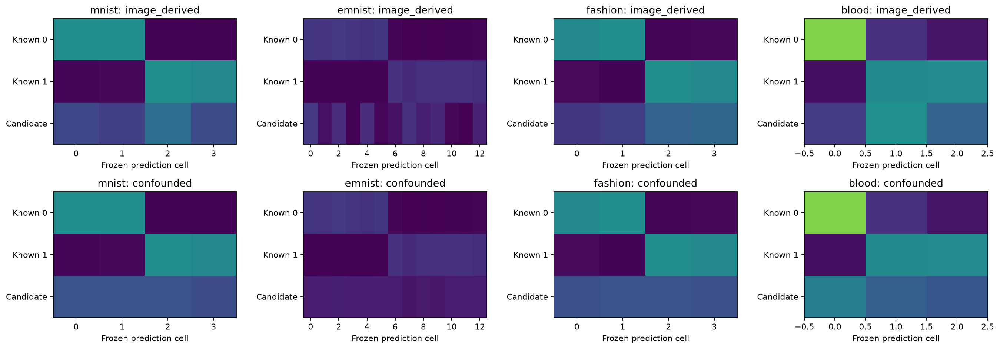
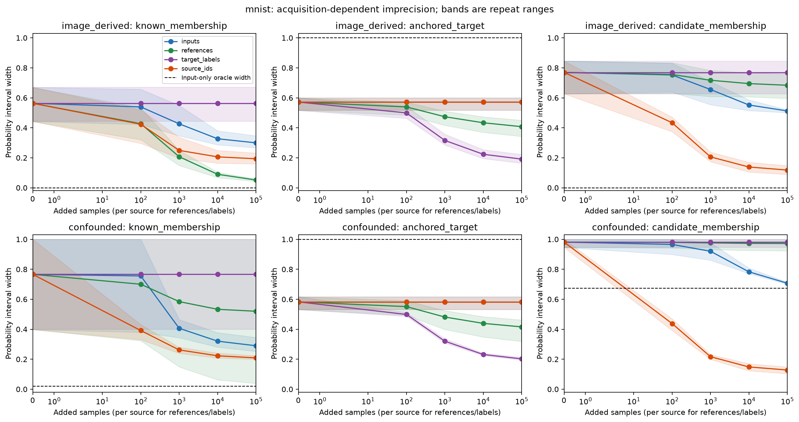
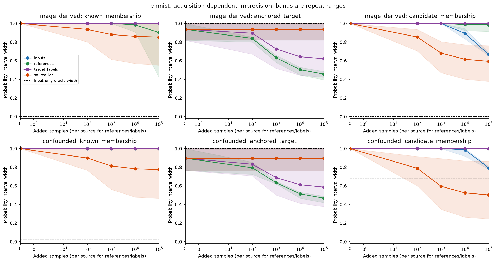
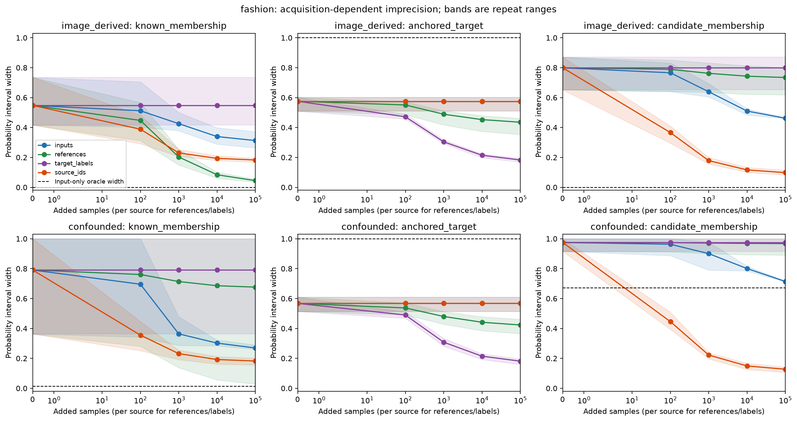
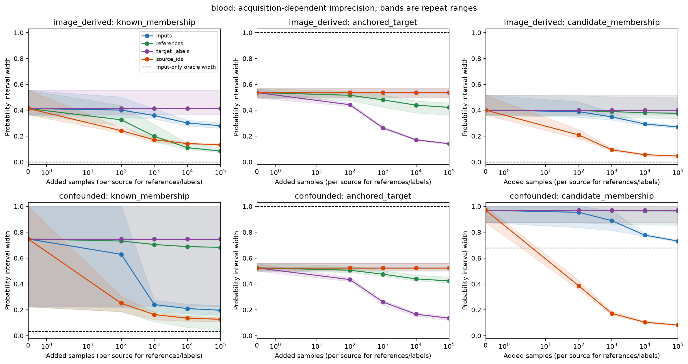
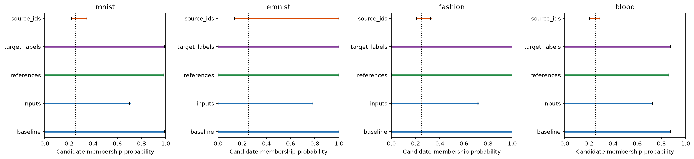

# Four-dataset acquisition example

This page collects all six saved figures, their interpretation, and complementary numerical results for MNIST, EMNIST Letters, Fashion-MNIST, and BloodMNIST.

**Notebook coverage:** [executed.ipynb](executed.ipynb) already embeds all six figures: source laws in section 4, four acquisition plots in section 7, and candidate endpoints in section 8. It also displays the analytic example, source roles, geometry, oracle intervals, acquisition summaries, and validation tables. The [source snapshot](source_notebook.ipynb) intentionally has no saved outputs. The figures are embedded below so they can be read without opening Jupyter; numerical results that are only tables in the notebook are summarized here too.

See also the [run report](RESULTS.md), [theoretical and dataset sources](SOURCES.md), and [editable notebook](../../source_acquisition_four_datasets.ipynb).

## What the experiment measures

This is a **controlled image-derived finite-cell simulation**. Cached classifier predictions define cells; image class groups define two known sources and one specified candidate-novel source. Subsequent acquisitions are simulated categorical draws from those fixed laws, not newly collected images. No network is retrained. Source histograms weight classes equally within each group and include a declared 2% uniform-cell replacement mechanism.

At a fixed probe cell, interval endpoints range over models compatible with the observations. The plots measure three distinct probability widths:

| Plot target | Probability being bounded |
|---|---|
| `known_membership` | Membership in known source 0, conditional on the cell **and on belonging to a known source**; not the probability of being in-distribution. |
| `anchored_target` | Binary target probability at the cell under fixed, equally weighted known-source prevalences; not the deployment label probability. |
| `candidate_membership` | Membership in the specified candidate-novel source, conditional on the cell. |

A zero width means a probability is identified within the model, not that individual outcomes are deterministic. These widths are not an additive epistemic/aleatoric decomposition; aleatoric uncertainty is not estimated.

There are two regimes. In `image_derived`, the candidate law comes from cached held-out classes. In `confounded`, it is constructed as the average of the two known-source laws. The second regime deliberately makes different source mixtures observationally equivalent from inputs alone.

## Acquisition design and plot guide

The baseline contains 500 deployment inputs, 200 reference cells per known source, 100 noisy binary target labels per known source, and no deployment source identities. Each arm adds only its own channel, with budgets 0, 100, 1,000, 10,000, and 100,000 across six paired repeats.

| Curve | Added observations at budget b | What the channel informs |
|---|---|---|
| Blue: `inputs` | b unlabeled deployment cells | Deployment cell frequencies |
| Green: `references` | b reference cells per known source; 2b total | Known-source cell laws |
| Purple: `target_labels` | b noisy binary labels per known source; 2b total | Known-source target rates, with specified 10% label-flip noise |
| Orange: `source_ids` | b representative deployment source identities | Deployment source proportions; paired cells are unused |

The acquisition figures have image-derived results on the top row and constructed confounding on the bottom; columns show known membership, anchored target, and candidate membership. Lines are mean interval widths; shading is the minimum-to-maximum range across repeats, **not a confidence band**. Budgets are not normalized for total acquisition cost.

The dashed membership benchmark assumes exact source laws and exact deployment input frequencies, without source identities. It is a population identification floor, not a universal lower bound on realized finite-sample intervals. Identity information can cross it. For the anchored target, the dashed width of one assumes no target labels; the finite baseline already has labels. Recomputed confidence boxes need not be nested, so individual curves need not decrease at every step.

## Source laws

[Open PNG](source_laws.png) · [PDF](source_laws.pdf) · [Underlying probabilities](source_laws.csv)

Each row is a source distribution over frozen prediction cells, not a display of raw example images. Similar rows make source separation difficult. In the bottom panels, the candidate is exactly the average of the known rows, so its contribution can be exchanged with known-source mixture mass without changing the observable input distribution.

The [geometry table](geometry.csv) confirms this construction: the smallest singular value of the two source-difference columns is approximately zero in all confounded worlds. For image-derived worlds it is 0.1039 (MNIST), 0.2812 (EMNIST), 0.0425 (Fashion), and 0.1461 (Blood). This is a descriptive affine-independence diagnostic, not a finite-sample performance ranking or a theorem constant.

## Acquisition results by dataset

### MNIST

[Open PNG](mnist_acquisition_curves.png) · [PDF](mnist_acquisition_curves.pdf)

Under constructed confounding, the candidate's exact input-only width is 0.6732. At 100,000 added observations, input acquisition leaves a mean width of 0.7071, while source identities reduce it to 0.1280. In the image-derived regime, reference acquisition brings known-membership width to 0.0518; target-label acquisition brings anchored-target width to 0.1911. The useful channel depends on the probability being estimated.

### EMNIST Letters

[Open PNG](emnist_acquisition_curves.png) · [PDF](emnist_acquisition_curves.pdf)

EMNIST retains substantial finite-sample ambiguity. Under confounding, candidate width is 0.7925 after input acquisition and 0.5017 after identities, compared with the exact input-only floor of 0.6758. Known-membership mean width remains 1.0000 after input acquisition in both regimes. In the image-derived regime, references reduce anchored-target width to 0.4559, compared with 0.6212 after target labels. Learning target rates alone leaves uncertainty in the reference cell laws; the undefined-denominator policy also contributes fully uninformative intervals in this dataset.

### Fashion-MNIST

[Open PNG](fashion_acquisition_curves.png) · [PDF](fashion_acquisition_curves.pdf)

Under confounding, input acquisition leaves candidate width 0.7145 against an exact floor of 0.6710; source identities reduce it to 0.1273. In the image-derived regime, references give known-membership width 0.0447, while target labels give anchored-target width 0.1828. Despite the image-derived population membership floor being zero, acquiring only one finite observation channel leaves residual uncertainty.

### BloodMNIST

[Open PNG](blood_acquisition_curves.png) · [PDF](blood_acquisition_curves.pdf)

Under confounding, candidate width is 0.7319 after input acquisition and 0.0820 after identities, against an exact input-only floor of 0.6775. In the image-derived regime, identities give candidate width 0.0460, references give known-membership width 0.0848, and target labels give anchored-target width 0.1409. These are results for the declared finite model, with no clinical interpretation.

All finite widths quoted above are means over six repeats at the maximum added budget; [acquisition_summary.csv](acquisition_summary.csv) contains every budget, target, regime, and arm, including repeat ranges and mean endpoints.

## Candidate probability endpoints

[Open PNG](candidate_endpoints.png) · [PDF](candidate_endpoints.pdf) · [Plotted values](plotted_endpoints.csv)

These panels show actual lower and upper probabilities for the predetermined repeat 0 in the confounded regime. Each panel compares the baseline with each maximum-budget arm; the dotted vertical line is the true candidate membership. These are individual-repeat intervals, not the mean widths reported above. Identities constrain candidate membership much more tightly, while target labels leave membership unchanged by construction. Interval position matters as well as width: a narrow interval would be misleading if it excluded the true probability.

## Complementary numerical results

The following results are tabulated in the executed notebook rather than presented as additional standalone plots.

### Population identification and finite acquisition

| Dataset | Confounded exact known-membership width | Confounded exact candidate width | Candidate mean width after 100,000 inputs | Candidate mean width after 100,000 identities |
|---|---:|---:|---:|---:|
| MNIST | 0.0195 | 0.6732 | 0.7071 | 0.1280 |
| EMNIST Letters | 0.0275 | 0.6758 | 0.7925 | 0.5017 |
| Fashion-MNIST | 0.0130 | 0.6710 | 0.7145 | 0.1273 |
| BloodMNIST | 0.0326 | 0.6775 | 0.7319 | 0.0820 |

Sources: [oracle intervals](oracle_intervals.csv) and [finite acquisition summaries](acquisition_summary.csv). In the image-derived regime, both membership targets have exact input-only widths of zero up to numerical precision for every dataset. In the confounded regime, exact source proportions remove the remaining membership ambiguity when source laws are also exact. For the anchored target, exact inputs without target labels leave width one; exact target rates together with exact source laws give width zero.

The notebook also checks an analytically solvable two-cell example: known-source laws `(1, 0)` and `(0, 1)`, candidate law `(0.5, 0.5)`, and exact input law `(0.5, 0.5)` allow candidate membership anywhere in `[0, 1]`. Revealing source weights `(0.35, 0.35, 0.30)` collapses it to `[0.30, 0.30]`. This validates the solver against a direct non-identification example.

### Inclusion, numerical checks, and interpretation limits

- All 2,880 saved target intervals include their declared true target; no compatible sets are empty. These settings share observations and are not independent coverage trials.
- There are 348 undefined-denominator cases, for which the explicit conservative policy returns `[0, 1]`. Full-width intervals can therefore reflect this policy as well as unresolved model ambiguity.
- The maximum recorded solver constraint residual is approximately `1.24e-14`.
- Executed assertions confirm that changing target-label counts leaves both membership intervals unchanged, and changing deployment inputs or identities leaves the anchored-target interval unchanged. These invariances follow from the model and observation-channel definitions; reference acquisition can affect all three targets.

See [inclusion_and_solver_checks.csv](inclusion_and_solver_checks.csv) for the breakdown. The nominal guarantee is at least 95% simultaneous inclusion of the three targets **at one fixed setting**, conditional on the assumptions and exact optimization. It does not cover all datasets, budgets, and repeats jointly, and six repeats cannot establish precise calibration.

The candidate law and label-noise rate are specified, observations are independent draws from fixed source laws, and identities are assumed correct and representative. The constructed candidate is synthetic. The cell representation can hide distinctions present in raw images, and uncertainty about generalizing the empirical laws to natural image populations is outside this experiment.

## Complete artifact index

| Artifact | Contents |
|---|---|
| [Executed notebook](executed.ipynb), [source snapshot](source_notebook.ipynb) | Full derivation, narrative, code, and saved outputs in the executed version |
| [RESULTS.md](RESULTS.md), [SOURCES.md](SOURCES.md) | Generated run report and cited foundations |
| [source_roles.csv](source_roles.csv), [image_assignments.csv](image_assignments.csv) | Original class groups, class weights, image indices, and frozen cells |
| [source_laws.csv](source_laws.csv), [geometry.csv](geometry.csv) | Declared source probabilities, probe cells, and separation diagnostics |
| [oracle_intervals.csv](oracle_intervals.csv) | Exact-information endpoints, truths, widths, and solver status |
| [acquisition_counts.csv](acquisition_counts.csv) | Saved acquisition counts and sample sizes for reconstructing inference |
| [acquisition_intervals.csv](acquisition_intervals.csv) | Every finite interval, truth, inclusion indicator, status, and residual |
| [acquisition_summary.csv](acquisition_summary.csv) | Mean widths/endpoints, repeat ranges, and inclusion by setting |
| [plotted_endpoints.csv](plotted_endpoints.csv) | Numerical values for the candidate endpoint figure |
| [inclusion_and_solver_checks.csv](inclusion_and_solver_checks.csv) | Inclusion, empty sets, denominator-policy counts, and residuals |
| [config.json](config.json) | Seed, budgets, assumptions, and dependency versions |
| [input_manifest.json](input_manifest.json), [artifact_manifest.json](artifact_manifest.json) | Input hashes and original run artifact inventory; the artifact manifest predates this README expansion |
| [source_acquisition.py](source_acquisition.py) | Solver/helper source snapshot |

The six PNG figures above also have linked PDF versions. No additional standalone figures are saved in this run folder.
