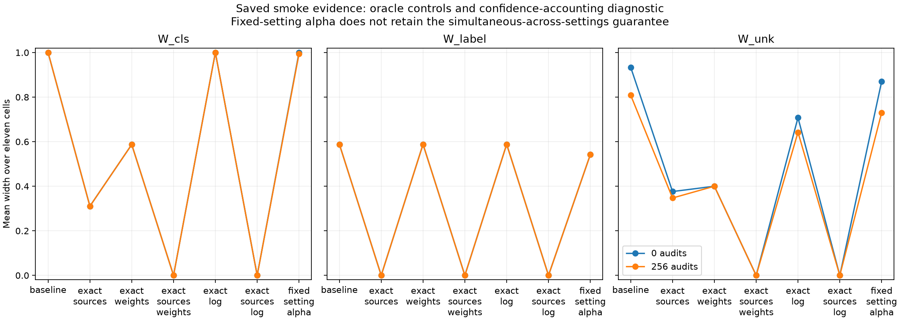

# Why are the smoke-test intervals broad?

Date: 2026-10-22. Completed paired diagnostic using the saved image evidence.
No new training, acquisitions, partition fitting or changes to the target definitions.

**The finite source-law confidence regions are a major bottleneck in this setup.**
Mixture-weight uncertainty also matters. This experiment is not intrinsically
nonidentifiable at the population level, and these controls do not establish
that a larger encoder is needed. They do not prove the current representation
is sufficient for other shifts or tasks.

## Paired controls

For all sixteen saved arm/budget settings, compare the original inference with
exact source laws, exact mixture weights, both, exact deployment marginal,
exact source laws plus exact deployment marginal, and a confidence-accounting
control. Every other constraint and observation stays fixed. Exact quantities
come from the finite-pool evaluation world and are **oracle information**, not
obtainable at the recorded annotation cost.

With 256 deployment audits, means over eleven cells are:

| Control | W_cls | W_label | W_unk |
| --- | ---: | ---: | ---: |
| Original finite evidence | 1.000 | 0.588 | 0.808 |
| Exact source laws | 0.310 | 0.000 | 0.347 |
| Exact mixture weights | 0.587 | 0.588 | 0.400 |
| Exact source laws and weights | 0.000 | 0.000 | 0.000 |
| Exact deployment marginal only | 1.000 | 0.588 | 0.642 |
| Exact source laws and deployment marginal | 0.000 | 0.000 | 0.000 |
| Fixed-setting confidence accounting | 0.994 | 0.542 | 0.730 |

The last row allocates alpha=0.05 across eight families for one setting instead
of across sixteen settings as well. It has a different guarantee: it cannot be
used to select among all inspected settings while retaining the original joint
claim. It is a diagnostic, not a recommended relaxation. Removing that multiplicity
penalty alone does not resolve the broad class intervals.

W_label becomes a point with exact source laws because parity rates are already
known from digit identity. Exact weights or log information do not change its
reference-anchor definition. These responses are consequences of this task's
definitions, not evidence for three independent uncertainty components.

## Why finite source bounds matter

For the 200 reference images per known digit, the catalog coordinate Hoeffding
half-width is approximately **0.183** at the recorded allocation. Of the 110
known-source/cell coordinates, 57 have zero observed counts. Their catalog upper
bounds are nevertheless about 0.183 before normalization and other constraints.
Such bounds allow substantial source-cell confusion absent from the observations.
This is conservative statistical uncertainty, not an observed CNN confusion rate.

At 256 audits, six of eleven W_cls intervals use the zero-conditioning-mass
policy. The other five are genuine optimized ranges spanning [0,1]. Exact weights
reduce zero-mass cases to one; exact source laws remove all of them. Exact log
information alone still leaves four zero-mass cases and all class widths at one.
Therefore changing only the zero-mass policy would not resolve this result.

The minimum mass for W_cls is the known-source cell mass; for W_unk it is total
cell mass. Minimum masses are recorded separately for every cell/control, rather
than equating a broad ratio with an empty feasible set. No control rejected.

The 11-by-11 population source-law matrix has rank 11, with smallest singular
value approximately 0.196. Thus exact A and deployment marginal p identify the
weights in this finite-cell model. The exact-source/exact-log control independently
returns point intervals for all three targets. Unlike exact camouflage, this
particular experiment has no population identification floor.

## Checks and scope

The diagnostic contains **3,696 interval records**. It reproduces all 528 original
modeled interval endpoints/statuses, verifies containment of each control's
intervals in the original ones on this evidence, and verifies point identification
under both combined exact controls. All recorded truths are covered. The original
1,056-record smoke validator and two analytic solver checks also pass after adding
optional minimum-mass logging. Tiny negative label widths from floating-point
roundoff are clipped to zero in the diagnostic width column only.

These are one-split oracle comparisons. Width reductions are not additive variance
components and do not measure the cost-effectiveness of purchasing exact knowledge.
The controls isolate source-law uncertainty but do not quantify how much is
unavoidable sampling uncertainty versus avoidable looseness of Hoeffding boxes.

## Next step

Compare the existing bounds with sharper finite-sample bounds appropriate to the
same without-replacement sampling design, at the **same confidence budget** and
using the same observations. Start with source-row bounds, keeping other families
fixed, so any improvement has a clear origin. Candidate options include inversion
of finite-population hypergeometric tails for catalog and conditional audit rows.
Document which population sizes the archive makes available; do not use census
cell frequencies as inference inputs. Unrestricted live deployment would require
a different sampling justification.

Validate boundary/zero-count cases and coverage under the stipulated sampling
before comparing widths and decisions. Preserve the original results; do not
change alpha, discard difficult cells or treat an oracle as an acquisition method.
If tighter valid bounds still yield no useful decisions, revisit budgets/task
design before expanding training or adapting acquisition. No new method or CVPR
contribution is established by this diagnosis.

Reproduce with `python diagnose.py` in this folder. Outputs:
`diagnostic_intervals.csv`, `diagnostic_summary.csv`, `diagnostic_validation.json`,
and `diagnostic_widths.png`. The executable records matrix rank and singular value
in its validation JSON. `solver.py` only adds an optional diagnostics dictionary;
its original return values and zero-mass policy are unchanged.
