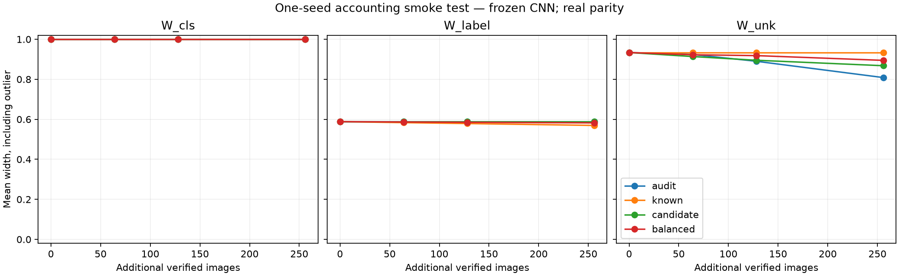

# Visual acquisition: one-seed smoke results

Date: 2026-10-22. The accounting and inference smoke test is complete; the
full [protocol](PROTOCOL.md) evaluation is not. No new representation was trained.

## Implemented setup

Reuse cached frozen-CNN cell assignments for MNIST and Fashion. Sources are the
ten individual digits and a declared Fashion candidate. The target label is real
digit parity, with exact theta_s = s mod 2, under the uniform known-source anchor.
No synthetic target-label draws or synthetic identity-only observations are used.
The deployed mixture is still deliberately constructed, not naturally observed.

One split seed, 2,512 initial reference images (200 per digit and 512 Fashion),
4,000 deployment-log images, and 2,000 reserved probes. Additional budgets are
0, 64, 128, and 256 verified images. Four allocations spend each budget entirely
on random deployment audits, known references, candidate references, or split it
approximately equally across those actions. Catalog access is assumed. Purchase
cost is one verified image, not measured annotation time.

Images are disjoint across roles within this split. Methods/arms reuse the same
initial evidence and nested acquisition prefixes. Audit source counts are random;
their annotated images reveal source, cell and parity where defined. Deployment
log source labels are used only for construction/evaluation, not provided to
inference. Saved manifests retain them for validation.

The local solver extends the existing joint-mass LP with audited joint-probability
bounds. It uses both source proportions and source-cell information from audits.
Known/candidate reference boxes and conditional audit row boxes are intersected.
Parity intervals also use available source-row and balanced-anchor evidence.

Methods:

- `reach_direct_law`: modeled intervals with direct candidate-law estimation.
  In this matched-reference setting, direct law estimation is already the candidate
  constraint used by REACH; duplicating it under another name is not a comparator.
- `direct_target`: conservative empirical joint-probability ratio bounds from
  deployment audits for membership; balanced known-reference parity/cell counts
  for the reference-anchor label target. This method does not exploit mixture
  reference constraints for membership and is not claimed to be an optimal direct
  estimator. It receives the same acquired data.

The class query is the cell-associated digit (fixed digit 0 for the outlier).
It is not a search over every possible digit. Both methods return [0,1] when
their region permits a zero conditioning mass.

## Confidence accounting and sampling scope

Total alpha 0.05 is split over 16 fixed arm/budget settings and eight reserved
evidence families per setting: alpha_family = 0.000390625. Six families are used
(catalog rows, conditional audit rows, audit identities, audit joint masses,
deployment log, balanced anchor counts); two shares remain unused. Bounds are
coordinatewise Hoeffding with a union bound. This is deliberately conservative.

Within a source, image prefixes are uniform samples without replacement. Audit
rows condition on their random source counts; the row bound holds for each count,
with zero-count rows unrestricted. Audit identities are iid source draws. For
an audited joint event, condition on these counts, apply the without-replacement
exponential bound within each source, and average over multinomial source counts:
the result is bounded by the corresponding iid Bernoulli exponential moment.
The fixed-stratum log and balanced-anchor counts similarly combine independent
source-stratum exponential bounds. Dependencies between evidence streams do not
invalidate their union bound. This argument concerns the specified random sampling,
not uncertainty-selected images. Sampling capacity is checked; there is no
resampling of failed allocations. Larger budgets require a fresh capacity check.

Evaluation truth is the full cached finite-pool census, including sampled images.
This is not an independent estimate of an infinite-population posterior. The
same pools have previously been explored; coverage here is a descriptive check,
not a calibration study. Parity is already known from source identity, so this
does not test an independent target-label acquisition channel.

## Results

Mean widths across all eleven cells, including the outlier:

| Additional allocation | Budget | W_cls | W_label | W_unk |
| --- | ---: | ---: | ---: | ---: |
| Initial evidence only | 0 | 1.000 | 0.588 | 0.934 |
| Deployment audits | 256 | 1.000 | 0.588 | 0.808 |
| Known references | 256 | 1.000 | 0.569 | 0.934 |
| Candidate references | 256 | 1.000 | 0.588 | 0.868 |
| Balanced acquisition | 256 | 1.000 | 0.582 | 0.895 |

All 1,056 recorded intervals cover their finite-pool truths; none reject.
This includes two methods, sixteen settings, eleven cells and three targets,
with substantial dependence and repeated baseline settings. It is not 1,056
independent calibration trials.

**Neither method certifies any probe decisions** at probability thresholds
0.8, 0.9 or 0.95. Certified mass is zero, so conditional error is undefined,
not zero. The direct empirical membership intervals all equal [0,1]. Its parity
mean width is 0.605 initially and 0.576 with 256 known references.

For modeled W_cls, 118/176 records use the zero-mass policy; the other 58 are
optimized intervals that also span [0,1]. Thus removing only the zero-mass policy
would not explain all unresolved class uncertainty. All modeled W_unk records
are optimized intervals. The output establishes modest target-specific contraction,
but no useful decision benefit at these budgets and confidence allocations.

## Validation and limitations

[Validation](validation.json) passed: role disjointness; exact costs and nested
purchase prefixes; saved counts reconstructed from image IDs; parity/source fields;
independent census truths; equal baseline intervals across arms; normalized probe
population weights; zero-count behavior; exact-joint-law identification and an
infeasible-joint-law analytic check. The smoke plot was visually inspected.

Pending protocol items: pixel/PCA representation, ten splits, population-weighted
width summaries, relative action-cost sensitivity, richer direct-estimation
baselines and the full per-class decision rule. Training-seed variation and a
meaningful independent attribute-label channel remain later scientific tasks.

## Next decision

Follow-up completed: [oracle diagnosis and conditioning-mass checks](DIAGNOSIS.md).
The controls below have now run; the next task is a same-budget comparison of
sharper sampling-valid source-row bounds.

Do not interpret a narrower interval alone as a practical gain, or expand this
to an adaptive acquisition method yet. First diagnose the broad intervals on
the same saved evidence: minimum conditioning masses, exact-source and exact-weight
controls, and the contribution of simultaneous confidence accounting. Exact controls
are oracle diagnostics, never acquisition baselines. Any alternative confidence
region must retain the stated sampling validity and be compared at the same error
budget; do not tune alpha or cells to obtain favorable decisions.

Then decide whether to implement the second representation/full grid or redesign
the task. The current result does not justify a CVPR contribution claim.

## Reproduction

Using the reach-aistats environment, run `python run.py` then `python validate.py`
from this folder. Inputs are the prior candidate-audit `image_cells.csv`; its hash
is recorded in `config.json`. Main outputs: `image_assignments.csv`, `purchases.csv`,
`evidence.json`, `intervals.csv`, `summary.csv`, `decisions.csv` and `validation.json`.
